# AI/ML Engineer Fundamentals — 3-Day Bootcamp

> Python and math, then classical ML, then deep learning and PyTorch: one connected path from first principles to LLM-ready skills.

| | |
|---|---|
| **Length** | 3 days + 1 capstone, 24 topics |
| **Day 1** | Python, NumPy, Pandas/Polars/PyArrow, datasets, ML mathematics (topics 01-05) |
| **Day 2** | Classical machine learning (topics 06-14) |
| **Day 3** | Deep learning, PyTorch, Hugging Face (topics 15-24) |
| **Prerequisite** | Working knowledge of programming |
| **Leads to** | [`llm-fine-tuning/`](../llm-fine-tuning/fine_tuning_roadmap.md) |

## 📖 Short forms used across the course

| Term | Full form | What it is |
|---|---|---|
| **AI** | Artificial Intelligence | Systems doing tasks that normally need human intelligence. |
| **ML** | Machine Learning | Learning patterns from data instead of hand-written rules. |
| **DL** | Deep Learning | ML with many-layered neural networks. |
| **LLM** | Large Language Model | Very large neural language model (GPT-style). |
| **RAG** | Retrieval-Augmented Generation | Letting an LLM answer using retrieved documents. |
| **LoRA** | Low-Rank Adaptation | Fine-tuning method that trains small low-rank adapter matrices instead of all weights. |
| **OOP** | Object-Oriented Programming | Organising code around classes and objects. |
| **GIL** | Global Interpreter Lock | CPython lock allowing one thread to run Python bytecode at a time. |
| **API** | Application Programming Interface | Functions/endpoints a library or service exposes. |
| **CSV / JSON** | Comma-Separated Values / JavaScript Object Notation | Common text data formats (table / nested). |
| **CPU / GPU** | Central / Graphics Processing Unit | General processor / massively parallel processor used for training. |
| **RAM** | Random-Access Memory | Main memory. |
| **HF** | Hugging Face | Hub and libraries (`datasets`, `transformers`) for data and models. |
| **SVD** | Singular Value Decomposition | Matrix factorisation `U Σ Vᵀ`. |
| **PCA** | Principal Component Analysis | Linear dimensionality reduction onto max-variance directions. |
| **t-SNE / UMAP** | t-distributed Stochastic Neighbor Embedding / Uniform Manifold Approximation and Projection | Non-linear 2-D/3-D embeddings for visualisation. |
| **K-means / DBSCAN** | K-means clustering / Density-Based Spatial Clustering of Applications with Noise | Centroid-based vs density-based clustering. |
| **k-NN** | k-Nearest Neighbors | Classify by majority vote of the k closest points. |
| **SVM** | Support Vector Machine | Max-margin classifier. |
| **XGBoost / LightGBM** | eXtreme Gradient Boosting / Light Gradient Boosting Machine | Fast gradient-boosted tree libraries. |
| **MSE** | Mean Squared Error | Average squared error; regression loss. |
| **SGD** | Stochastic Gradient Descent | Gradient descent on random mini-batches. |
| **Adam / AdaGrad / RMSProp** | Adaptive Moment Estimation / Adaptive Gradient / Root Mean Square Propagation | Optimisers with per-parameter adaptive step sizes. |
| **LR** | Learning rate | Step size of gradient-based updates. |
| **L1 / L2** | L1 / L2 regularization | Penalise absolute / squared weights; Elastic Net mixes both. |
| **ROC / PR / AUC** | Receiver Operating Characteristic / Precision-Recall / Area Under the Curve | Threshold-free classification metrics. |
| **F1** | F1 score | Harmonic mean of precision and recall. |
| **CV** | Cross-validation | Repeating train/validate over several folds for a stable estimate. |
| **MLP** | Multi-Layer Perceptron | Stack of fully connected layers. |
| **CNN** | Convolutional Neural Network | Network using convolutions; strong for images. |
| **RNN / LSTM / GRU** | Recurrent NN / Long Short-Term Memory / Gated Recurrent Unit | Sequence models with a hidden state. |
| **Colab** | Google Colaboratory | Hosted notebook environment. |
| **`.ipynb`** | IPython Notebook | Jupyter notebook file format. |

## 🧠 In plain words

This bootcamp teaches the foundations an engineer needs before working with LLMs. Day 1 gives you the tools (Python, arrays, tables, data handling, math), Day 2 teaches how machines learn from data and how to judge them, and Day 3 builds neural networks and trains them with PyTorch. A capstone then runs the whole pipeline once.

## 🎒 Analogy to remember

Learning to **build a car**: Day 1 is the workshop (tools and physics), Day 2 is the engine theory (how and why it works, how to test it), Day 3 is assembling a modern car (neural networks) and driving it (PyTorch training), and the capstone is the road test.
*Where it breaks down:* in ML the "physics" (maths) is used continuously while building, not only at the start.

A connected, hands-on path through the fundamentals a software engineer needs before tackling
LLMs, RAG, fine-tuning, and inference engineering (see the companion
[`llm-fine-tuning/`](../llm-fine-tuning/fine_tuning_roadmap.md) curriculum in this workspace, which assumes
everything taught here).

> Understand concepts → implement them → connect them → explain them in interviews.

## 🗺️ The 3-day journey

Colour key: 🟦 Day 1 (Python, data, maths) · 🟩 Day 2 (machine learning) · 🟧 Day 3 (deep learning, PyTorch) · 🟪 Capstone and beyond

```mermaid
flowchart LR
  subgraph DAY1["Day 1: Python, data, maths"]
    T1["01 Python"] --> T2["02 NumPy"] --> T3["03 Pandas, Polars, PyArrow"] --> T4["04 Datasets"]
    T2 --> T5["05 ML mathematics"]
  end
  subgraph DAY2["Day 2: machine learning"]
    T6["06 Fundamentals"] --> T7["07 Regression"] --> T8["08 Classification"] --> T9["09 Unsupervised"]
    T10["10 Optimization"] --> T11["11 Generalization"] --> T12["12 Evaluation"] --> T13["13 Feature engineering"] --> T14["14 Hyperparameter tuning"]
  end
  subgraph DAY3["Day 3: deep learning and PyTorch"]
    T15["15 Deep learning"] --> T16["16 Backpropagation"] --> T17["17 Architectures"]
    T18["18 PyTorch basics"] --> T19["19 Autograd"] --> T20["20 Models"] --> T21["21 Data"] --> T22["22 Training"] --> T23["23 Performance"] --> T24["24 Hugging Face"]
  end
  CAP["Capstone: end-to-end pipeline"]
  LLM["Next: llm-fine-tuning curriculum"]
  T4 --> T6
  T5 --> T10
  T9 --> T10
  T14 --> T15
  T17 --> T18
  T22 --> CAP
  T24 --> CAP
  CAP --> LLM
  classDef d1 fill:#DBEAFE,stroke:#2563EB,color:#1a1a1a;
  classDef d2 fill:#DCFCE7,stroke:#16A34A,color:#1a1a1a;
  classDef d3 fill:#FEF3C7,stroke:#D97706,color:#1a1a1a;
  classDef cap fill:#EDE9FE,stroke:#7C3AED,color:#1a1a1a;
  class T1,T2,T3,T4,T5 d1;
  class T6,T7,T8,T9,T10,T11,T12,T13,T14 d2;
  class T15,T16,T17,T18,T19,T20,T21,T22,T23,T24 d3;
  class CAP,LLM cap;
```



| Chip | Day | Core question answered |
|---|---|---|
| 🟦 | 1 | How do I represent, clean and reason about data? |
| 🟩 | 2 | How does a model learn, and how do I know it works? |
| 🟧 | 3 | How do neural networks learn, and how do I train them in PyTorch? |
| 🟪 | Capstone | Can I wire it all together correctly end to end? |

> [!TIP]
> Do the topics in order: each README lists its prerequisites and what it leads to, and later notebooks reuse earlier ideas (shape thinking, train-only fitting, gradients).

> [!IMPORTANT]
> Two habits recur in every day: never let test information influence training (leakage), and always know the shape of what you are computing.

## Status

| Day | Topic | Status |
|---|---|---|
| 1 | Python + Data + Mathematics | ✅ Complete |
| 2 | Machine Learning | ✅ Complete |
| 3 | Deep Learning + PyTorch | ✅ Complete (this build) |
| — | Capstone project | ✅ Complete (this build) |

Built incrementally: each day is created → executed → validated → fixed before moving to the next
(see `reports/notebook_validation.md` for proof every notebook — all 3 days plus the capstone —
actually runs end to end).

## How to use this repo

**Option A — Google Colab (recommended, zero setup):** open any `.ipynb` directly in Colab. The
first cell of each notebook installs anything Colab doesn't already ship (see
`requirements-colab.txt`).

**Option B — Local:**

```bash
cd ai-ml-engineer-fundamentals
python -m venv .venv && source .venv/bin/activate   # or reuse an existing venv
pip install -r requirements.txt
jupyter lab
```

## Structure

```text
ai-ml-engineer-fundamentals/
├── day01_python_data_math/   # Python, NumPy, Pandas/Polars/PyArrow, Datasets, ML Math
├── day02_machine_learning/   # ML fundamentals through hyperparameter tuning
├── day03_deep_learning/      # Deep learning, backprop, architectures, PyTorch, Hugging Face
├── projects/                 # end-to-end capstone pipeline
├── scripts/                  # validate_notebooks.py, run_notebooks.py
├── reports/                  # notebook_validation.md
└── references/
```

Each topic folder contains a `README.md` (objectives, concepts, diagrams, interview questions,
exercises) and one or more Colab-ready `.ipynb` notebooks.

## Day 1 topics

1. [`01_python`](day01_python_data_math/01_python/README.md) — core language, OOP, iterators/generators, decorators, concurrency basics
2. [`02_numpy`](day01_python_data_math/02_numpy/README.md) — ndarrays, broadcasting, vectorization, tensor-shape reasoning
3. [`03_data_libraries`](day01_python_data_math/03_data_libraries/README.md) — Pandas, Polars, PyArrow
4. [`04_datasets`](day01_python_data_math/04_datasets/README.md) — dataset design + Hugging Face `datasets`
5. [`05_ml_mathematics`](day01_python_data_math/05_ml_mathematics/README.md) — linear algebra, probability/statistics, calculus for ML

## Day 2 topics

6. [`06_ml_fundamentals`](day02_machine_learning/06_ml_fundamentals/README.md) — learning paradigms, parameters vs hyperparameters, capacity
7. [`07_regression`](day02_machine_learning/07_regression/README.md) — linear regression from scratch and with scikit-learn
8. [`08_classification`](day02_machine_learning/08_classification/README.md) — logistic regression, k-NN, trees, forests, boosting, XGBoost/LightGBM, SVM, Naive Bayes
9. [`09_unsupervised_learning`](day02_machine_learning/09_unsupervised_learning/README.md) — K-means, hierarchical, DBSCAN, PCA/SVD, t-SNE/UMAP
10. [`10_ml_optimization`](day02_machine_learning/10_ml_optimization/README.md) — SGD, momentum, AdaGrad, RMSProp, Adam, LR schedules
11. [`11_generalization`](day02_machine_learning/11_generalization/README.md) — bias-variance, L1/L2/Elastic Net, early stopping
12. [`12_ml_evaluation`](day02_machine_learning/12_ml_evaluation/README.md) — confusion matrix metrics, ROC/PR-AUC, ranking metrics, cross-validation
13. [`13_feature_engineering`](day02_machine_learning/13_feature_engineering/README.md) — encoding, scaling, imputation, selection, pipelines
14. [`14_hyperparameter_tuning`](day02_machine_learning/14_hyperparameter_tuning/README.md) — grid/random search, Bayesian optimization

## Day 3 topics

15. [`15_deep_learning`](day03_deep_learning/15_deep_learning/README.md) — perceptron, MLP forward pass, activations, losses
16. [`16_backpropagation`](day03_deep_learning/16_backpropagation/README.md) — the chain rule, by hand, verified numerically
17. [`17_deep_learning_architectures`](day03_deep_learning/17_deep_learning_architectures/README.md) — CNN, RNN/LSTM/GRU, attention, Transformer block
18. [`18_pytorch_basics`](day03_deep_learning/18_pytorch_basics/README.md) — tensors, devices, shapes
19. [`19_pytorch_autograd`](day03_deep_learning/19_pytorch_autograd/README.md) — `.backward()`, `.grad`, `torch.no_grad()`
20. [`20_pytorch_models`](day03_deep_learning/20_pytorch_models/README.md) — `nn.Module`, `nn.Linear`/`Embedding`/`LayerNorm`/`Dropout`
21. [`21_pytorch_data`](day03_deep_learning/21_pytorch_data/README.md) — `Dataset`, `DataLoader`, `collate_fn`, `num_workers`
22. [`22_pytorch_training`](day03_deep_learning/22_pytorch_training/README.md) — the complete training pipeline, checkpointing, early stopping
23. [`23_pytorch_performance`](day03_deep_learning/23_pytorch_performance/README.md) — mixed precision, gradient accumulation/clipping, profiling
24. [`24_huggingface_foundations`](day03_deep_learning/24_huggingface_foundations/README.md) — tokenizers, `AutoModel`, `generate()`, LoRA concept

## Capstone

[`projects/project_end_to_end_ai_foundation`](projects/project_end_to_end_ai_foundation/README.md)
— the complete pipeline (raw data → preprocessing → PyTorch `Dataset`/`DataLoader` → model →
training → evaluation → inference) on a real dataset, tying together all 3 days.

See `ROADMAP.md` for the full 3-day map and `STUDY_PLAN.md` for a suggested daily schedule.

## Validating notebooks

```bash
python scripts/validate_notebooks.py        # execute every notebook, assert outputs, write report
python scripts/run_notebooks.py <path.ipynb> # re-run and save outputs for a single notebook
```
