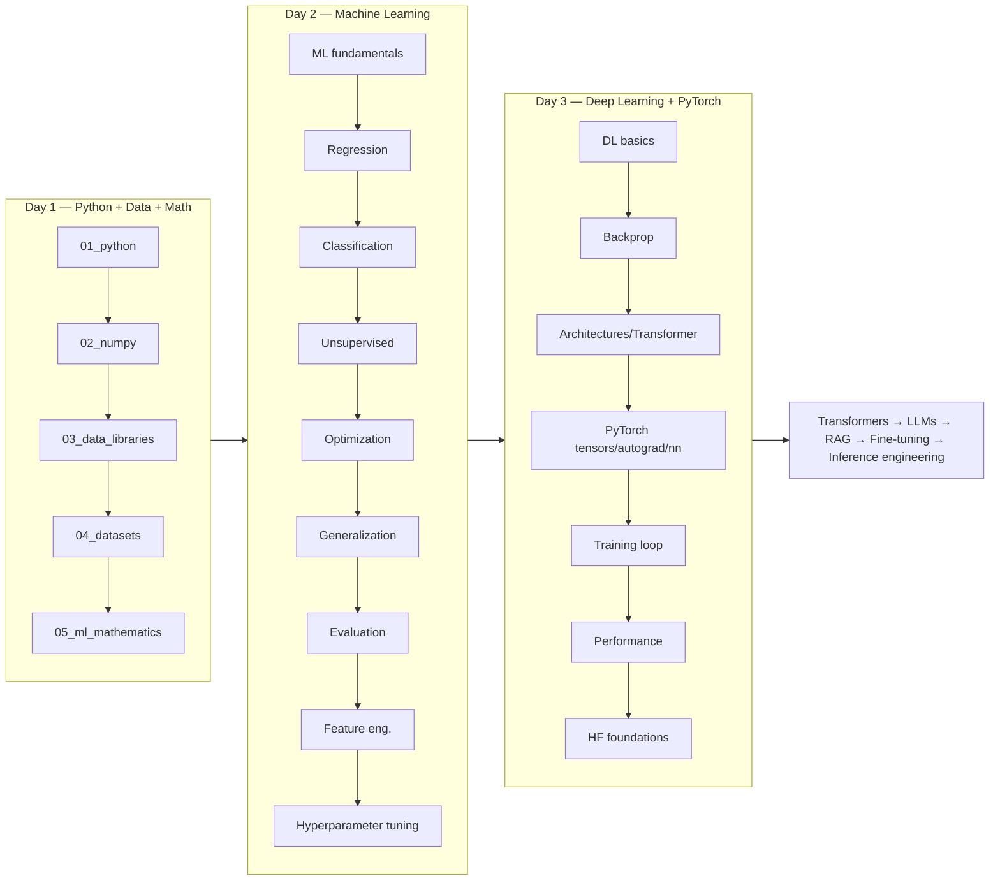

# Roadmap

## Day 1 — Python + Data + Mathematics ✅

| # | Topic | Folder |
|---|---|---|
| 1 | Python fundamentals, OOP, generators, decorators, concurrency | `day01_python_data_math/01_python` |
| 2 | NumPy | `day01_python_data_math/02_numpy` |
| 3 | Pandas / Polars / PyArrow | `day01_python_data_math/03_data_libraries` |
| 4 | Dataset design + Hugging Face Datasets | `day01_python_data_math/04_datasets` |
| 5 | ML Mathematics (linear algebra, probability, calculus) | `day01_python_data_math/05_ml_mathematics` |

## Day 2 — Machine Learning ✅

| # | Topic | Folder |
|---|---|---|
| 6 | ML fundamentals (paradigms, parameters vs hyperparameters, capacity) | `day02_machine_learning/06_ml_fundamentals` |
| 7 | Regression (from scratch + scikit-learn) | `day02_machine_learning/07_regression` |
| 8 | Classification (logistic regression → Naive Bayes, XGBoost/LightGBM) | `day02_machine_learning/08_classification` |
| 9 | Unsupervised learning (clustering + dimensionality reduction) | `day02_machine_learning/09_unsupervised_learning` |
| 10 | ML optimization (SGD → Adam, LR schedules) | `day02_machine_learning/10_ml_optimization` |
| 11 | Generalization (bias-variance, regularization, early stopping) | `day02_machine_learning/11_generalization` |
| 12 | ML evaluation (classification/ranking metrics, cross-validation) | `day02_machine_learning/12_ml_evaluation` |
| 13 | Feature engineering (encoding, scaling, pipelines) | `day02_machine_learning/13_feature_engineering` |
| 14 | Hyperparameter tuning (grid/random search, Bayesian optimization) | `day02_machine_learning/14_hyperparameter_tuning` |

## Day 3 — Deep Learning + PyTorch ✅

| # | Topic | Folder |
|---|---|---|
| 15 | Deep learning fundamentals (perceptron, MLP, activations, losses) | `day03_deep_learning/15_deep_learning` |
| 16 | Backpropagation (chain rule by hand, verified numerically) | `day03_deep_learning/16_backpropagation` |
| 17 | Architectures (CNN, RNN/LSTM/GRU, attention, Transformer block) | `day03_deep_learning/17_deep_learning_architectures` |
| 18 | PyTorch basics (tensors, devices, shapes) | `day03_deep_learning/18_pytorch_basics` |
| 19 | PyTorch autograd (`.backward()`, `.grad`, `no_grad`) | `day03_deep_learning/19_pytorch_autograd` |
| 20 | PyTorch models (`nn.Module` and core layers) | `day03_deep_learning/20_pytorch_models` |
| 21 | PyTorch data (`Dataset`, `DataLoader`, `collate_fn`) | `day03_deep_learning/21_pytorch_data` |
| 22 | PyTorch training (the complete pipeline, checkpointing) | `day03_deep_learning/22_pytorch_training` |
| 23 | PyTorch performance (mixed precision, accumulation, clipping, profiling) | `day03_deep_learning/23_pytorch_performance` |
| 24 | Hugging Face foundations (tokenizers, `AutoModel`, `generate()`, LoRA concept) | `day03_deep_learning/24_huggingface_foundations` |

## Capstone ✅

[`projects/project_end_to_end_ai_foundation/`](projects/project_end_to_end_ai_foundation/README.md)
— raw data → preprocessing → PyTorch `Dataset`/`DataLoader` → model → training → evaluation →
inference, on `sklearn.datasets.load_breast_cancer`. Exercises something from every one of the
three days.

## Curriculum complete

All 3 days plus the capstone are built and validated (38/38 notebooks pass — see
`reports/notebook_validation.md`). Continue into this workspace's `llm-fine-tuning/` curriculum
for Transformers → LLMs → RAG → fine-tuning → inference engineering.
