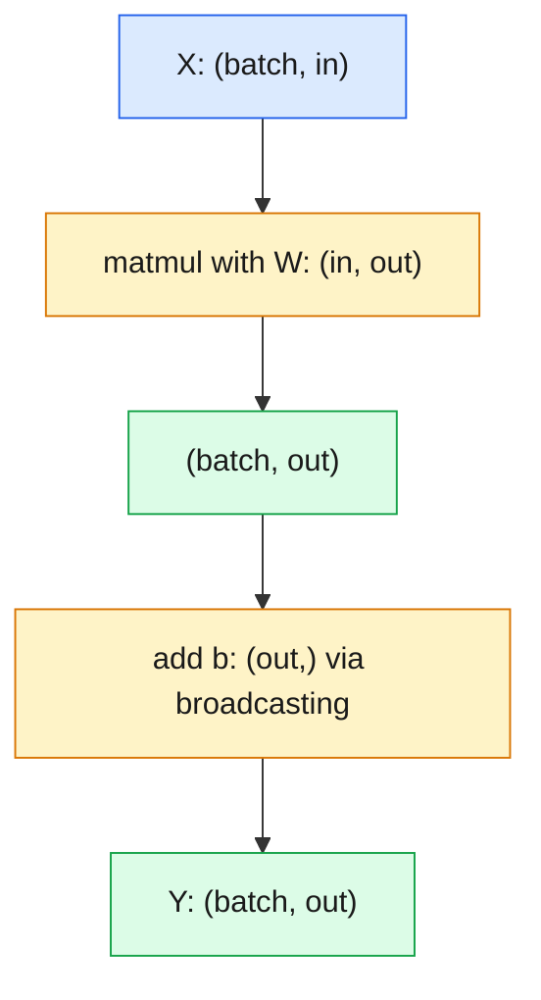

# 02 — NumPy: Thinking in Shapes

> NumPy's mental model - shape, dtype, broadcasting - is the vocabulary of every tensor library; learn to predict shapes before you run code.

| | |
|---|---|
| **Day** | 1 — Python + Data + Math |
| **Topic** | 02 — NumPy: thinking in shapes |
| **Notebooks** | 1 (`01_numpy_fundamentals`) |
| **Builds on** | [`01_python`](../01_python/README.md) |
| **Leads to** | [`03_data_libraries`](../03_data_libraries/README.md), [`05_ml_mathematics`](../05_ml_mathematics/README.md), PyTorch tensors (Day 3) |

## 📖 Short forms used in this topic

| Term | Full form | What it is |
|---|---|---|
| **ndarray** | N-dimensional array | NumPy's core typed, fixed-shape array object. |
| **dtype** | Data type | Element type of an array (`float32`, `int64`, ...) controlling memory and precision. |
| **ndim** | Number of dimensions | How many axes an array has (`len(shape)`). |
| **axis** | Axis | One dimension of an array; `axis=0` runs down rows, `axis=1` across columns. |
| **matmul** | Matrix multiplication | The `@` / `np.matmul` operation: `(m,n) @ (n,p) -> (m,p)`. |
| **ReLU** | Rectified Linear Unit | Activation `max(x, 0)` (an exercise here). |
| **X, W, b** | Inputs, weights, bias | Input batch, parameter matrix and bias vector of a linear layer `X @ W + b`. |
| **ML** | Machine Learning | Building models that learn from data. |
| **GPU** | Graphics Processing Unit | Parallel processor for deep learning, typically using `float32` or lower precision. |
| **float32 / float64** | 32-/64-bit floating point | Single and double precision numbers. |
| **CS231n** | Stanford course CS231n | Convolutional Neural Networks course; its NumPy tutorial is listed in References. |

## 🧠 In plain words

NumPy gives Python a fast, fixed-type grid of numbers (the `ndarray`) and lets you operate on the whole grid at once instead of looping. Each array has a `shape` that tells you its size along each axis, and a small set of shape rules (broadcasting, matmul) decides what operations are allowed.

## 🎒 Analogy to remember

An `ndarray` is an **egg carton / spreadsheet block**: every cell holds the same kind of thing, in a fixed grid. A vectorized operation is a **stamp across the whole carton** instead of marking each egg by hand. Broadcasting is **re-using one row of a stamp** across every row of the carton.
*Where it breaks down:* a spreadsheet can hold mixed types; an ndarray cannot, and that uniformity is precisely what makes it fast.

## Learning objectives

By the end of this topic you can:
- Create and inspect `ndarray`s (`shape`, `dtype`, `ndim`).
- Index/slice/reshape/transpose arrays and predict the resulting shape before running code.
- Explain and apply broadcasting rules.
- Use vectorized operations and boolean masking instead of Python loops.
- Compute dot products, matrix multiplication, and reductions, and reason about tensor shapes
  through a mock "mini neural network layer" computation.

## Why it matters

Every tensor library (PyTorch, TensorFlow, JAX) uses NumPy's mental model: shape, dtype, strides,
broadcasting. If you can predict `X @ W + b`'s output shape without running it, you can read any
model's `forward()` method. If you can't, every shape-mismatch error becomes a guessing game.

## Prerequisites

[`01_python`](../01_python/README.md) — comfort with Python functions and basic data structures.

## Core concepts

- **`ndarray`**: NumPy's core data structure — a typed, fixed-shape, contiguous (by default) block of memory.
- **`shape`/`ndim`/`dtype`**: `shape` is a tuple describing size along each axis; `dtype` controls memory layout and numeric precision (`float32` vs `float64` matters a lot for ML).
- **Indexing & slicing**: basic slicing (`a[1:3]`), boolean masking (`a[a > 0]`), fancy indexing (`a[[0, 2]]`).
- **reshape/transpose/squeeze/expand_dims**: changing how the same data is *viewed* without copying (usually).
- **concatenate/stack**: joining arrays along existing vs new axes.
- **Broadcasting**: NumPy's rule for applying an operation between arrays of different (but compatible) shapes without explicit loops.
- **Vectorization**: expressing an operation over a whole array at once — orders of magnitude faster than a Python `for` loop, because it drops into compiled C code.
- **dot product / matrix multiplication**: `np.dot`, `@`, `np.matmul` — the core operation of every linear layer.
- **Reductions**: `sum`/`mean`/`max`/`argmax` along an axis — which axis gets reduced is a constant source of bugs.
- **Tensor-shape reasoning**: given `X: (batch, in_features)` and `W: (in_features, out_features)`, `X @ W` has shape `(batch, out_features)` — this is the whole vocabulary of a neural network layer.

```mermaid
flowchart LR
  subgraph G1["Structure"]
    A["ndarray: shape and dtype"]
  end
  subgraph G2["Selecting and reshaping"]
    B["Indexing, slicing, masking"] --> C["reshape, transpose, concatenate"]
  end
  subgraph G3["Computing"]
    D["Broadcasting rules"] --> E["Vectorized ops"] --> F["dot, matmul, reductions"]
  end
  G["Tensor-shape reasoning: X @ W + b"]
  H["Ready for Pandas and Polars"]
  A --> B
  C --> D
  F --> G --> H
  classDef struct fill:#DBEAFE,stroke:#2563EB,color:#1a1a1a;
  classDef sel fill:#DCFCE7,stroke:#16A34A,color:#1a1a1a;
  classDef comp fill:#FEF3C7,stroke:#D97706,color:#1a1a1a;
  classDef goal fill:#EDE9FE,stroke:#7C3AED,color:#1a1a1a;
  class A struct;
  class B,C sel;
  class D,E,F comp;
  class G,H goal;
```

## 🔍 Concepts explained

**Category chips:** 🟦 Structure · 🟩 Selecting and reshaping · 🟧 Computing · 🟥 Pitfalls

### 🟦 Structure: `ndarray`, `shape`, `dtype`
- **Definition:** a block of same-typed numbers plus metadata (`shape`, `dtype`, strides).
- **Analogy:** egg carton - fixed grid, one kind of egg.
- **Code idea:** `a = np.zeros((32, 10), dtype=np.float32); a.shape  # (32, 10)`
- **Use when / watch out:** print or assert shapes constantly. `float32` is the usual choice for deep learning.

### 🟩 Selecting and reshaping

| Operation | What it does | Copy or view | Pitfall |
|---|---|---|---|
| Basic slice `a[1:3]` | contiguous / strided sub-array | view | mutating it changes the original |
| Boolean mask `a[a > 0]` | elements where condition is true | copy | result is 1-D |
| Fancy index `a[[0, 2]]` | pick rows/elements by index list | copy | easy to mix up with slices |
| `reshape` | same data, new shape | usually view | total size must match |
| `transpose` / `.T` | swap axes | view | result may be non-contiguous |
| `squeeze` / `expand_dims` | remove / add length-1 axes | view | wrong axis breaks broadcasting |
| `concatenate` | join along an **existing** axis | copy | other dims must match |
| `stack` | join along a **new** axis | copy | all shapes must be identical |

> [!WARNING]
> `.reshape()` often returns a **view**. Writing into the result can silently modify the original array.

### 🟧 Computing

**Broadcasting**
- **Definition:** shapes are compared from the **last axis backwards**; two dims are compatible if equal or one of them is 1. A size-1 (or missing) dim is virtually stretched.
- **Analogy:** photocopying one row to fill every row of a grid, without actually printing the copies.
- **Code idea:** `(32,10) + (10,) -> (32,10)`; `(32,1) + (1,10) -> (32,10)`; `(32,10) + (5,)` raises `ValueError`.
- **Use when / watch out:** bias addition, normalization. A mistaken extra axis silently makes a huge `(n, n)` array.

**Vectorization**
- **Definition:** apply an operation to a whole array in compiled code.
- **Analogy:** a stamp across the carton vs marking each egg.
- **Use when / watch out:** almost always; the speed-up comes from removing per-element Python overhead.

**Matmul and shape reasoning**
- **Definition:** `X @ W` with `X:(batch, in)` and `W:(in, out)` gives `(batch, out)`; inner dims must match.
- **Formula:** `Y = X @ W + b`, with `b:(out,)` broadcast across the batch.
- **Use when / watch out:** `*` is elementwise, `@` is matrix product.

**Reductions**

| Call on shape `(5, 3)` | Collapses | Result shape |
|---|---|---|
| `a.sum(axis=0)` | rows (down each column) | `(3,)` |
| `a.sum(axis=1)` | columns (across each row) | `(5,)` |
| `a.sum()` | everything | scalar |

> [!TIP]
> Rule of thumb: the axis you name **disappears** from the shape.

> [!IMPORTANT]
> Shape thinking transfers one-to-one to PyTorch and JAX: if you can name every tensor's shape, you can read any `forward()`.

## Important APIs / functions

`np.array`, `.shape`, `.ndim`, `.dtype`, `.reshape`, `.T`/`np.transpose`, `np.squeeze`,
`np.expand_dims`, `np.concatenate`, `np.stack`, broadcasting (elementwise `+`/`*` between
different shapes), boolean masking (`a[a > 0]`), `np.dot`/`@`/`np.matmul`, `.sum`/`.mean`/`.max`/`.argmax(axis=...)`.

## Notebooks

| Notebook | Purpose | Expected output |
|---|---|---|
| `01_numpy_fundamentals.ipynb` | ndarray creation, shape/dtype, indexing/slicing/masking, reshape/transpose/concat/stack, broadcasting, vectorization, dot/matmul/reductions, a mini "linear layer" shape-reasoning exercise | Printed shapes at every step; a vectorized op benchmark beating a pure-Python loop by orders of magnitude; `X @ W + b` computed with explicit shape assertions |

## Key takeaways

- Always know the shape of every array you're working with — print it or assert it.
- Broadcasting lets `(32, 10) + (10,)` work without a loop — the smaller array is "stretched" along compatible axes.
- Vectorized NumPy code is fast because it avoids per-element Python overhead, not because of magic.
- `axis=0` reduces rows (collapses down each column); `axis=1` reduces columns (collapses across each row) — this trips up almost everyone at least once.

## Common mistakes

- Confusing `axis=0` and `axis=1` in a reduction.
- Assuming `.reshape()` always copies (it often returns a view — mutating the result can mutate the original).
- Adding arrays with incompatible shapes and being surprised by a `ValueError` instead of understanding broadcasting rules.
- Using `float64` everywhere without realizing GPU-bound deep learning code typically wants `float32`.
- Writing a Python `for` loop over array elements instead of a vectorized operation.

## Interview questions

**Conceptual**
1. What are NumPy's broadcasting rules, and why does `(32, 10) + (10,)` work but `(32, 10) + (5,)` doesn't?
2. Why is vectorized NumPy code faster than an equivalent Python `for` loop?
3. What's the difference between `.reshape()` returning a view vs a copy, and why does it matter?
4. If `X` has shape `(32, 10)` and `W` has shape `(10, 3)`, what is the shape of `X @ W`, and what does each dimension represent?
5. What's the difference between `axis=0` and `axis=1` for `.sum()` on a 2D array?

**Coding**
1. Given a 2D array, write a one-liner to normalize each row to sum to 1.
2. Implement "one-hot encoding" of an integer label array using only NumPy (no loops).
3. Given `X: (batch, features)`, compute the pairwise Euclidean distance matrix `(batch, batch)` using broadcasting, without a loop.

**Debugging**
1. `a.reshape(3, 4)` raises a `ValueError` on a 10-element array — why, and how do you fix it?
2. A broadcasting operation silently produces a much larger array than expected (e.g. `(32, 1) + (1, 10)` → `(32, 10)`) — why did that happen, and was it intended?

**Real-world engineering**
1. You're processing a batch of 10,000 images as a Python list and looping over each to normalize pixel values — how would you vectorize this, and what speedup would you expect?
2. Your model consumes `float32` but your preprocessing pipeline produces `float64` NumPy arrays — what's the practical consequence, and how do you fix it at the source?

## Exercises

1. Create a `(5, 3)` array of random floats; compute the mean along each axis and verify the output shapes are `(3,)` and `(5,)` respectively.
2. Implement a vectorized ReLU: `relu(x) = max(x, 0)` using boolean masking, no loops.
3. Given `X: (100, 20)`, `W: (20, 5)`, `b: (5,)`, compute `Y = X @ W + b` and assert `Y.shape == (100, 5)`.
4. Benchmark squaring 1,000,000 numbers with a Python loop vs `np.square` and report the speedup.

## References

- [NumPy docs — Quickstart](https://numpy.org/doc/stable/user/quickstart.html)
- [NumPy docs — Broadcasting](https://numpy.org/doc/stable/user/basics.broadcasting.html)
- [NumPy docs — Indexing](https://numpy.org/doc/stable/user/basics.indexing.html)
- [Stanford CS231n — Python/NumPy tutorial](https://cs231n.github.io/python-numpy-tutorial/)
