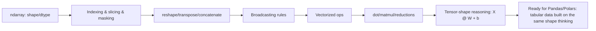

# 02 — NumPy: Thinking in Shapes

## Learning objectives

By the end of this topic you can:
- Create and inspect `ndarray`s (`shape`, `dtype`, `ndim`).
- Index/slice/reshape/transpose arrays and predict the resulting shape before running code.
- Explain and apply broadcasting rules.
- Use vectorized operations and boolean masking instead of Python loops.
- Compute dot products, matrix multiplication, and reductions, and reason about tensor shapes
  through a mock "mini neural network layer" computation.

## Why it matters

Every tensor library (PyTorch, TensorFlow, JAX) uses NumPy's mental model: shape, dtype, strides,
broadcasting. If you can predict `X @ W + b`'s output shape without running it, you can read any
model's `forward()` method. If you can't, every shape-mismatch error becomes a guessing game.

## Prerequisites

[`01_python`](../01_python/README.md) — comfort with Python functions and basic data structures.

## Core concepts

- **`ndarray`**: NumPy's core data structure — a typed, fixed-shape, contiguous (by default) block of memory.
- **`shape`/`ndim`/`dtype`**: `shape` is a tuple describing size along each axis; `dtype` controls memory layout and numeric precision (`float32` vs `float64` matters a lot for ML).
- **Indexing & slicing**: basic slicing (`a[1:3]`), boolean masking (`a[a > 0]`), fancy indexing (`a[[0, 2]]`).
- **reshape/transpose/squeeze/expand_dims**: changing how the same data is *viewed* without copying (usually).
- **concatenate/stack**: joining arrays along existing vs new axes.
- **Broadcasting**: NumPy's rule for applying an operation between arrays of different (but compatible) shapes without explicit loops.
- **Vectorization**: expressing an operation over a whole array at once — orders of magnitude faster than a Python `for` loop, because it drops into compiled C code.
- **dot product / matrix multiplication**: `np.dot`, `@`, `np.matmul` — the core operation of every linear layer.
- **Reductions**: `sum`/`mean`/`max`/`argmax` along an axis — which axis gets reduced is a constant source of bugs.
- **Tensor-shape reasoning**: given `X: (batch, in_features)` and `W: (in_features, out_features)`, `X @ W` has shape `(batch, out_features)` — this is the whole vocabulary of a neural network layer.

## Important APIs / functions

`np.array`, `.shape`, `.ndim`, `.dtype`, `.reshape`, `.T`/`np.transpose`, `np.squeeze`,
`np.expand_dims`, `np.concatenate`, `np.stack`, broadcasting (elementwise `+`/`*` between
different shapes), boolean masking (`a[a > 0]`), `np.dot`/`@`/`np.matmul`, `.sum`/`.mean`/`.max`/`.argmax(axis=...)`.

## Notebooks

| Notebook | Purpose | Expected output |
|---|---|---|
| `01_numpy_fundamentals.ipynb` | ndarray creation, shape/dtype, indexing/slicing/masking, reshape/transpose/concat/stack, broadcasting, vectorization, dot/matmul/reductions, a mini "linear layer" shape-reasoning exercise | Printed shapes at every step; a vectorized op benchmark beating a pure-Python loop by orders of magnitude; `X @ W + b` computed with explicit shape assertions |

## Key takeaways

- Always know the shape of every array you're working with — print it or assert it.
- Broadcasting lets `(32, 10) + (10,)` work without a loop — the smaller array is "stretched" along compatible axes.
- Vectorized NumPy code is fast because it avoids per-element Python overhead, not because of magic.
- `axis=0` reduces rows (collapses down each column); `axis=1` reduces columns (collapses across each row) — this trips up almost everyone at least once.

## Common mistakes

- Confusing `axis=0` and `axis=1` in a reduction.
- Assuming `.reshape()` always copies (it often returns a view — mutating the result can mutate the original).
- Adding arrays with incompatible shapes and being surprised by a `ValueError` instead of understanding broadcasting rules.
- Using `float64` everywhere without realizing GPU-bound deep learning code typically wants `float32`.
- Writing a Python `for` loop over array elements instead of a vectorized operation.

## Interview questions

**Conceptual**
1. What are NumPy's broadcasting rules, and why does `(32, 10) + (10,)` work but `(32, 10) + (5,)` doesn't?
2. Why is vectorized NumPy code faster than an equivalent Python `for` loop?
3. What's the difference between `.reshape()` returning a view vs a copy, and why does it matter?
4. If `X` has shape `(32, 10)` and `W` has shape `(10, 3)`, what is the shape of `X @ W`, and what does each dimension represent?
5. What's the difference between `axis=0` and `axis=1` for `.sum()` on a 2D array?

**Coding**
1. Given a 2D array, write a one-liner to normalize each row to sum to 1.
2. Implement "one-hot encoding" of an integer label array using only NumPy (no loops).
3. Given `X: (batch, features)`, compute the pairwise Euclidean distance matrix `(batch, batch)` using broadcasting, without a loop.

**Debugging**
1. `a.reshape(3, 4)` raises a `ValueError` on a 10-element array — why, and how do you fix it?
2. A broadcasting operation silently produces a much larger array than expected (e.g. `(32, 1) + (1, 10)` → `(32, 10)`) — why did that happen, and was it intended?

**Real-world engineering**
1. You're processing a batch of 10,000 images as a Python list and looping over each to normalize pixel values — how would you vectorize this, and what speedup would you expect?
2. Your model consumes `float32` but your preprocessing pipeline produces `float64` NumPy arrays — what's the practical consequence, and how do you fix it at the source?

## Exercises

1. Create a `(5, 3)` array of random floats; compute the mean along each axis and verify the output shapes are `(3,)` and `(5,)` respectively.
2. Implement a vectorized ReLU: `relu(x) = max(x, 0)` using boolean masking, no loops.
3. Given `X: (100, 20)`, `W: (20, 5)`, `b: (5,)`, compute `Y = X @ W + b` and assert `Y.shape == (100, 5)`.
4. Benchmark squaring 1,000,000 numbers with a Python loop vs `np.square` and report the speedup.

## References

- [NumPy docs — Quickstart](https://numpy.org/doc/stable/user/quickstart.html)
- [NumPy docs — Broadcasting](https://numpy.org/doc/stable/user/basics.broadcasting.html)
- [NumPy docs — Indexing](https://numpy.org/doc/stable/user/basics.indexing.html)
- [Stanford CS231n — Python/NumPy tutorial](https://cs231n.github.io/python-numpy-tutorial/)
