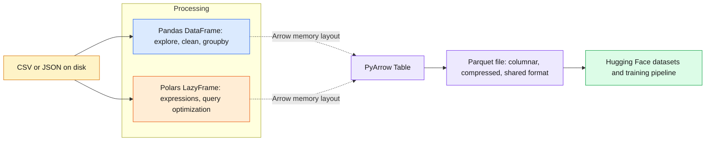
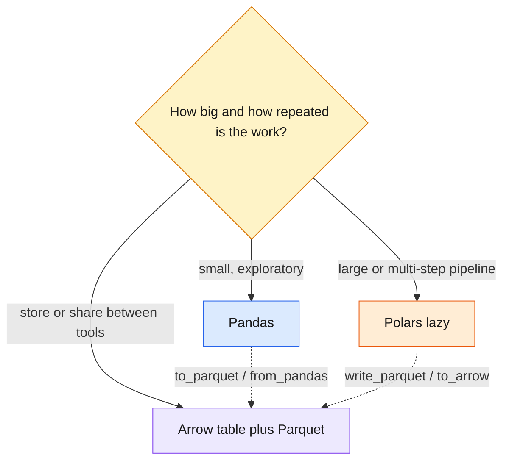

# 03 — Data Libraries: Pandas, Polars, PyArrow

> Three tools, one shape of data: Pandas for ergonomic exploration, Polars for fast lazy queries, Arrow/Parquet as the shared columnar format between them.

| | |
|---|---|
| **Day** | 1 — Python + Data + Math |
| **Topic** | 03 — Data libraries: Pandas, Polars, PyArrow |
| **Notebooks** | 3 (`01_pandas`, `02_polars`, `03_pyarrow`) plus `generate_dataset.py` and `data/` |
| **Builds on** | [`02_numpy`](../02_numpy/README.md) |
| **Leads to** | [`04_datasets`](../04_datasets/README.md) |

## 📖 Short forms used in this topic

| Term | Full form | What it is |
|---|---|---|
| **CSV** | Comma-Separated Values | Row-oriented plain-text table format; simple but large and untyped. |
| **JSON** | JavaScript Object Notation | Text format for nested key-value data. |
| **API** | Application Programming Interface | The functions/classes a library exposes (Pandas API, Polars expression API). |
| **RAM** | Random-Access Memory | Main memory; "larger-than-RAM" data cannot be loaded all at once. |
| **ML** | Machine Learning | Building models that learn from data. |
| **SQL** | Structured Query Language | Database query language; `merge`/`join` follow SQL join semantics. |
| **HF** | Hugging Face | Company/hub behind the `datasets` library, which uses Arrow. |
| **DataFrame** | Data frame | A 2-D table with labelled columns. |
| **Series** | Series | A labelled 1-D column of values (Pandas). |
| **LazyFrame** | Lazy data frame | Polars object that records a query plan and runs it on `.collect()`. |
| **Parquet** | Apache Parquet | Compressed columnar file format for tables. |
| **Arrow** | Apache Arrow | Columnar in-memory format shared across tools. |
| **EDA** | Exploratory Data Analysis | Inspecting and summarising data before modelling (what Pandas is used for). |

## 🧠 In plain words

Real ML data is mostly tables. Pandas, Polars and PyArrow are three Python tools for loading, cleaning, combining and saving tables. They differ in speed, memory use and how they run your code, but they can hand data to each other cheaply because they share the Arrow column layout.

## 🎒 Analogy to remember

A table is a **filing cabinet**. Pandas is a **hands-on clerk**: does each instruction immediately, easy to talk to. Polars is a **planner clerk**: you hand over the whole job (lazy), and they reorder steps and use several helpers before touching a file. Arrow/Parquet is the **standard folder format** every clerk understands, so no one retypes anything.
*Where it breaks down:* Pandas is not literally slow for everything; for small data its eager style is often simpler and fast enough.

## Learning objectives

By the end of this topic you can:
- Load, filter, sort, clean, and aggregate tabular data with Pandas.
- Express the same operations with Polars' expression API, including lazy execution.
- Understand Arrow's columnar memory format and read/write Parquet with PyArrow.
- Know when to reach for each library.

## Why it matters

Almost every ML pipeline starts with tabular data: labeled examples, logs, or metadata joined
against features. Pandas is the lingua franca for exploration; Polars is increasingly used for
speed and memory efficiency on larger-than-RAM data via lazy execution; Arrow/Parquet is the
columnar interchange format behind Hugging Face `datasets`, Spark, and most data lakes.

## Prerequisites

[`02_numpy`](../02_numpy/README.md) — a DataFrame column is backed by array-like shape thinking.

## Core concepts

### Pandas
- `Series` (1D, labeled) and `DataFrame` (2D, labeled rows/columns).
- Loading data (`read_csv`, `read_json`), filtering (`df[df.col > 0]`), sorting (`sort_values`).
- Missing values (`isna`, `fillna`, `dropna`) and duplicates (`duplicated`, `drop_duplicates`).
- `groupby` + aggregation (`.agg`, `.mean()`, `.sum()`).
- `merge`/`join` (SQL-style joins) and `concat` (stacking).
- `pivot`/`melt` (reshaping wide ↔ long).
- `.apply`/`.map` (row/element-wise transforms — a last resort after vectorized ops).

### Polars
- `DataFrame`, the **expression API** (`pl.col("x") > 0`), which Polars can optimize and parallelize.
- **Lazy execution**: `LazyFrame` builds a query plan (`.lazy()` ... `.collect()`) instead of executing eagerly, letting Polars push down filters/projections.
- Joins, aggregations, and streaming (processing data larger than RAM in chunks).

### PyArrow
- The Arrow columnar in-memory format — the same layout Pandas 2.x, Polars, and `datasets` can all share **without copying**.
- Reading/writing Parquet (`pyarrow.parquet`) — the standard columnar on-disk format for ML datasets.

## 🔍 Concepts explained

**Category chips:** 🟦 Pandas · 🟧 Polars · 🟪 Arrow / Parquet · 🟥 Pitfalls

### Differences at a glance

| | 🟦 Pandas | 🟧 Polars | 🟪 PyArrow |
|---|---|---|---|
| **Role** | Explore, clean, prototype | Fast / large-data transforms | In-memory columnar format + Parquet I/O |
| **Execution** | Eager (each line runs now) | Eager or **lazy** (`.lazy()`, `.collect()`) | Compute kernels, mostly eager |
| **Style** | Method chains, boolean masks, index | Expressions: `pl.col("x") > 0` | Tables and arrays |
| **Strength** | Richest ecosystem, ergonomic | Parallel, query optimisation, streaming | Zero-copy sharing, Parquet |
| **Pitfall** | `.apply()` slow; `MultiIndex` after groupby | Lazy defers errors/cost until `.collect()` | Lower-level, fewer analysis helpers |
| **Pick when** | Small/medium data, notebooks | Big data, speed, pipelines | Interchange and storage |

### 🟦 Pandas building blocks

**`groupby` + `agg`**
- **Definition:** split rows by a key, apply an aggregate to each group, combine results.
- **Analogy:** sort receipts into piles by customer, then total each pile.
- **Code idea:** `df.groupby("category").agg(n=("id", "count"))`
- **Use when / watch out:** per-user/per-class stats; `reset_index()` to flatten, and de-duplicate first or you double-count.

| Join-type operation | Combines | Like in SQL | Pitfall |
|---|---|---|---|
| `merge` / `join` | columns, matched on keys | `JOIN` | duplicate keys multiply rows |
| `concat` | stacks rows (or columns) as-is | `UNION ALL` | column mismatch gives NaN |
| `pivot` / `melt` | reshape long to wide / wide to long | - | duplicate index/column pairs break `pivot` |

**Missing values and duplicates**
- Detect with `isna` / `duplicated`; treat with `fillna`, `dropna`, `drop_duplicates`.
- **Watch out:** decide *drop vs fill* deliberately; dropping silently shifts class balance.

### 🟧 Polars: expressions and lazy execution
- **Definition:** an *expression* describes a computation on columns; a `LazyFrame` collects expressions into a plan the optimiser can rewrite (push filters and column selection down) before running.
- **Analogy:** hand the clerk the whole shopping list so they plan one efficient route.
- **Code idea:** `pl.scan_csv(...)` or `df.lazy().filter(pl.col("x") > 0).select("a").collect()`; inspect with `.explain()`.
- **Use when / watch out:** large data and multi-step pipelines. Nothing runs until `.collect()`.

### 🟪 Arrow and Parquet

| | CSV | Parquet |
|---|---|---|
| Layout | row-oriented text | columnar binary |
| Types | not stored (inferred) | stored in schema |
| Size | large | compressed, much smaller |
| Read a few columns | must scan whole file | reads only those columns |
| Human-readable | yes | no |

- **Arrow** is the in-memory counterpart: Pandas (with Arrow-backed dtypes), Polars and Hugging Face `datasets` can share it, often without copying.

> [!NOTE]
> "Zero-copy" means different libraries point at the same memory buffers rather than duplicating them; it depends on compatible types, so a conversion can still copy.

> [!WARNING]
> `.apply()` with a Python function runs per row/element in Python. Prefer vectorized Pandas methods or Polars expressions.

> [!TIP]
> Mixing is normal: explore in Pandas, run the heavy pipeline in Polars, persist as Parquet.

## Important APIs / functions

Pandas: `pd.read_csv`, `pd.DataFrame`, boolean filtering, `.sort_values`, `.isna`/`.fillna`/`.dropna`,
`.duplicated`/`.drop_duplicates`, `.groupby().agg`, `pd.merge`, `pd.concat`, `.pivot`/`.melt`, `.apply`.
Polars: `pl.DataFrame`, `pl.col`, `.filter`, `.select`, `.group_by().agg`, `.lazy()`/`.collect()`, `.join`.
PyArrow: `pyarrow.Table.from_pandas`, `pyarrow.parquet.write_table`/`read_table`.

## Notebooks

| Notebook | Purpose | Expected output |
|---|---|---|
| `01_pandas.ipynb` | Series/DataFrame, loading, filtering, sorting, missing values, duplicates, groupby/agg, merge/concat, pivot/melt, apply/map | A cleaned, deduplicated, aggregated small ticket-support dataset; before/after row counts printed at each cleaning step |
| `02_polars.ipynb` | Polars DataFrame, expressions, lazy execution, joins, aggregation, streaming | The same dataset reproduced with Polars expressions; a printed Polars query plan via `.explain()`; lazy vs eager timing comparison |
| `03_pyarrow.ipynb` | Arrow Table, Parquet round-trip, columnar layout, zero-copy interop with Pandas/Polars | A Parquet file written and read back with identical data; file size comparison vs CSV |

## Key takeaways

- Pandas optimizes for ergonomics and the richest ecosystem; Polars optimizes for speed/memory via lazy, parallel execution; Arrow/Parquet is the shared columnar format that makes moving between them (and into `datasets`) cheap.
- `groupby` + `agg` is the single most common tabular ML-prep operation (e.g. aggregating events per user).
- Lazy execution (`.lazy()...collect()`) lets Polars see the *whole* query before running it, enabling optimizations eager execution can't do.
- Parquet is columnar and compressed — much smaller and faster to read a subset of columns from than CSV.

## Common mistakes

- Using `.apply()` with a Python function when a vectorized Pandas/Polars expression would do the same thing 10-100x faster.
- Forgetting `reset_index()` after a `groupby` and being confused by a `MultiIndex`.
- Not checking for duplicate rows before aggregating, silently double-counting.
- Treating Polars eager and lazy APIs as interchangeable without realizing lazy defers execution until `.collect()`.

## Interview questions

**Conceptual**
1. What's the practical difference between Pandas eager execution and Polars lazy execution?
2. Why is Parquet generally preferred over CSV for ML datasets?
3. What does Arrow's columnar format give you that a row-oriented format doesn't?
4. When would you choose `merge` over `concat`, or vice versa?
5. Why is `.apply()` usually a last resort in both Pandas and Polars?

**Coding**
1. Given a DataFrame with a `user_id` and `event_time` column, compute the number of events per user.
2. Write a Polars lazy query that filters rows, selects two columns, and groups by one of them — call `.explain()` on it before `.collect()`.
3. Round-trip a small DataFrame through Parquet using PyArrow and verify the data is identical after reading it back.

**Debugging**
1. A `groupby().mean()` result has a `MultiIndex` you didn't expect — why, and how do you flatten it?
2. A `merge` produces more rows than either input DataFrame — what's the likely cause (hint: duplicate join keys)?

**Real-world engineering**
1. You have a 50GB CSV that doesn't fit in memory — how would Polars' lazy/streaming execution help, and how would Pandas alone fail here?
2. Your team shares datasets between a Pandas-based notebook and a Polars-based production pipeline — how does Arrow/Parquet make that handoff cheap?

## Exercises

1. Load a small synthetic support-ticket dataset into Pandas; drop duplicates, fill missing categories with `"unknown"`, and compute ticket counts per category.
2. Reproduce the same pipeline in Polars using `.lazy()`, and call `.explain()` to see the query plan before `.collect()`.
3. Write the cleaned DataFrame to Parquet with PyArrow, read it back, and assert the two DataFrames are equal.

## References

- [Pandas docs — User Guide](https://pandas.pydata.org/docs/user_guide/index.html)
- [Polars docs — User Guide](https://docs.pola.rs/)
- [Apache Arrow docs](https://arrow.apache.org/docs/python/index.html)
- [Apache Parquet](https://parquet.apache.org/docs/)
