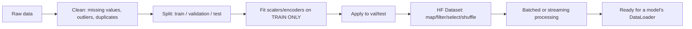

# 04 — Datasets: Design Principles + Hugging Face `datasets`

## Learning objectives

By the end of this topic you can:
- Explain samples/features/labels and why train/validation/test splits exist.
- Identify and fix common dataset problems: missing values, outliers, duplicates, imbalance, and leakage.
- Normalize/standardize numeric features and encode categorical ones.
- Use Hugging Face `datasets`' `Dataset`/`DatasetDict`, `map`/`filter`/`select`/`shuffle`/`train_test_split`, batched processing, and streaming.

## Why it matters

Model quality is bounded by dataset quality far more often than by architecture choice. Leakage
(information from validation/test leaking into training) silently inflates reported accuracy and
is one of the most common real-world ML bugs. Hugging Face `datasets` is the standard interface
for dataset manipulation you'll reuse directly when fine-tuning LLMs later in this workspace's
`llm-fine-tuning/` curriculum.

## Prerequisites

[`03_data_libraries`](../03_data_libraries/README.md) — `datasets` is built on Arrow, covered there.

## Core concepts

- **Samples / features / labels**: a sample is one row/example; features are its inputs; a label is what you're predicting (supervised learning only).
- **Train / validation / test split**: train to fit, validation to tune/select, test to report a final, unbiased estimate — never tune based on test performance.
- **Structured vs unstructured data**: tabular/structured (rows+columns) vs text/image/audio (unstructured, needs featurization).
- **Cleaning**: missing values (drop vs impute), outliers (cap/remove/investigate), duplicates (can cause train/test leakage if not removed before splitting).
- **Imbalance**: when one class dominates — accuracy becomes misleading; needs resampling, class weights, or different metrics (see Day 2's evaluation topic).
- **Leakage**: any case where information not available at prediction time (or from the test set) influences training — e.g. normalizing using statistics computed over the *entire* dataset before splitting, or duplicate rows split across train and test.
- **Normalization/standardization**: scaling numeric features (min-max to `[0,1]`, or z-score to mean 0/std 1) — fit the scaler on train only, then apply to val/test.
- **Encoding**: turning categories into numbers (one-hot, label/ordinal encoding) since models need numeric input.

### Hugging Face `datasets`
- `load_dataset` — loads a dataset (from the Hub or local files) as Arrow-backed `Dataset`/`DatasetDict`.
- `.map()` — apply a function to every example (optionally `batched=True` for speed).
- `.filter()` — keep only examples matching a predicate.
- `.select()` — take a specific set of row indices.
- `.shuffle()` / `.train_test_split()` — randomize order / split into train+test with reproducible seeds.
- `.remove_columns()` — drop columns no longer needed after preprocessing.
- **Streaming**: `load_dataset(..., streaming=True)` yields an `IterableDataset` that never loads the whole thing into memory — the dataset-level analog of the generators from `01_python`.

## Important APIs / functions

`datasets.load_dataset`, `datasets.Dataset`, `datasets.DatasetDict`, `.map`, `.filter`,
`.select`, `.shuffle`, `.train_test_split`, `.remove_columns`, `batched=True`,
`streaming=True`.

## Notebooks

| Notebook | Purpose | Expected output |
|---|---|---|
| `01_dataset_design_and_hf_datasets.ipynb` | Dataset design principles (split, leakage, imbalance, scaling fit-on-train-only) using a small synthetic tabular dataset, then the same data wrapped as a Hugging Face `Dataset` demonstrating map/filter/select/shuffle/train_test_split/batched/streaming | A deliberately-leaky split shown to inflate "accuracy," contrasted with a correct split; an HF `Dataset` built from a Pandas DataFrame, transformed via `.map(batched=True)`, and split via `.train_test_split()` |

## Key takeaways

- Fit any data-dependent transform (scaler, encoder, vocabulary) on the training split only, then apply it unchanged to validation/test.
- Deduplicate *before* splitting, or duplicates can land in both train and test, leaking information.
- Class imbalance doesn't go away by ignoring it — accuracy on an imbalanced dataset can look great while the model learns to always predict the majority class.
- `datasets.Dataset` is Arrow-backed, so `.map(batched=True)` is fast and streaming works on data too large for memory — the same ideas as `03_data_libraries`.

## Common mistakes

- Normalizing/standardizing using statistics from the *whole* dataset before splitting (leakage).
- Shuffling before splitting without a fixed seed, making results non-reproducible.
- Treating accuracy as sufficient on an imbalanced dataset.
- Calling `.map()` without `batched=True` on a large dataset when the function could easily be vectorized over a batch.

## Interview questions

**Conceptual**
1. Why must you fit a scaler on the training set only, not the full dataset?
2. Give a concrete example of data leakage that wouldn't show up as a bug until deployment.
3. Why is accuracy a poor metric on an imbalanced dataset?
4. What's the difference between `Dataset.map()` with and without `batched=True`?
5. When would you use streaming mode (`streaming=True`) instead of loading a dataset fully?

**Coding**
1. Given a Pandas DataFrame, build a Hugging Face `Dataset` and use `.train_test_split(test_size=0.2, seed=42)`.
2. Write a `.map(batched=True)` function that lowercases a text column across the whole dataset.
3. Use `.filter()` to keep only rows where a `label` column is not null.

**Debugging**
1. A model gets 99% validation accuracy but performs terribly in production — what dataset issue would you check first?
2. After splitting, you realize duplicate rows exist in both train and test — what's the fix, and does it require re-splitting?

**Real-world engineering**
1. You're building a fraud-detection model where fraud is 0.1% of transactions — how does this change your evaluation strategy, independent of the model itself?
2. Your dataset is 500GB and doesn't fit in memory — how does Hugging Face `datasets`' Arrow-backed storage and streaming mode help?

## Exercises

1. Build a synthetic dataset, deliberately leak test statistics into a "normalized" feature, and measure the artificially inflated validation score vs a correct, leakage-free pipeline.
2. Convert a Pandas DataFrame to a Hugging Face `Dataset`, apply `.map(batched=True)` to add a derived column, then `.remove_columns()` the original.
3. Load a small dataset with `streaming=True` and iterate the first 5 examples without ever materializing the full dataset.

## References

- [Hugging Face `datasets` docs](https://huggingface.co/docs/datasets/index)
- [Hugging Face `datasets` — Process](https://huggingface.co/docs/datasets/process)
- [Hugging Face `datasets` — Streaming](https://huggingface.co/docs/datasets/stream)
- [scikit-learn — Data leakage](https://scikit-learn.org/stable/common_pitfalls.html#data-leakage)
