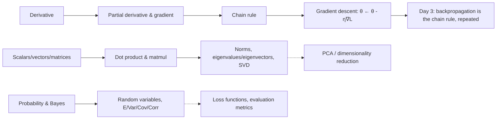

# 05 — ML Mathematics: Linear Algebra, Probability/Statistics, Calculus

## Learning objectives

By the end of this topic you can:
- Explain scalars/vectors/matrices/tensors and compute dot products, matrix multiplication, transpose, and norms.
- State what eigenvalues/eigenvectors and SVD represent at an intuitive level and where they show up in ML (PCA, dimensionality reduction).
- Apply Bayes' theorem and reason about expected value, variance, covariance, and correlation.
- Compute a derivative, partial derivative, and gradient by hand for a small function, and connect that to gradient descent.

## Why it matters

Every ML algorithm is linear algebra (data representation and transformations), probability
(uncertainty, loss functions like cross-entropy, Bayesian models), and calculus (how a model
learns, via gradients). Backpropagation in `16_backpropagation` on Day 3 is nothing more than
the chain rule applied repeatedly — if that's solid here, backprop won't feel like magic there.

## Prerequisites

[`02_numpy`](../02_numpy/README.md) — every concept here is implemented with NumPy.

## Core concepts

### Linear algebra
- **Scalars/vectors/matrices/tensors**: 0D/1D/2D/N-D numeric objects.
- **Dot product**: `u · v = Σ uᵢvᵢ` — a measure of alignment between two vectors; the core operation inside every linear layer.
- **Matrix multiplication**: composing linear transformations; `(m,n) @ (n,p) -> (m,p)`.
- **Transpose**: flipping rows/columns; used constantly to make shapes line up for matmul.
- **Norms**: `‖v‖₂` (Euclidean length) — used in regularization (L2) and distance metrics.
- **Eigenvalues/eigenvectors**: directions a matrix only *scales* (doesn't rotate) — the basis for PCA.
- **SVD (concept)**: decomposes any matrix into rotation-scale-rotation (`U Σ Vᵗ`) — underlies PCA, dimensionality reduction, and recommender systems.

### Probability & statistics
- **Probability, conditional probability, Bayes' theorem**: `P(A|B) = P(B|A)P(A) / P(B)` — the basis of generative models and many evaluation metrics.
- **Random variables & distributions**: a random variable maps outcomes to numbers; common distributions (normal, Bernoulli, binomial) model different kinds of uncertainty.
- **Expected value, variance, covariance, correlation**: the mean, spread, and joint-spread of a distribution — correlation is covariance normalized to `[-1, 1]`.
- **Sampling**: drawing data from a distribution — the basis of train/test splitting, bootstrapping, and stochastic gradient descent's "stochastic" part.

### Calculus
- **Derivative**: instantaneous rate of change — "if I nudge the input, how much does the output move?"
- **Partial derivative**: derivative with respect to one variable, holding others fixed — needed once a function has more than one input (every model parameter).
- **Gradient**: the vector of all partial derivatives — points in the direction of steepest increase.
- **Chain rule**: `d/dx f(g(x)) = f'(g(x)) · g'(x)` — the single rule that makes backpropagation possible.
- **Gradient descent**: repeatedly stepping *against* the gradient to minimize a function — `θ ← θ - η∇L(θ)`.

## Important APIs / functions

`np.dot`, `@`, `.T`, `np.linalg.norm`, `np.linalg.eig`, `np.linalg.svd`, `np.random.default_rng`,
`scipy.stats` (optional), manual finite-difference derivatives, a from-scratch gradient-descent
loop.

## Notebooks

| Notebook | Purpose | Expected output |
|---|---|---|
| `01_linear_algebra.ipynb` | Scalars→tensors, dot product, matmul, transpose, norms, eigenvalues/eigenvectors, SVD intuition via a tiny PCA-by-hand example | Verified matmul shapes; eigen-decomposition reconstructing the original matrix; a 2D dataset reduced to 1D via its top eigenvector, visualized |
| `02_probability_statistics.ipynb` | Probability, conditional probability, Bayes' theorem, distributions, expected value/variance/covariance/correlation, sampling | A worked Bayes' theorem example (e.g. a diagnostic-test false-positive scenario); empirical mean/variance from sampled data matching theoretical values within tolerance |
| `03_calculus_and_gradient_descent.ipynb` | Derivative → partial derivative → gradient → chain rule, via manual numerical approximation, then a from-scratch gradient descent on a simple quadratic/MSE loss | A numeric gradient matching an analytic gradient within tolerance; a loss curve that monotonically decreases over gradient descent steps |

Each notebook follows: intuition → equation → small example → Python → ML usage, per the
curriculum's math-topic format.

## Key takeaways

- Matrix multiplication shape rule (`(m,n)@(n,p)->(m,p)`) is the same rule from `02_numpy`'s tensor-shape reasoning — math and code share one mental model here.
- Bayes' theorem is "update your belief given new evidence" — it underlies both generative models and why a rare-disease test with 99% accuracy can still be mostly wrong on positives (base-rate fallacy).
- The gradient always points toward steepest *increase*; gradient descent subtracts it to decrease the loss.
- The chain rule applied repeatedly through a computation graph *is* backpropagation — no extra magic.

## Common mistakes

- Confusing correlation with causation.
- Forgetting the base rate when applying Bayes' theorem (ignoring `P(A)`).
- Assuming a higher learning rate always converges faster — too high can diverge or oscillate.
- Mixing up when a derivative is zero (critical point: could be min, max, *or* saddle point) with "this is the minimum."

## Interview questions

**Conceptual**
1. Why does matrix multiplication require the inner dimensions to match, and what does the result's shape represent?
2. State Bayes' theorem and give an example where ignoring the base rate leads to a wrong conclusion.
3. What is the relationship between the gradient and the direction of steepest ascent/descent?
4. Why is the chain rule essential for training a multi-layer neural network?
5. What do eigenvectors of a covariance matrix represent in PCA?

**Coding**
1. Implement matrix multiplication from scratch with nested loops, then verify it matches `@`.
2. Implement a numerical gradient (finite differences) for a function of two variables and compare it to the analytic gradient.
3. Implement gradient descent from scratch to minimize `f(x) = (x - 3)^2` and verify it converges near `x=3`.

**Debugging**
1. Your from-scratch gradient descent loop's loss is increasing instead of decreasing — what's the most likely bug?
2. A Bayes' theorem calculation gives a probability greater than 1 — what's almost certainly wrong?

**Real-world engineering**
1. You want to reduce a 100-feature dataset to 10 features while preserving as much variance as possible — what technique do you reach for, and what's it built on?
2. Your gradient descent training loss oscillates wildly instead of smoothly decreasing — what hyperparameter would you check first, and why?

## Exercises

1. Verify by hand (then in code) that `(A @ B).T == B.T @ A.T` for two small matrices.
2. Compute the eigenvalues/eigenvectors of a 2x2 covariance matrix and verify `A @ v == λ * v` for each eigenpair.
3. Simulate 10,000 draws of two correlated normal variables and verify the empirical correlation matches the one you specified.
4. Extend the gradient descent notebook to minimize a 2-variable function and plot the (x, y, loss) trajectory.

## References

- [3Blue1Brown — Essence of Linear Algebra](https://www.3blue1brown.com/topics/linear-algebra)
- [3Blue1Brown — Essence of Calculus](https://www.3blue1brown.com/topics/calculus)
- [Stanford CS229 — Linear Algebra Review](https://cs229.stanford.edu/section/cs229-linalg.pdf)
- [NumPy docs — `linalg`](https://numpy.org/doc/stable/reference/routines.linalg.html)
