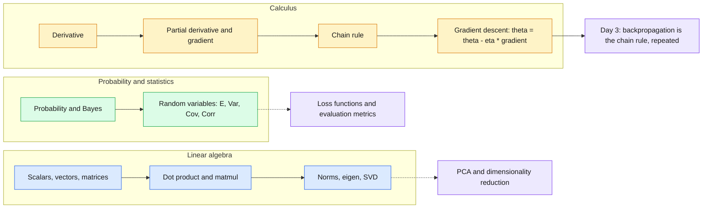
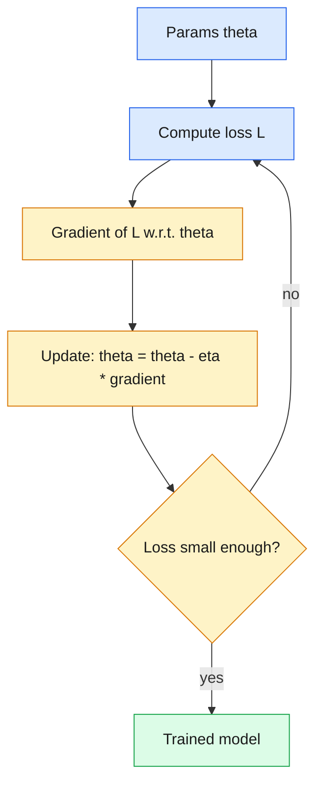

# 05 — ML Mathematics: Linear Algebra, Probability/Statistics, Calculus

> Three languages power all of ML: linear algebra represents data, probability handles uncertainty, calculus explains how models learn.

| | |
|---|---|
| **Day** | 1 — Python + Data + Math |
| **Topic** | 05 — ML mathematics: linear algebra, probability/statistics, calculus |
| **Notebooks** | 3 (`01_linear_algebra`, `02_probability_statistics`, `03_calculus_and_gradient_descent`) |
| **Builds on** | [`02_numpy`](../02_numpy/README.md) |
| **Leads to** | Day 2 (regression, PCA, optimization) and Day 3 [`16_backpropagation`](../../day03_deep_learning/16_backpropagation/README.md) |

## 📖 Short forms used in this topic

| Term | Full form | What it is |
|---|---|---|
| **SVD** | Singular Value Decomposition | Factorises any matrix `A = U Σ Vᵀ` (rotate, scale, rotate). |
| **PCA** | Principal Component Analysis | Projects data onto the directions of largest variance (top eigenvectors of the covariance matrix, or via SVD). |
| **MSE** | Mean Squared Error | Average of squared prediction errors; a common regression loss. |
| **SGD** | Stochastic Gradient Descent | Gradient descent using random mini-batches (samples) to estimate the gradient. |
| **CLT** | Central Limit Theorem | Averages of many independent samples tend toward a normal distribution. |
| **L2** | L2 norm / L2 regularization | Euclidean length `‖v‖₂`; as a penalty it adds the squared weights to the loss. |
| **ML** | Machine Learning | Building models that learn from data. |
| **E[X]** | Expected value | Probability-weighted average of a random variable. |
| **Var / Cov / Corr** | Variance / Covariance / Correlation | Spread, joint spread, and covariance scaled to `[-1, 1]`. |
| **P(A\|B)** | Conditional probability | Probability of A given B happened. |
| **θ** | Theta | The model's parameters. |
| **η** | Eta | Learning rate: the gradient-descent step size. |
| **∇L** | Gradient of the loss | Vector of partial derivatives of the loss `L` w.r.t. each parameter. |
| **λ, v** | Eigenvalue, eigenvector | `A v = λ v`: a direction `v` that `A` only scales, by `λ`. |
| **f'(x)** | Derivative | Instantaneous rate of change of `f`. |

## 🧠 In plain words

Linear algebra is how we store and transform data (vectors and matrices). Probability and statistics describe what is uncertain and how to update beliefs from evidence. Calculus tells us how a small change in a model's parameters changes its error, which is exactly what gradient descent uses to improve the model.

## 🎒 Analogy to remember

Training a model is **hiking down a foggy mountain**. Linear algebra is the **map coordinates** (where you are, as a vector). Calculus is the **slope under your feet** (the gradient says which way is uphill, so you step the other way). Probability is your **confidence about what the fog hides**.
*Where it breaks down:* real loss surfaces have millions of dimensions, saddle points and noisy gradients - the 2-D mountain is only intuition.

## Learning objectives

By the end of this topic you can:
- Explain scalars/vectors/matrices/tensors and compute dot products, matrix multiplication, transpose, and norms.
- State what eigenvalues/eigenvectors and SVD represent at an intuitive level and where they show up in ML (PCA, dimensionality reduction).
- Apply Bayes' theorem and reason about expected value, variance, covariance, and correlation.
- Compute a derivative, partial derivative, and gradient by hand for a small function, and connect that to gradient descent.

## Why it matters

Every ML algorithm is linear algebra (data representation and transformations), probability
(uncertainty, loss functions like cross-entropy, Bayesian models), and calculus (how a model
learns, via gradients). Backpropagation in `16_backpropagation` on Day 3 is nothing more than
the chain rule applied repeatedly — if that's solid here, backprop won't feel like magic there.

## Prerequisites

[`02_numpy`](../02_numpy/README.md) — every concept here is implemented with NumPy.

## Core concepts

### Linear algebra
- **Scalars/vectors/matrices/tensors**: 0D/1D/2D/N-D numeric objects.
- **Dot product**: `u · v = Σ uᵢvᵢ` — a measure of alignment between two vectors; the core operation inside every linear layer.
- **Matrix multiplication**: composing linear transformations; `(m,n) @ (n,p) -> (m,p)`.
- **Transpose**: flipping rows/columns; used constantly to make shapes line up for matmul.
- **Norms**: `‖v‖₂` (Euclidean length) — used in regularization (L2) and distance metrics.
- **Eigenvalues/eigenvectors**: directions a matrix only *scales* (doesn't rotate) — the basis for PCA.
- **SVD (concept)**: decomposes any matrix into rotation-scale-rotation (`U Σ Vᵗ`) — underlies PCA, dimensionality reduction, and recommender systems.

### Probability & statistics
- **Probability, conditional probability, Bayes' theorem**: `P(A|B) = P(B|A)P(A) / P(B)` — the basis of generative models and many evaluation metrics.
- **Random variables & distributions**: a random variable maps outcomes to numbers; common distributions (normal, Bernoulli, binomial) model different kinds of uncertainty.
- **Expected value, variance, covariance, correlation**: the mean, spread, and joint-spread of a distribution — correlation is covariance normalized to `[-1, 1]`.
- **Sampling**: drawing data from a distribution — the basis of train/test splitting, bootstrapping, and stochastic gradient descent's "stochastic" part.

### Calculus
- **Derivative**: instantaneous rate of change — "if I nudge the input, how much does the output move?"
- **Partial derivative**: derivative with respect to one variable, holding others fixed — needed once a function has more than one input (every model parameter).
- **Gradient**: the vector of all partial derivatives — points in the direction of steepest increase.
- **Chain rule**: `d/dx f(g(x)) = f'(g(x)) · g'(x)` — the single rule that makes backpropagation possible.
- **Gradient descent**: repeatedly stepping *against* the gradient to minimize a function — `θ ← θ - η∇L(θ)`.

## 🔍 Concepts explained

**Category chips:** 🟦 Linear algebra · 🟩 Probability and statistics · 🟧 Calculus · 🟥 Pitfalls

### 🟦 Linear algebra

| Object | Dimensions | Example | ML use |
|---|---|---|---|
| Scalar | 0-D | `3.0` | learning rate, loss value |
| Vector | 1-D | `(n,)` | one sample's features, embedding |
| Matrix | 2-D | `(m, n)` | batch of samples, weights |
| Tensor | N-D | `(b, h, w, c)` | images, sequences |

**Dot product**
- **Definition:** `u · v = Σ uᵢvᵢ`; equals `‖u‖‖v‖cosθ`.
- **Analogy:** how much two arrows point the same way.
- **Use when / watch out:** similarity, every linear layer; scale-dependent unless vectors are normalised.

**Matrix multiplication**
- **Definition:** `(m,n) @ (n,p) -> (m,p)`; composes linear transformations.
- **Watch out:** not commutative (`AB != BA` in general); `(AB)ᵀ = BᵀAᵀ`.

**Norms**
- **Definition:** `‖v‖₂ = sqrt(Σ vᵢ²)`, the length; `‖v‖₁ = Σ |vᵢ|`.
- **Use when / watch out:** L2 for distances and weight decay; L1 encourages sparsity.

**Eigen-decomposition and SVD**

| | Eigen-decomposition | SVD |
|---|---|---|
| Applies to | square matrices (best: symmetric, e.g. covariance) | any matrix, any shape |
| Form | `A = V Λ V⁻¹` | `A = U Σ Vᵀ` |
| Meaning | directions only scaled by `A` | rotate, scale, rotate |
| ML use | PCA via covariance matrix | PCA, low-rank approximation, recommenders |

- **Analogy:** a stretchy sheet - eigenvectors are the directions that only stretch, never twist.

### 🟩 Probability and statistics

**Bayes' theorem**
- **Definition:** `P(A|B) = P(B|A) P(A) / P(B)`; update a prior with evidence.
- **Analogy:** a detective revising a suspect list after each clue.
- **Use when / watch out:** diagnostic tests. A 99%-accurate test for a rare condition still yields mostly false positives because the **base rate** `P(A)` is tiny.

| Measure | Formula | Reads as | Pitfall |
|---|---|---|---|
| Expected value | `E[X] = Σ x·P(x)` | long-run average | can be a value never observed |
| Variance | `E[(X - E[X])²]` | average squared spread | units are squared; use std |
| Covariance | `E[(X - μx)(Y - μy)]` | do they move together | scale-dependent |
| Correlation | `Cov(X,Y) / (σx σy)` in `[-1, 1]` | scale-free linear association | misses non-linear links; not causation |

| Distribution | Models | Parameters |
|---|---|---|
| Bernoulli | one yes/no trial | `p` |
| Binomial | number of successes in `n` trials | `n`, `p` |
| Normal | many natural measurements, averages (CLT) | mean, std |

### 🟧 Calculus

| Concept | Definition | Role in ML |
|---|---|---|
| Derivative `f'(x)` | slope / rate of change | sensitivity of loss to one input |
| Partial derivative | derivative w.r.t. one variable, others fixed | sensitivity to one parameter |
| Gradient `∇L` | vector of all partials; points to steepest **increase** | direction to move **against** |
| Chain rule | `d/dx f(g(x)) = f'(g(x))·g'(x)` | backpropagation |
| Gradient descent | `θ ← θ - η∇L(θ)` | the learning step |

> [!WARNING]
> Learning rate `η` too small is slow; too large oscillates or diverges. Zero gradient only means a **critical point** (minimum, maximum or saddle).

> [!IMPORTANT]
> Backpropagation is the chain rule applied repeatedly through the computation graph - nothing more.

> [!TIP]
> Sanity check any hand-derived gradient with a finite difference: `(f(x+h) - f(x-h)) / 2h` should match closely.

## Important APIs / functions

`np.dot`, `@`, `.T`, `np.linalg.norm`, `np.linalg.eig`, `np.linalg.svd`, `np.random.default_rng`,
`scipy.stats` (optional), manual finite-difference derivatives, a from-scratch gradient-descent
loop.

## Notebooks

| Notebook | Purpose | Expected output |
|---|---|---|
| `01_linear_algebra.ipynb` | Scalars→tensors, dot product, matmul, transpose, norms, eigenvalues/eigenvectors, SVD intuition via a tiny PCA-by-hand example | Verified matmul shapes; eigen-decomposition reconstructing the original matrix; a 2D dataset reduced to 1D via its top eigenvector, visualized |
| `02_probability_statistics.ipynb` | Probability, conditional probability, Bayes' theorem, distributions, expected value/variance/covariance/correlation, sampling | A worked Bayes' theorem example (e.g. a diagnostic-test false-positive scenario); empirical mean/variance from sampled data matching theoretical values within tolerance |
| `03_calculus_and_gradient_descent.ipynb` | Derivative → partial derivative → gradient → chain rule, via manual numerical approximation, then a from-scratch gradient descent on a simple quadratic/MSE loss | A numeric gradient matching an analytic gradient within tolerance; a loss curve that monotonically decreases over gradient descent steps |

Each notebook follows: intuition → equation → small example → Python → ML usage, per the
curriculum's math-topic format.

## Key takeaways

- Matrix multiplication shape rule (`(m,n)@(n,p)->(m,p)`) is the same rule from `02_numpy`'s tensor-shape reasoning — math and code share one mental model here.
- Bayes' theorem is "update your belief given new evidence" — it underlies both generative models and why a rare-disease test with 99% accuracy can still be mostly wrong on positives (base-rate fallacy).
- The gradient always points toward steepest *increase*; gradient descent subtracts it to decrease the loss.
- The chain rule applied repeatedly through a computation graph *is* backpropagation — no extra magic.

## Common mistakes

- Confusing correlation with causation.
- Forgetting the base rate when applying Bayes' theorem (ignoring `P(A)`).
- Assuming a higher learning rate always converges faster — too high can diverge or oscillate.
- Mixing up when a derivative is zero (critical point: could be min, max, *or* saddle point) with "this is the minimum."

## Interview questions

**Conceptual**
1. Why does matrix multiplication require the inner dimensions to match, and what does the result's shape represent?
2. State Bayes' theorem and give an example where ignoring the base rate leads to a wrong conclusion.
3. What is the relationship between the gradient and the direction of steepest ascent/descent?
4. Why is the chain rule essential for training a multi-layer neural network?
5. What do eigenvectors of a covariance matrix represent in PCA?

**Coding**
1. Implement matrix multiplication from scratch with nested loops, then verify it matches `@`.
2. Implement a numerical gradient (finite differences) for a function of two variables and compare it to the analytic gradient.
3. Implement gradient descent from scratch to minimize `f(x) = (x - 3)^2` and verify it converges near `x=3`.

**Debugging**
1. Your from-scratch gradient descent loop's loss is increasing instead of decreasing — what's the most likely bug?
2. A Bayes' theorem calculation gives a probability greater than 1 — what's almost certainly wrong?

**Real-world engineering**
1. You want to reduce a 100-feature dataset to 10 features while preserving as much variance as possible — what technique do you reach for, and what's it built on?
2. Your gradient descent training loss oscillates wildly instead of smoothly decreasing — what hyperparameter would you check first, and why?

## Exercises

1. Verify by hand (then in code) that `(A @ B).T == B.T @ A.T` for two small matrices.
2. Compute the eigenvalues/eigenvectors of a 2x2 covariance matrix and verify `A @ v == λ * v` for each eigenpair.
3. Simulate 10,000 draws of two correlated normal variables and verify the empirical correlation matches the one you specified.
4. Extend the gradient descent notebook to minimize a 2-variable function and plot the (x, y, loss) trajectory.

## References

- [3Blue1Brown — Essence of Linear Algebra](https://www.3blue1brown.com/topics/linear-algebra)
- [3Blue1Brown — Essence of Calculus](https://www.3blue1brown.com/topics/calculus)
- [Stanford CS229 — Linear Algebra Review](https://cs229.stanford.edu/section/cs229-linalg.pdf)
- [NumPy docs — `linalg`](https://numpy.org/doc/stable/reference/routines.linalg.html)
