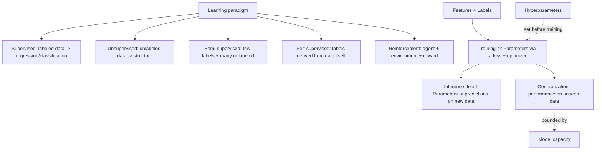

# 06 — ML Fundamentals

## Learning objectives

By the end of this topic you can:
- Distinguish supervised, unsupervised, semi-supervised, self-supervised, and reinforcement learning, with an example of each.
- Define features, labels, parameters, and hyperparameters precisely enough to not confuse them in an interview.
- Explain training vs inference and why they use the model differently.
- Explain generalization and model capacity, and why neither "more capacity" nor "less capacity" is universally better.

## Why it matters

This is the vocabulary the rest of Day 2 and Day 3 assume. Every later topic ("regularization",
"hyperparameter tuning", "overfitting") is meaningless without a precise handle on
parameters vs hyperparameters and training vs inference.

## Prerequisites

Day 1 complete, especially [`05_ml_mathematics`](../../day01_python_data_math/05_ml_mathematics/README.md)
(gradient descent) and [`04_datasets`](../../day01_python_data_math/04_datasets/README.md) (splits).

## Core concepts

- **Supervised learning**: learn a mapping from features to known labels (regression, classification).
- **Unsupervised learning**: find structure in unlabeled data (clustering, dimensionality reduction).
- **Semi-supervised learning**: a small amount of labeled data plus a large amount of unlabeled data.
- **Self-supervised learning**: labels are derived automatically from the data itself (e.g. predict a masked word) — the basis of most modern LLM pretraining.
- **Reinforcement learning**: an agent learns by interacting with an environment and receiving rewards, not from a fixed labeled dataset.
- **Features**: the inputs a model sees. **Labels**: the supervised target. **Parameters**: values the model *learns* from data (e.g. weights `w`, bias `b`). **Hyperparameters**: values a human (or a search) sets *before* training that control how learning happens (e.g. learning rate, number of trees, `k` in k-NN).
- **Training vs inference**: training updates parameters using labeled data and a loss function; inference uses the already-trained, now-fixed parameters to make predictions on new data.
- **Generalization**: how well a model performs on data it did *not* train on — the entire point of ML.
- **Model capacity**: how complex a function class a model can represent — too little capacity underfits; too much, without enough data/regularization, overfits (formalized in `11_generalization`).

## Important APIs / functions

No new APIs yet — this topic is purely conceptual, anchored with small `scikit-learn` examples
(`sklearn.linear_model.LinearRegression`, `sklearn.cluster.KMeans`) to make each paradigm concrete.

## Notebooks

| Notebook | Purpose | Expected output |
|---|---|---|
| `01_ml_fundamentals.ipynb` | One small, runnable example per learning paradigm; an explicit parameters-vs-hyperparameters worked example; a training-vs-inference walkthrough; a capacity/generalization demo (underfit vs good fit vs overfit on the same data) | Side-by-side plots of underfit/good-fit/overfit polynomial regression on one synthetic dataset; a clustering example (unsupervised) on the same kind of data |

## Key takeaways

- If you can't say whether a given value is a *parameter* or a *hyperparameter*, you don't yet understand that model.
- Self-supervised learning (not supervised or unsupervised in the classic sense) is how most large language models are pretrained — labels come from masking/predicting parts of the input itself.
- Generalization, not training performance, is what you should always report and optimize for.

## Common mistakes

- Calling a hyperparameter a parameter (or vice versa) — e.g. saying "the model's parameter `k`" for k-NN's `k`, which is actually a hyperparameter.
- Judging a model by training-set performance alone.
- Assuming "higher capacity model" always means "better model."

## Interview questions

**Conceptual**
1. Give one concrete example each of supervised, unsupervised, self-supervised, and reinforcement learning.
2. What's the precise difference between a parameter and a hyperparameter?
3. Why can a model have excellent training performance and terrible generalization?
4. What changes between training and inference, computationally?
5. Why is self-supervised learning especially important for training large language models?

**Coding**
1. Fit a `LinearRegression` and print its learned parameters (`.coef_`, `.intercept_`) vs the hyperparameters you set when constructing it.
2. Generate polynomial features of increasing degree and fit a linear model on each, plotting training error vs degree.
3. Implement a simple self-supervised task: predict a masked element of a short synthetic sequence from its neighbors.

**Debugging**
1. A model gets 99.9% training accuracy and 60% validation accuracy — name the phenomenon and two likely causes.
2. You tuned a hyperparameter using the test set and got a great test score — why is this score untrustworthy going forward?

**Real-world engineering**
1. You have 1,000,000 unlabeled images and 500 labeled ones — which learning paradigm(s) would you consider, and why?
2. Your production model needs predictions in under 10ms — what does that imply about training vs inference compute budgets?

## Exercises

1. Build a synthetic dataset and fit three polynomial regressions (degree 1, 4, 15); plot and label which is underfit, good-fit, and overfit.
2. List, for `KMeans(n_clusters=3)`, every hyperparameter and every learned parameter after `.fit()`.
3. Write one sentence each distinguishing semi-supervised from self-supervised learning, then find one real example of each from memory or a quick reference check.

## References

- [scikit-learn — An introduction to ML](https://scikit-learn.org/stable/tutorial/basic/tutorial.html)
- [Stanford CS229 — Lecture notes, supervised learning](https://cs229.stanford.edu/notes2022fall/)
- [Google ML Crash Course — Framing](https://developers.google.com/machine-learning/crash-course)
