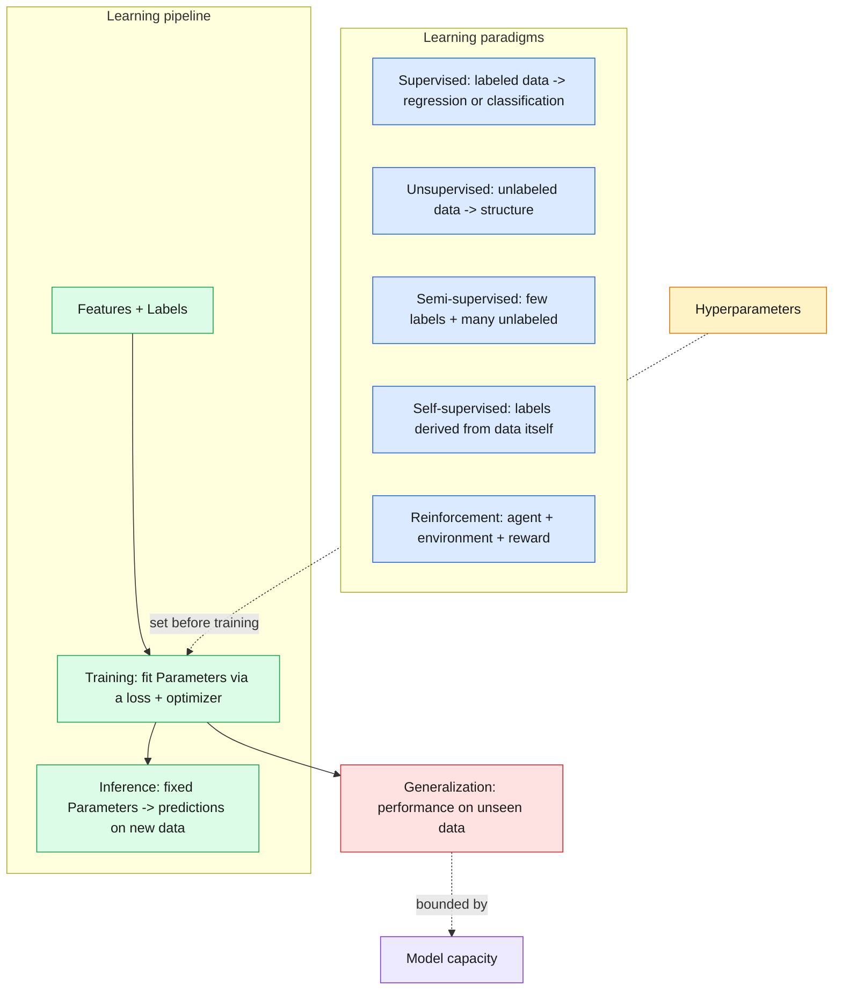

# 06 — ML Fundamentals

> The shared vocabulary of machine learning: how models learn, what they learn, and why "works on training data" is not enough.

| | |
|---|---|
| **Day** | 2 — Machine Learning |
| **Topic** | Learning paradigms, parameters vs hyperparameters, training vs inference, capacity |
| **Notebooks** | [`01_ml_fundamentals.ipynb`](01_ml_fundamentals.ipynb) |
| **Builds on** | Day 1 — [`05_ml_mathematics`](../../day01_python_data_math/05_ml_mathematics/README.md), [`04_datasets`](../../day01_python_data_math/04_datasets/README.md) |
| **Leads to** | [`07_regression`](../07_regression/README.md), [`11_generalization`](../11_generalization/README.md) |

## 📖 Short forms used in this topic

| Term | Full form | What it is |
|---|---|---|
| **ML** | Machine Learning | Learning patterns from data to make predictions, instead of hand-coding rules. |
| **RL** | Reinforcement Learning | An agent learns by trial and error from a (possibly delayed) reward signal. |
| **LLM** | Large Language Model | Very large Transformer trained on text to predict the next token (e.g. GPT). |
| **MSE** | Mean Squared Error | Average of squared prediction errors; the standard regression loss. |
| **API** | Application Programming Interface | The functions/classes a library exposes (e.g. scikit-learn's `fit` / `predict`). |
| **k-NN** | k-Nearest Neighbors | Predicts from the `k` closest training points; `k` is a hyperparameter. |

## 🧠 In plain words

Machine learning is writing programs that *learn their behaviour from examples* instead of being hand-coded. A model has internal numbers (**parameters**) that are tuned during **training** to fit data; you choose the settings of that tuning process (**hyperparameters**) yourself. Afterwards, **inference** applies the frozen parameters to new data. A good model **generalizes**: it works on data it has never seen.

## 🎒 Analogy to remember

Learning to cook from recipes-with-tasting. The **parameters** are the exact amounts of salt, sugar and spice you settle on by tasting (learned). The **hyperparameters** are how you practise: how many dishes you cook, how big each adjustment is (set beforehand). **Training** is practising in your kitchen; **inference** is serving a new guest. **Overfitting** is perfecting a dish for one friend's taste so it flops with everyone else.
*Where it breaks:* a cook adjusts by feel; ML adjusts by minimizing a numeric loss.

## Learning objectives

By the end of this topic you can:
- Distinguish supervised, unsupervised, semi-supervised, self-supervised, and reinforcement learning, with an example of each.
- Define features, labels, parameters, and hyperparameters precisely enough to not confuse them in an interview.
- Explain training vs inference and why they use the model differently.
- Explain generalization and model capacity, and why neither "more capacity" nor "less capacity" is universally better.

## Why it matters

This is the vocabulary the rest of Day 2 and Day 3 assume. Every later topic ("regularization",
"hyperparameter tuning", "overfitting") is meaningless without a precise handle on
parameters vs hyperparameters and training vs inference.

## Prerequisites

Day 1 complete, especially [`05_ml_mathematics`](../../day01_python_data_math/05_ml_mathematics/README.md)
(gradient descent) and [`04_datasets`](../../day01_python_data_math/04_datasets/README.md) (splits).

## Core concepts

- **Supervised learning**: learn a mapping from features to known labels (regression, classification).
- **Unsupervised learning**: find structure in unlabeled data (clustering, dimensionality reduction).
- **Semi-supervised learning**: a small amount of labeled data plus a large amount of unlabeled data.
- **Self-supervised learning**: labels are derived automatically from the data itself (e.g. predict a masked word) — the basis of most modern LLM pretraining.
- **Reinforcement learning**: an agent learns by interacting with an environment and receiving rewards, not from a fixed labeled dataset.
- **Features**: the inputs a model sees. **Labels**: the supervised target. **Parameters**: values the model *learns* from data (e.g. weights `w`, bias `b`). **Hyperparameters**: values a human (or a search) sets *before* training that control how learning happens (e.g. learning rate, number of trees, `k` in k-NN).
- **Training vs inference**: training updates parameters using labeled data and a loss function; inference uses the already-trained, now-fixed parameters to make predictions on new data.
- **Generalization**: how well a model performs on data it did *not* train on — the entire point of ML.
- **Model capacity**: how complex a function class a model can represent — too little capacity underfits; too much, without enough data/regularization, overfits (formalized in `11_generalization`).

## 🔍 Concepts explained

### Learning paradigms

| Chip | Paradigm | Data it needs | Typical task | Pitfall |
|---|---|---|---|---|
| 🟦 | Supervised | Features + labels | Regression, classification | Labels are expensive |
| 🟩 | Unsupervised | Features only | Clustering, dimensionality reduction | No single "right answer" to validate against |
| 🟨 | Semi-supervised | Few labels + many unlabeled | Image/text with scarce labels | Poor labels can propagate errors |
| 🟪 | Self-supervised | Raw data (labels made from it) | LLM pretraining (masked/next-token prediction) | Needs huge data and compute |
| 🟥 | Reinforcement | Environment + reward signal | Games, robotics, policy tuning | Sparse/delayed rewards, unstable training |

> [!NOTE]
> Self-supervised is *not* classic unsupervised: it does have a prediction target, but the target is generated from the data automatically.

### 🟦 Supervised learning
- **Definition:** learn `f(features) -> label` from examples with known answers.
- **Analogy:** studying with an answer key.
- **Code idea:** `LinearRegression().fit(X, y)` then `.predict(X_new)`.
- **Use when / watch out:** you have trustworthy labels; evaluate on held-out data, not training data.

### 🟩 Unsupervised learning
- **Definition:** find structure in data without labels.
- **Analogy:** sorting a pile of unlabeled photos into piles by similarity.
- **Code idea:** `KMeans(n_clusters=3).fit(data)` gives `.labels_` and `.cluster_centers_`.
- **Use when / watch out:** exploring data; cluster count and meaning are your judgement.

### 🟪 Self-supervised learning
- **Definition:** hide part of the input and predict it from the rest; the hidden part is the label.
- **Analogy:** fill-in-the-blank exercises made from any book.
- **Code idea:** from a sequence, use neighbours `[seq[i-1], seq[i+1]]` to predict `seq[i]` (as in the notebook).
- **Use when / watch out:** lots of raw data and no labels; basis of LLM pretraining.

### 🟥 Reinforcement learning
- **Definition:** an agent acts in an environment and learns to maximize cumulative reward.
- **Analogy:** training a dog with treats; the reward may come long after the action.
- **Use when / watch out:** sequential decisions; covered conceptually here only.

### Parameters vs hyperparameters

| Chip | Kind | Who sets it | When | Examples |
|---|---|---|---|---|
| 🟦 | Parameter | The training algorithm | During training | `coef_`, `intercept_`, K-means `cluster_centers_` |
| 🟧 | Hyperparameter | You (or a search) | Before training | learning rate, `n_clusters`, polynomial `degree`, `k` in k-NN |

- **Analogy:** parameters are the recipe amounts you converge on; hyperparameters are the cooking method you chose first.
- **Watch out:** if you tune hyperparameters on the test set, the test score is no longer trustworthy.

### Training vs inference

| | Training | Inference |
|---|---|---|
| Uses loss and optimizer | Yes | No |
| Parameters | Updated | Fixed |
| Cost profile | Heavy, offline | Latency-sensitive, repeated |
| Code | `.fit(X, y)` | `.predict(X_new)` |

### Generalization and capacity
- **Definition:** generalization is performance on unseen data; capacity is how complex a function the model can represent.
- **Analogy:** a student who memorizes past exam answers (high capacity, no understanding) versus one who learns the method.
- **Formula/Code idea:** compare training vs validation error as polynomial `degree` grows (1, 4, 15 in the notebook).
- **Use when / watch out:** too little capacity underfits; too much overfits without data or regularization.

> [!WARNING]
> The lowest training error (degree 15) is the *worst* generalizer in the notebook's demo. Never judge by training error alone.

> [!TIP]
> Interview shortcut: if you can say who sets a value (algorithm or you), you know whether it is a parameter or a hyperparameter.

## Important APIs / functions

No new APIs yet — this topic is purely conceptual, anchored with small `scikit-learn` examples
(`sklearn.linear_model.LinearRegression`, `sklearn.cluster.KMeans`) to make each paradigm concrete.

## Notebooks

| Notebook | Purpose | Expected output |
|---|---|---|
| `01_ml_fundamentals.ipynb` | One small, runnable example per learning paradigm; an explicit parameters-vs-hyperparameters worked example; a training-vs-inference walkthrough; a capacity/generalization demo (underfit vs good fit vs overfit on the same data) | Side-by-side plots of underfit/good-fit/overfit polynomial regression on one synthetic dataset; a clustering example (unsupervised) on the same kind of data |

## Key takeaways

- If you can't say whether a given value is a *parameter* or a *hyperparameter*, you don't yet understand that model.
- Self-supervised learning (not supervised or unsupervised in the classic sense) is how most large language models are pretrained — labels come from masking/predicting parts of the input itself.
- Generalization, not training performance, is what you should always report and optimize for.

## Common mistakes

- Calling a hyperparameter a parameter (or vice versa) — e.g. saying "the model's parameter `k`" for k-NN's `k`, which is actually a hyperparameter.
- Judging a model by training-set performance alone.
- Assuming "higher capacity model" always means "better model."

## Interview questions

**Conceptual**
1. Give one concrete example each of supervised, unsupervised, self-supervised, and reinforcement learning.
2. What's the precise difference between a parameter and a hyperparameter?
3. Why can a model have excellent training performance and terrible generalization?
4. What changes between training and inference, computationally?
5. Why is self-supervised learning especially important for training large language models?

**Coding**
1. Fit a `LinearRegression` and print its learned parameters (`.coef_`, `.intercept_`) vs the hyperparameters you set when constructing it.
2. Generate polynomial features of increasing degree and fit a linear model on each, plotting training error vs degree.
3. Implement a simple self-supervised task: predict a masked element of a short synthetic sequence from its neighbors.

**Debugging**
1. A model gets 99.9% training accuracy and 60% validation accuracy — name the phenomenon and two likely causes.
2. You tuned a hyperparameter using the test set and got a great test score — why is this score untrustworthy going forward?

**Real-world engineering**
1. You have 1,000,000 unlabeled images and 500 labeled ones — which learning paradigm(s) would you consider, and why?
2. Your production model needs predictions in under 10ms — what does that imply about training vs inference compute budgets?

## Exercises

1. Build a synthetic dataset and fit three polynomial regressions (degree 1, 4, 15); plot and label which is underfit, good-fit, and overfit.
2. List, for `KMeans(n_clusters=3)`, every hyperparameter and every learned parameter after `.fit()`.
3. Write one sentence each distinguishing semi-supervised from self-supervised learning, then find one real example of each from memory or a quick reference check.

## References

- [scikit-learn — An introduction to ML](https://scikit-learn.org/stable/tutorial/basic/tutorial.html)
- [Stanford CS229 — Lecture notes, supervised learning](https://cs229.stanford.edu/notes2022fall/)
- [Google ML Crash Course — Framing](https://developers.google.com/machine-learning/crash-course)
