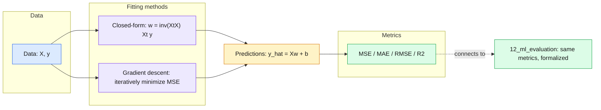
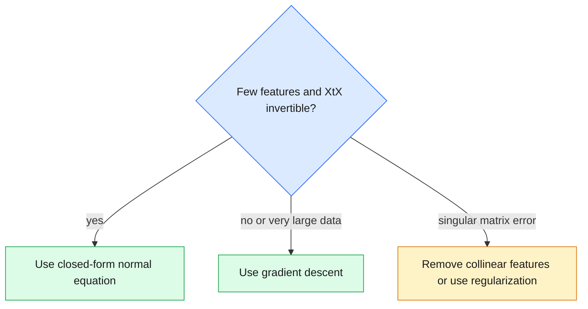

# 07 — Regression

> Fit a line (or hyperplane) to numbers, then measure how wrong it is — the cleanest end-to-end ML pipeline.

| At a glance | |
|---|---|
| **Day** | Day 2 — Machine Learning |
| **Topic** | Linear and multiple regression, regression metrics |
| **Notebooks** | 2 (`01_linear_regression_numpy`, `02_linear_regression_sklearn`) |
| **Builds on** | [`06_ml_fundamentals`](../06_ml_fundamentals/README.md), Day 1 `05_ml_mathematics` (gradient descent) |
| **Leads to** | [`08_classification`](../08_classification/README.md), [`12_ml_evaluation`](../12_ml_evaluation/README.md) |

## 📖 Short forms used in this topic

| Term | Full form | What it is |
|---|---|---|
| **MSE** | Mean Squared Error | Average of squared prediction errors; the standard regression loss. |
| **MAE** | Mean Absolute Error | Average of absolute errors; less outlier-sensitive than MSE. |
| **RMSE** | Root Mean Squared Error | Square root of MSE; in the same units as the target. |
| **R²** | Coefficient of determination | Fraction of target variance explained by the model (1 = perfect). |
| **SS_res** | Residual sum of squares | Sum of squared errors of the model: Σ(y − ŷ)². |
| **SS_tot** | Total sum of squares | Sum of squared deviations of y from its mean: Σ(y − ȳ)². |
| **OLS** | Ordinary Least Squares | Fitting weights by minimizing the sum of squared errors. |
| **F1** | F1 score | Harmonic mean of precision and recall (mentioned only as a preview of classification). |

## 🧠 In plain words

Regression predicts a *number* (a price, a temperature) from input features. Linear regression assumes the answer is a weighted sum of the inputs plus a constant, and picks the weights that make the squared errors on the training data as small as possible. You can solve for those weights in one shot with algebra, or find them step by step with gradient descent.

## 🎒 Analogy to remember

Laying a stiff ruler through a scatter of nails on a board so the total *squared* distance from the nails to the ruler is smallest. Far-away nails pull hard on the ruler (squared error), just like outliers pull on a least-squares fit. Where it breaks down: a real ruler is straight in 2-D only; the model generalizes this to a flat hyperplane in many dimensions.

## Learning objectives

By the end of this topic you can:
- Derive and implement linear and multiple linear regression from scratch with NumPy (least squares and gradient descent).
- Fit the same models with scikit-learn and get matching results.
- Compute and interpret MSE, MAE, RMSE, and R².

## Why it matters

Linear regression is the simplest supervised model and the cleanest way to see the full
ML pipeline (fit → predict → evaluate) without an opaque algorithm in the middle. Every
regression metric here (MSE/MAE/RMSE/R²) reappears throughout Day 2 and in real evaluation
dashboards.

## Prerequisites

[`06_ml_fundamentals`](../06_ml_fundamentals/README.md), Day 1's
[`05_ml_mathematics`](../../day01_python_data_math/05_ml_mathematics/README.md) (gradient descent, calculus).

## Core concepts

- **Linear regression**: `ŷ = wx + b` (one feature) or `ŷ = Xw + b` (many features) — fit the
  line/hyperplane that minimizes squared error.
- **Multiple regression**: more than one feature; `X` becomes a matrix, `w` becomes a vector.
- **Least squares (closed-form)**: `w = (XᵗX)⁻¹Xᵗy` — directly solves for the optimal weights
  when `XᵗX` is invertible.
- **Gradient descent**: iteratively approaches the same optimum (useful when the closed-form
  solution doesn't scale or doesn't exist, e.g. non-invertible `XᵗX`).
- **MSE / MAE / RMSE / R²**: MSE punishes large errors more (squared); MAE is robust to outliers
  (absolute); RMSE puts the error back in the original units; R² is the fraction of variance
  explained (1.0 = perfect, 0.0 = no better than predicting the mean).

## 🔍 Concepts explained

> [!NOTE]
> Category chips: 🟦 model/fitting method, 🟩 metric, 🟥 pitfall.

### 🟦 Linear / multiple regression
- **Definition**: predict `ŷ = Xw + b`; one feature gives a line, many give a hyperplane.
- **Analogy**: a recipe where each ingredient (feature) has a fixed price per unit (weight) and `b` is the fixed fee.
- **Code idea**: `LinearRegression().fit(X, y)` then `.coef_`, `.intercept_`.
- **Use when / watch out**: relationship is roughly linear; check residuals for curvature.

### 🟦 Closed-form least squares (normal equation)
- **Definition**: solve `w = (XᵗX)⁻¹Xᵗy` directly, with a column of 1s appended to `X` for the bias.
- **Analogy**: jumping straight to the bottom of a bowl by formula.
- **Code idea**: `np.linalg.inv(Xb.T @ Xb) @ Xb.T @ y`.
- **Use when / watch out**: small/medium feature count. Fails with a singular `XᵗX` (collinear features).

### 🟦 Gradient descent
- **Definition**: repeatedly step the weights against the MSE gradient: `∂MSE/∂w = (2/n) Xᵗ(Xw+b−y)`.
- **Analogy**: walking downhill in fog, feeling the slope under your feet.
- **Code idea**: `w -= lr * grad_w; b -= lr * grad_b`.
- **Use when / watch out**: general-purpose (also used for neural nets); too large a learning rate diverges.

### 🟩 Regression metrics
- **MSE**: `mean((ŷ−y)²)`. Analogy: a fine that grows with the square of the miss. Use as a loss; sensitive to outliers.
- **MAE**: `mean(|ŷ−y|)`. Analogy: average miss distance. Robust to outliers.
- **RMSE**: `sqrt(MSE)`. Back in the target's units, easiest to explain.
- **R²**: `1 − SS_res/SS_tot`. Analogy: score vs. a lazy student who always guesses the average. 0 means no better than the mean; negative means worse.

### Differences at a glance

| Option | Group | Key property | Use when | Pitfall |
|---|---|---|---|---|
| Closed form | 🟦 | Exact answer in one step | Few features, `XᵗX` invertible | Singular matrix with collinear columns; costly for many features |
| Gradient descent | 🟦 | Iterative, general | Large data or non-closed-form models | Learning rate/convergence tuning |
| MSE | 🟩 | Squares errors | Optimization loss | Dominated by outliers; units are squared |
| MAE | 🟩 | Absolute errors | Reporting typical error, outliers present | Less smooth to optimize |
| RMSE | 🟩 | Units of the target | Stakeholder reporting | Still outlier-sensitive; not comparable across datasets with different scales |
| R² | 🟩 | Unitless, 1 is perfect | Quick quality read | Can be negative on test data; hides outlier skew |

> [!WARNING]
> 🟥 Forgetting the intercept in a from-scratch fit makes it underperform scikit-learn, which includes one by default.

> [!TIP]
> Always inspect residuals (residuals vs predictions plot): they should look like random noise centred near 0.

Decision flow for choosing a fitting method:

## Important APIs / functions

NumPy: `np.linalg.inv`, `@`, manual gradient loop (from `05_ml_mathematics`).
scikit-learn: `sklearn.linear_model.LinearRegression`, `sklearn.metrics.mean_squared_error`,
`mean_absolute_error`, `r2_score`.

## Notebooks

| Notebook | Purpose | Expected output |
|---|---|---|
| `01_linear_regression_numpy.ipynb` | Linear + multiple regression from scratch: closed-form least squares AND gradient descent, on synthetic data | Learned weights matching the true generating weights within tolerance; closed-form and gradient-descent solutions agreeing with each other |
| `02_linear_regression_sklearn.ipynb` | The same data fit with `sklearn.linear_model.LinearRegression`; MSE/MAE/RMSE/R² computed and interpreted; a comparison table against the from-scratch results | scikit-learn's learned coefficients matching the from-scratch closed-form solution within floating-point tolerance |

## Key takeaways

- The closed-form least-squares solution and gradient descent converge to (approximately) the same answer — gradient descent is the general-purpose tool that also works when the closed form doesn't (e.g. in neural networks).
- R² can be negative on test data — it means the model is worse than just predicting the mean.
- Always report the metric in context: RMSE in the target's original units is much easier for stakeholders to interpret than raw MSE.

## Common mistakes

- Reporting only R² without also showing residuals/MAE — R² can mask the fact that a model is skewed by a few outliers.
- Forgetting to add a bias/intercept term and being confused why a NumPy from-scratch fit underperforms scikit-learn's default (which includes an intercept).
- Confusing MSE (useful for optimization, sensitive to outliers) with MAE (useful for reporting typical error, robust to outliers) and using the wrong one for the situation.

## Interview questions

**Conceptual**
1. Derive (at a high level) why minimizing squared error leads to the normal equation `w = (XᵗX)⁻¹Xᵗy`.
2. When would gradient descent be preferred over the closed-form solution?
3. What does an R² of 0 mean? Can R² be negative, and what does that indicate?
4. Why is RMSE more interpretable than MSE in a business report?
5. Why is MAE more robust to outliers than MSE?

**Coding**
1. Implement least-squares regression from scratch using the normal equation and verify it matches `sklearn.linear_model.LinearRegression`.
2. Implement gradient descent for multiple linear regression (2+ features) and verify convergence to the closed-form solution.
3. Compute MSE, MAE, RMSE, and R² from raw predictions and true values without using `sklearn.metrics`.

**Debugging**
1. Your from-scratch gradient descent for linear regression diverges (loss grows) — what are the two most likely causes?
2. Your closed-form solution throws a `LinAlgError: Singular matrix` — what does that imply about your features?

**Real-world engineering**
1. You're predicting house prices and a few mansions are 100x the median price — how would MSE vs MAE change your model's behavior, and which would you choose?
2. Your feature matrix has two nearly-identical (collinear) columns — why might this break the closed-form solution, and what's a practical fix?

## Exercises

1. Generate `y = 3x1 - 2x2 + 5 + noise`; recover `w ≈ [3, -2]` and `b ≈ 5` via both closed-form and gradient descent.
2. Compute MSE/MAE/RMSE/R² for a model that always predicts the mean of `y`, and verify R² ≈ 0.
3. Add a single extreme outlier to your dataset and compare how much MSE vs MAE change.

## References

- [scikit-learn — Linear Models](https://scikit-learn.org/stable/modules/linear_model.html)
- [Stanford CS229 — Linear Regression notes](https://cs229.stanford.edu/notes2022fall/cs229-notes1.pdf)
- [scikit-learn — Regression metrics](https://scikit-learn.org/stable/modules/model_evaluation.html#regression-metrics)
