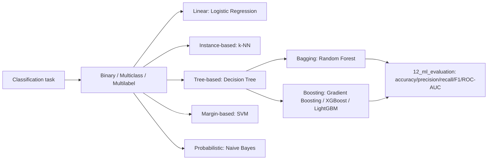

# 08 — Classification

## Learning objectives

By the end of this topic you can:
- Distinguish binary, multiclass, and multilabel classification.
- Fit and reason about logistic regression, k-NN, decision trees, random forests, gradient boosting, XGBoost, LightGBM, SVM, and Naive Bayes.
- For each algorithm, state what it does, how it works, when to use it, its strengths/weaknesses, and common failure cases.

## Why it matters

Classification is the most common supervised-learning task in production ML (spam detection,
fraud, churn, intent classification). Knowing *when* to reach for logistic regression vs a
gradient-boosted tree vs an SVM — and why — is a staple interview topic and a real engineering
decision with cost/latency/interpretability tradeoffs.

## Prerequisites

[`07_regression`](../07_regression/README.md) (the same fit/predict/evaluate pipeline, now with
a categorical target).

## Core concepts

- **Binary / multiclass / multilabel**: binary = 2 classes; multiclass = >2 mutually exclusive classes; multilabel = each sample can belong to multiple classes simultaneously.
- **Logistic regression**: linear regression's output passed through a sigmoid, trained with log-loss — *what*: a linear decision boundary with probabilistic output. *How*: gradient descent on cross-entropy loss. *When*: interpretable baseline, linearly (or near-linearly) separable data. *Strengths*: fast, interpretable, probabilistic output. *Weaknesses*: can't capture non-linear boundaries without manual feature engineering. *Failure case*: XOR-like data that isn't linearly separable.
- **k-NN**: classify by majority vote among the `k` nearest training points. *When*: small datasets, non-linear boundaries, no training phase needed. *Weaknesses*: slow at inference (must scan training data), sensitive to feature scaling and the curse of dimensionality.
- **Decision tree**: recursively split on the feature/threshold that best separates classes. *Strengths*: interpretable, handles non-linear boundaries and mixed feature types. *Weaknesses*: prone to overfitting if unconstrained (unlimited depth).
- **Random forest**: an ensemble of decision trees, each trained on a bootstrap sample with random feature subsets, averaged/voted. *Strengths*: much less overfitting than a single tree, good default performance. *Weaknesses*: less interpretable, slower, larger memory footprint.
- **Gradient boosting**: builds trees sequentially, each correcting the previous ensemble's errors (fits the residual/gradient of the loss). *Strengths*: often the best tabular-data performance. *Weaknesses*: more hyperparameters to tune, easier to overfit than random forest if not careful, slower to train (sequential).
- **XGBoost / LightGBM**: optimized, production-grade gradient boosting implementations — XGBoost is depth-wise with strong regularization controls; LightGBM grows leaf-wise and uses histogram-based splits for speed on large datasets. *When*: large tabular datasets, Kaggle-style competitions, when squeezing out maximum tabular accuracy matters.
- **SVM**: finds the maximum-margin separating hyperplane (optionally using a kernel trick for non-linear boundaries). *Strengths*: effective in high dimensions, strong theoretical guarantees. *Weaknesses*: doesn't scale well to very large datasets, requires careful kernel/hyperparameter choice.
- **Naive Bayes**: applies Bayes' theorem assuming features are conditionally independent given the class. *Strengths*: extremely fast, works surprisingly well for text classification despite the "naive" independence assumption. *Weaknesses*: the independence assumption is usually false, which can bias probability estimates (even when the final classification is still correct).

## Important APIs / functions

`sklearn.linear_model.LogisticRegression`, `sklearn.neighbors.KNeighborsClassifier`,
`sklearn.tree.DecisionTreeClassifier`, `sklearn.ensemble.RandomForestClassifier`,
`sklearn.ensemble.GradientBoostingClassifier`, `xgboost.XGBClassifier`,
`lightgbm.LGBMClassifier`, `sklearn.svm.SVC`, `sklearn.naive_bayes.GaussianNB`,
`sklearn.metrics.accuracy_score/classification_report`.

## Notebooks

| Notebook | Purpose | Expected output |
|---|---|---|
| `01_classification_fundamentals.ipynb` | Binary/multiclass/multilabel framing; logistic regression, k-NN, decision tree, random forest, gradient boosting, SVM, Naive Bayes, all fit on the same dataset(s) and compared | A comparison table of accuracy across all 7 algorithms on one dataset; a visualized decision boundary per algorithm on a 2D toy dataset |
| `02_xgboost_lightgbm.ipynb` | XGBoost and LightGBM specifically, compared to `GradientBoostingClassifier` from notebook 1 | Accuracy/training-time comparison across sklearn's gradient boosting, XGBoost, and LightGBM; gracefully skips with a clear message if either library isn't installed in the current environment |

## Key takeaways

- There's no universally "best" classifier — the right choice depends on data size, dimensionality, interpretability needs, and latency budget.
- Tree ensembles (random forest, gradient boosting, XGBoost, LightGBM) are usually the strongest default for tabular data; linear models and Naive Bayes are strong, fast baselines.
- Decision boundaries make the differences between algorithms visually obvious: logistic regression and SVM (linear kernel) draw straight lines; k-NN and trees draw jagged, local boundaries.

## Common mistakes

- Not scaling features before k-NN or SVM (both are distance/margin-based and sensitive to feature scale).
- Letting a single decision tree grow unconstrained and being surprised it overfits.
- Assuming XGBoost/LightGBM will always beat simpler models — on small or very noisy datasets they can overfit without careful tuning.
- Using accuracy as the only metric on an imbalanced classification dataset (see `12_ml_evaluation`).

## Interview questions

**Conceptual**
1. What's the practical difference between bagging (random forest) and boosting (gradient boosting)?
2. Why is feature scaling important for k-NN and SVM but not for decision trees?
3. What does "naive" refer to in Naive Bayes, and why does the assumption still often work in practice?
4. When would you prefer LightGBM over XGBoost, or vice versa?
5. Why can a single unconstrained decision tree achieve 100% training accuracy, and why is that a red flag?

**Coding**
1. Fit logistic regression, a decision tree, and a random forest on the same dataset and compare test accuracy.
2. Visualize the decision boundary of an SVM with a linear kernel vs an RBF kernel on the same 2D dataset.
3. Train an XGBoost classifier (or gracefully skip with a clear message if unavailable) and compare its accuracy and training time to `GradientBoostingClassifier`.

**Debugging**
1. Your k-NN classifier performs far worse than expected — what's the first thing to check about your features?
2. Your random forest gets near-100% training accuracy and poor test accuracy — is this still overfitting, given it's an ensemble? Why or why not?

**Real-world engineering**
1. You need sub-millisecond inference latency for a classifier in a trading system — which of these algorithms would you rule out immediately, and why?
2. You're classifying text with 50,000 sparse features and want a fast, strong baseline before trying anything fancier — which algorithm from this list would you reach for first?

## Exercises

1. Fit all 7 fundamentals-notebook algorithms on the same synthetic dataset and rank them by test accuracy and by training time.
2. Visualize decision boundaries for logistic regression, k-NN (k=1 vs k=15), and a decision tree on the same 2D moons-shaped dataset, and describe how each differs.
3. Tune `max_depth` for a single decision tree from 1 to 20 and plot train vs test accuracy — identify where overfitting begins.

## References

- [scikit-learn — Supervised learning](https://scikit-learn.org/stable/supervised_learning.html)
- [XGBoost docs](https://xgboost.readthedocs.io/)
- [LightGBM docs](https://lightgbm.readthedocs.io/)
- [scikit-learn — SVM](https://scikit-learn.org/stable/modules/svm.html)
