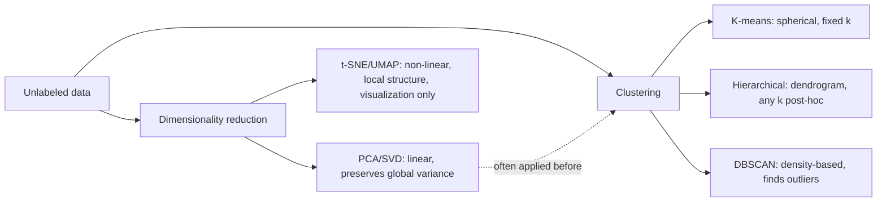

# 09 — Unsupervised Learning

## Learning objectives

By the end of this topic you can:
- Fit and compare K-means, hierarchical clustering, and DBSCAN.
- Explain PCA and SVD as dimensionality reduction, and apply them before and after clustering.
- Use t-SNE/UMAP for visualization and explain why they're for visualization, not general-purpose dimensionality reduction for downstream models.

## Why it matters

Most real-world data has no labels. Clustering surfaces structure (customer segments, anomalies);
dimensionality reduction makes high-dimensional data tractable to visualize, store, and feed to
simpler downstream models — both are everyday tools, not just academic exercises.

## Prerequisites

[`08_classification`](../08_classification/README.md); Day 1's
[`05_ml_mathematics`](../../day01_python_data_math/05_ml_mathematics/README.md) (eigenvectors/SVD, covered again here in an ML-algorithm context).

## Core concepts

- **K-means**: partitions data into `k` clusters by iteratively assigning points to the nearest centroid and recomputing centroids. *Strengths*: fast, simple. *Weaknesses*: must choose `k` in advance, assumes roughly spherical, similarly-sized clusters.
- **Hierarchical clustering**: builds a tree (dendrogram) of nested clusters by repeatedly merging (agglomerative) the closest pair. *Strengths*: no need to pick `k` upfront, the dendrogram shows structure at every granularity. *Weaknesses*: O(n²) or worse, doesn't scale to very large datasets.
- **DBSCAN**: density-based — groups points that are densely packed together, marking sparse points as noise/outliers. *Strengths*: finds arbitrarily shaped clusters, automatically detects outliers, no need to specify `k`. *Weaknesses*: sensitive to its two hyperparameters (`eps`, `min_samples`), struggles when clusters have very different densities.
- **PCA**: projects data onto the directions (principal components) of maximum variance — a linear dimensionality reduction (covered mathematically in Day 1's `05_ml_mathematics`).
- **SVD**: the general matrix factorization PCA is built on; applies even to non-square, sparse matrices (e.g. recommender systems).
- **t-SNE / UMAP**: non-linear techniques that preserve *local* neighborhood structure for 2D/3D visualization. They distort global distances and are **not** suitable as a general preprocessing step before a downstream supervised model (unlike PCA) — their primary use is making high-dimensional data visually inspectable.

## Important APIs / functions

`sklearn.cluster.KMeans`, `sklearn.cluster.AgglomerativeClustering`,
`scipy.cluster.hierarchy.dendrogram`, `sklearn.cluster.DBSCAN`, `sklearn.decomposition.PCA`,
`numpy.linalg.svd`, `sklearn.manifold.TSNE`, `umap.UMAP` (optional — falls back gracefully if
not installed).

## Notebooks

| Notebook | Purpose | Expected output |
|---|---|---|
| `01_clustering.ipynb` | K-means, hierarchical clustering (with dendrogram), and DBSCAN on the same 2D synthetic dataset, plus a case where K-means fails and DBSCAN succeeds (non-spherical clusters) | Side-by-side cluster visualizations; a dendrogram; a clear visual demonstration of K-means failing on non-convex clusters that DBSCAN handles correctly |
| `02_dimensionality_reduction.ipynb` | PCA (reusing/extending Day 1's eigendecomposition), SVD, and t-SNE (UMAP if available, else skipped gracefully) on a higher-dimensional dataset (e.g. digits) | A scree plot (variance explained per component); a 2D PCA projection vs a 2D t-SNE projection of the same data, compared |

## Key takeaways

- K-means assumes clusters are roughly spherical and similar in size — it fails visibly on elongated or nested shapes, which DBSCAN handles via density instead of distance-to-centroid.
- PCA's components are ranked by variance explained — a scree plot tells you how many components actually matter.
- t-SNE/UMAP plots are for *looking at* your data, not for feeding into a downstream model — their distances aren't globally meaningful.

## Common mistakes

- Picking `k` for K-means without checking an elbow plot or silhouette score.
- Feeding unscaled features into K-means or DBSCAN (both are distance-based).
- Using t-SNE output as input features for a classifier (loses global distance structure and isn't stable across re-runs).
- Forgetting DBSCAN's `eps` needs to match the data's scale — unscaled features make a single `eps` meaningless across dimensions.

## Interview questions

**Conceptual**
1. Why does K-means fail on non-convex or very differently-sized clusters?
2. What does DBSCAN do with points that don't belong to any dense region?
3. What's the practical difference between PCA and t-SNE, and why can't you substitute one for the other?
4. Why does hierarchical clustering not require you to pick `k` upfront?
5. What does a PCA scree plot tell you, and how would you use it to choose the number of components to keep?

**Coding**
1. Fit K-means with `k` from 2 to 10 and plot the elbow curve (inertia vs `k`).
2. Fit DBSCAN on data with two differently-shaped clusters (e.g. two interleaving moons) where K-means visibly fails.
3. Reduce a high-dimensional dataset to 2D with PCA and separately with t-SNE, and plot both side by side.

**Debugging**
1. Your K-means clusters look nothing like the obvious visual groups in a 2D scatter plot — what's the most likely cause?
2. DBSCAN marks almost every point as noise — which hyperparameter would you adjust first, and in which direction?

**Real-world engineering**
1. You want to compress a 500-dimensional embedding to 50 dimensions before storing it at scale — would you use PCA or t-SNE, and why?
2. You're segmenting customers by purchase behavior but don't know how many segments exist — which clustering algorithm would you start with, and why?

## Exercises

1. Generate 3 clusters of different sizes/densities and compare K-means vs DBSCAN cluster assignments visually.
2. Build a dendrogram for a small dataset and identify a sensible "cut height" to produce 3 clusters.
3. Compute the number of PCA components needed to explain 95% of variance on a real small dataset (e.g. `sklearn.datasets.load_digits`).

## References

- [scikit-learn — Clustering](https://scikit-learn.org/stable/modules/clustering.html)
- [scikit-learn — Decomposing signals (PCA)](https://scikit-learn.org/stable/modules/decomposition.html)
- [Distill.pub — How to Use t-SNE Effectively](https://distill.pub/2016/misread-tsne/)
- [UMAP documentation](https://umap-learn.readthedocs.io/)
