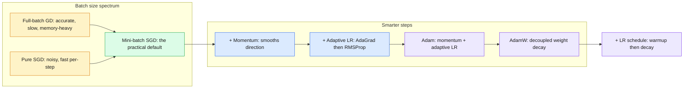

# 10 — ML Optimization

> Optimizers are the "how" of learning: the update rule that turns a loss into better parameters, step by step.

| At a glance | |
|---|---|
| **Day** | 2 — Machine Learning |
| **Topic** | Gradient descent variants, adaptive optimizers, learning-rate schedules |
| **Notebooks** | 1 (`01_optimizers_from_scratch.ipynb`) |
| **Builds on** | [`07_regression`](../07_regression/README.md) (gradient descent), Day 1 `05_ml_mathematics` (gradients) |
| **Leads to** | [`11_generalization`](../11_generalization/README.md), Day 3 `torch.optim` |

## 📖 Short forms used in this topic

| Term | Full form | What it is |
|---|---|---|
| **GD** | Gradient Descent | Iteratively steps parameters opposite the gradient to minimise a loss. |
| **SGD** | Stochastic Gradient Descent | Gradient descent using a single sample or mini-batch per update. |
| **AdaGrad** | Adaptive Gradient | Shrinks each parameter's step size using the accumulated sum of squared gradients. |
| **RMSProp** | Root Mean Square Propagation | Scales steps by an exponential moving average of squared gradients. |
| **Adam** | Adaptive Moment Estimation | Momentum (1st moment) plus RMSProp-style scaling (2nd moment), with bias correction. |
| **AdamW** | Adam with decoupled Weight decay | Adam where weight decay is applied directly to the weights, not through the gradient. |
| **L2** | L2 norm / Ridge penalty | Penalty on the sum of squared weights; shrinks weights smoothly. |
| **LR** | Learning Rate | Step size of each gradient update. |

## 🧠 In plain words

Training a model means finding parameters that make the loss small. An optimizer repeatedly measures which way the loss goes down (the gradient) and nudges the parameters that way. Different optimizers differ in how they smooth, rescale and schedule those nudges, which decides how fast and how reliably training converges.

## 🎒 Analogy to remember

Walking downhill in fog toward the valley floor. Plain GD feels the slope under your feet and steps; SGD feels only a small patch of ground (noisy but cheap); momentum is a rolling ball that keeps its speed through bumps; adaptive methods are different shoes per foot, taking shorter steps where the ground is steep. The learning-rate schedule is walking carefully at first, striding, then slowing near the bottom. Where it breaks: a real ball has no per-direction step control, and the loss landscape has millions of dimensions.

## Learning objectives

By the end of this topic you can:
- Explain the relationship between a loss, an objective, and a cost function.
- Implement and compare gradient descent variants: batch, SGD, mini-batch, momentum, AdaGrad, RMSProp, Adam, AdamW.
- Explain learning-rate schedules, warmup, and decay, and why they matter in practice.

## Why it matters

Every model in this curriculum — from linear regression to the Transformers in Day 3 — is fit by
some variant of gradient descent. Knowing why Adam usually beats plain SGD, and why a learning
rate schedule matters, is the difference between a training run that converges in an hour and
one that never converges at all.

## Prerequisites

[`07_regression`](../07_regression/README.md) (gradient descent from scratch) and Day 1's
[`05_ml_mathematics`](../../day01_python_data_math/05_ml_mathematics/README.md) (the chain rule/gradient).

## Core concepts

- **Loss / objective / cost**: a loss is computed per-example; cost (or objective) is typically the average loss over a batch/dataset — terms are often used interchangeably in practice, but the per-example vs aggregate distinction matters when reasoning about gradients.
- **(Batch) Gradient descent**: compute the gradient over the *entire* dataset before each update — accurate but slow per step, and may not fit in memory.
- **SGD (Stochastic Gradient Descent)**: update using the gradient from a *single* example — noisy but fast, and the noise can help escape shallow local minima.
- **Mini-batch SGD**: the practical middle ground — update using a small batch (e.g. 32-256 examples); the de facto standard.
- **Momentum**: accumulates a moving average of past gradients, smoothing out noisy updates and accelerating through consistent directions.
- **AdaGrad**: adapts the learning rate per-parameter based on the sum of squared past gradients — shrinks the learning rate for frequently-updated parameters.
- **RMSProp**: fixes AdaGrad's ever-shrinking learning rate by using an exponential moving average of squared gradients instead of a running sum.
- **Adam**: combines momentum (first moment) and RMSProp-style adaptive per-parameter learning rates (second moment) — the most common default optimizer for deep learning.
- **AdamW**: Adam with weight decay decoupled from the gradient update (rather than added into the gradient like L2 regularization) — generally preferred over plain Adam for training large models.
- **Learning-rate schedules, warmup, decay**: starting with a small LR and ramping up (warmup) avoids early instability; decaying the LR over training helps fine-grained convergence near the end.

## 🔍 Concepts explained

Category chips: 🟦 batch-size family, 🟩 momentum, 🟧 adaptive per-parameter, 🟪 schedules.

### 🟦 Batch GD, SGD, mini-batch SGD
- **Definition**: the same update `θ ← θ − η∇L(θ)`; they differ only in how many examples form the gradient estimate.
- **Analogy**: polling the whole country vs one person vs a sample of 64.
- **Code idea**: notebook simulates noise as `grad_fn(theta) + normal(scale=noise_scale)`; smaller noise = bigger batch.
- **Use when / watch out**: mini-batch is the default; changing batch size usually needs LR retuning.

### 🟩 Momentum
- **Definition**: keep a running velocity of gradients and step along it.
- **Analogy**: a heavy ball rolling downhill, ignoring small bumps.
- **Code idea**: `v = beta*v + g; theta -= lr*v`.
- **Use when / watch out**: elongated valleys where plain GD zig-zags; too large `beta` overshoots.

### 🟧 AdaGrad, RMSProp, Adam
- **Definition**: scale each parameter's step by the history of its squared gradients.
- **Analogy**: shorter strides on steep ground, longer on flat ground, per foot.
- **Code idea**: `theta -= lr * g / (sqrt(G) + eps)`; Adam adds `m_hat`, `v_hat` with bias correction.
- **Use when / watch out**: parameters with very different gradient scales; Adam still needs a tuned LR.

### 🟪 Learning-rate schedule (warmup + decay)
- **Definition**: change the LR over training rather than keep it fixed.
- **Analogy**: warm up before a run, then slow to a walk near the finish.
- **Code idea**: linear ramp for `warmup_steps`, then `0.5*(1+cos(pi*progress))` cosine decay.
- **Use when / watch out**: large models or datasets; warmup prevents early divergence.

### Differences at a glance

| Optimizer | Chip | Per-parameter LR | Uses momentum | Main pitfall |
|---|---|---|---|---|
| Batch GD | 🟦 | No | No | Slow per step, memory heavy |
| SGD / mini-batch | 🟦 | No | No | Noisy; oscillates on elongated surfaces |
| Momentum | 🟩 | No | Yes | Can overshoot |
| AdaGrad | 🟧 | Yes (sum of squares) | No | LR shrinks toward zero |
| RMSProp | 🟧 | Yes (moving average) | No | LR still needs tuning |
| Adam | 🟧🟩 | Yes | Yes | Not set-and-forget |
| AdamW | 🟧🟩 | Yes | Yes | Weight-decay value needs tuning |

> [!IMPORTANT]
> Adam with L2 added to the loss is not the same as AdamW: L2 gets rescaled by the adaptive denominator, decoupled weight decay does not.

> [!WARNING]
> AdaGrad's ever-growing sum of squared gradients makes its effective LR vanish on long runs; RMSProp and Adam fix this with a moving average.

> [!TIP]
> In the notebook the loss surface has curvature `[50, 1]`; this elongated bowl is chosen because plain GD struggles on it.

## Important APIs / functions

From-scratch NumPy implementations of each optimizer update rule; conceptually mirrored by
`torch.optim.SGD`, `torch.optim.Adam`, `torch.optim.AdamW`, and
`torch.optim.lr_scheduler.*` (used for real in Day 3).

## Notebooks

| Notebook | Purpose | Expected output |
|---|---|---|
| `01_optimizers_from_scratch.ipynb` | Implement batch GD, SGD, mini-batch SGD, momentum, AdaGrad, RMSProp, and Adam from scratch on the same loss surface; implement a linear warmup + decay schedule | A single plot comparing all optimizers' convergence curves on the same function; a visualization of how a learning-rate schedule changes the effective step size over training |

## Key takeaways

- Mini-batch SGD is a biased-free, lower-variance *estimate* of the full-batch gradient (connecting back to Day 1's sampling/expectation concepts) — this is why it works despite being "noisy."
- Adam's popularity comes from needing little tuning: it adapts per-parameter learning rates automatically, which matters enormously once a model has millions of parameters with very different gradient scales.
- A learning-rate schedule isn't optional polish for large models — warmup prevents early divergence, and decay is often necessary for the loss to settle near its minimum.

## Common mistakes

- Using a single fixed learning rate for the entire training run without ever checking if decay would help.
- Forgetting that increasing batch size changes the effective noise in SGD, which often means the learning rate needs retuning too.
- Confusing AdaGrad's ever-shrinking learning rate (a known limitation) with RMSProp/Adam's fix for it.
- Treating Adam as a magic "set and forget" optimizer — it still has hyperparameters (especially the learning rate) that matter.

## Interview questions

**Conceptual**
1. Why does mini-batch SGD work at all, given it uses a noisy, incomplete estimate of the true gradient?
2. What specific problem does momentum solve that plain SGD has?
3. What's AdaGrad's main weakness, and how does RMSProp fix it?
4. What does Adam combine, conceptually, from momentum and RMSProp?
5. Why is AdamW generally preferred over Adam with naive L2 regularization added to the loss?

**Coding**
1. Implement momentum-based gradient descent from scratch and compare its convergence speed to plain gradient descent on a function with a narrow, elongated minimum (e.g. a Rosenbrock-like function).
2. Implement Adam from scratch (first and second moment estimates with bias correction) and verify it converges on a simple quadratic.
3. Implement a linear warmup + cosine decay learning-rate schedule and plot the resulting learning rate over training steps.

**Debugging**
1. Your training loss oscillates wildly and occasionally spikes — what hyperparameter would you check first, and why?
2. Switching from SGD to Adam at the same learning rate causes immediate divergence — why might that happen, and what should you do?

**Real-world engineering**
1. You're training on a single GPU with limited memory — how does batch size interact with your choice of optimizer and learning rate?
2. Your model trains fine for small datasets but diverges early on a much larger one — how might a warmup schedule help, and why?

## Exercises

1. Compare batch GD, SGD, and mini-batch SGD (batch size 16) on the same quadratic loss and plot all three convergence curves together.
2. Implement AdaGrad and demonstrate its learning rate shrinking over time by plotting the effective per-parameter step size.
3. Implement a step-decay schedule (halve the LR every N steps) and compare final convergence to a constant learning rate.

## References

- [Sebastian Ruder — An overview of gradient descent optimization algorithms](https://ruder.io/optimizing-gradient-descent/)
- [Kingma & Ba (2014) — Adam: A Method for Stochastic Optimization](https://arxiv.org/abs/1412.6980)
- [Loshchilov & Hutter (2017) — Decoupled Weight Decay Regularization (AdamW)](https://arxiv.org/abs/1711.05101)
- [PyTorch docs — `torch.optim`](https://pytorch.org/docs/stable/optim.html)
