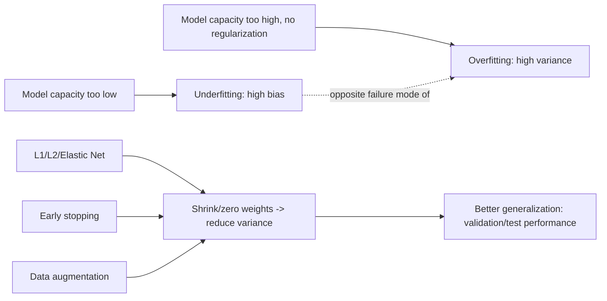

# 11 — Generalization

## Learning objectives

By the end of this topic you can:
- Formally define overfitting, underfitting, and the bias-variance tradeoff.
- Apply L1, L2, and Elastic Net regularization and explain what each does differently.
- Explain dropout and early stopping as regularization techniques, and why data augmentation helps.

## Why it matters

`06_ml_fundamentals` introduced the underfit/overfit demo informally; this topic formalizes it
and gives you the actual tools (regularization, early stopping) used to fix it in practice —
tools you'll reuse directly on neural networks in Day 3.

## Prerequisites

[`10_ml_optimization`](../10_ml_optimization/README.md); the underfit/overfit demo in
[`06_ml_fundamentals`](../06_ml_fundamentals/README.md).

## Core concepts

- **Overfitting**: the model fits training data (including its noise) so closely that it generalizes poorly to new data — low training error, high validation/test error.
- **Underfitting**: the model is too simple to capture the underlying pattern — high error on both training and validation/test data.
- **Bias-variance tradeoff**: bias = error from overly simplistic assumptions (underfitting); variance = error from sensitivity to the specific training sample (overfitting). Total expected error ≈ bias² + variance + irreducible noise — you can't drive both to zero simultaneously by adjusting capacity alone.
- **L1 regularization (Lasso)**: adds `λΣ|w|` to the loss — pushes some weights exactly to zero, giving automatic feature selection.
- **L2 regularization (Ridge)**: adds `λΣw²` to the loss — shrinks all weights smoothly toward zero without necessarily zeroing any out.
- **Elastic Net**: a weighted combination of L1 and L2 — gets some sparsity (from L1) while keeping L2's smoother shrinkage.
- **Dropout (concept)**: randomly zeroes out a fraction of neurons during training, forcing the network to not rely on any single neuron — a regularization technique specific to neural networks (hands-on in Day 3).
- **Early stopping**: stop training when validation loss stops improving, even if training loss keeps dropping — directly targets the overfitting point.
- **Data augmentation (concept)**: artificially expanding the effective training set (e.g. image flips/rotations, text paraphrasing) so the model sees more variation without needing more raw labeled data.

## Important APIs / functions

`sklearn.linear_model.Ridge`, `sklearn.linear_model.Lasso`, `sklearn.linear_model.ElasticNet`,
manually tracking train vs validation loss per epoch for early stopping.

## Notebooks

| Notebook | Purpose | Expected output |
|---|---|---|
| `01_regularization_and_generalization.ipynb` | Formal bias-variance demo (repeated resampling to show the tradeoff numerically); L1 vs L2 vs Elastic Net on the same overfitting-prone dataset, showing L1's sparsity vs L2's shrinkage; an early-stopping demo on an iteratively-fit model | A plot showing L1 driving several coefficients exactly to zero while L2 shrinks all of them smoothly; a train-vs-validation loss curve with the early-stopping point marked |

## Key takeaways

- Bias and variance trade off against each other as capacity changes — regularization explicitly buys down variance at the cost of a little bias.
- L1's sparsity (exact zeros) makes it useful for feature selection; L2's smooth shrinkage is usually better when all features are at least somewhat relevant.
- Early stopping is "free" regularization — it costs nothing but a validation set and tracking a metric per epoch.

## Common mistakes

- Choosing the regularization strength (`λ`/`alpha`) without a validation set — this itself needs tuning (previewed here, formalized in `14_hyperparameter_tuning`).
- Assuming L1 and L2 are interchangeable — they produce qualitatively different weight patterns (sparse vs smoothly shrunk).
- Stopping training the moment training loss plateaus, rather than watching validation loss (training loss plateauing is normal and doesn't imply overfitting has started).

## Interview questions

**Conceptual**
1. State the bias-variance tradeoff in your own words and connect it to under/overfitting.
2. Why does L1 regularization produce exactly-zero weights while L2 doesn't?
3. Why is early stopping considered a regularization technique, even though it doesn't change the loss function?
4. How does data augmentation reduce overfitting without collecting more labeled data?
5. Why can't you simultaneously minimize both bias and variance just by tuning model capacity?

**Coding**
1. Fit `Ridge`, `Lasso`, and `ElasticNet` on the same dataset with increasing regularization strength and plot how coefficients shrink/zero out.
2. Implement early stopping manually: track validation loss per epoch and stop when it hasn't improved for N epochs.
3. Numerically demonstrate the bias-variance tradeoff by fitting many models on different resamples of the same data-generating process and decomposing the average error.

**Debugging**
1. Increasing L2 regularization strength makes both training AND validation error worse — what does this suggest about your starting regularization strength?
2. Your early-stopping criterion triggers after just 2 epochs, far too early — what hyperparameter of the early-stopping logic itself might need adjusting?

**Real-world engineering**
1. You have 1,000 features but suspect only ~20 are actually relevant — would you reach for L1 or L2, and why?
2. Your model overfits badly and you can't collect more data — list three techniques from this topic you'd try, in order.

## Exercises

1. Generate an overfitting-prone dataset (many features, few samples) and compare unregularized, L1, L2, and Elastic Net linear models' test performance.
2. Plot coefficient magnitude vs regularization strength (`alpha`) for Ridge and Lasso side by side.
3. Simulate the bias-variance tradeoff: for polynomial models of increasing degree, repeatedly resample the training data, fit, and plot average bias² and variance separately.

## References

- [scikit-learn — Linear Models: Ridge, Lasso, Elastic Net](https://scikit-learn.org/stable/modules/linear_model.html)
- [Stanford CS229 — Bias-Variance notes](https://cs229.stanford.edu/notes2022fall/)
- [Srivastava et al. (2014) — Dropout](https://jmlr.org/papers/v15/srivastava14a.html)
