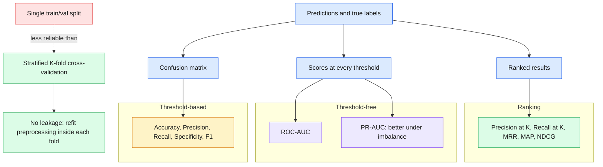

# 12 — ML Evaluation

> A model is only as trustworthy as the way you measured it: pick the right metric, and measure it on honest splits.

| At a glance | |
|---|---|
| **Day** | 2 — Machine Learning |
| **Topic** | Classification metrics, ROC vs PR curves, ranking metrics, cross-validation, leakage |
| **Notebooks** | 3 (`01_classification_metrics`, `02_ranking_metrics`, `03_cross_validation`) |
| **Builds on** | [`11_generalization`](../11_generalization/README.md), [`08_classification`](../08_classification/README.md) |
| **Leads to** | [`13_feature_engineering`](../13_feature_engineering/README.md), [`14_hyperparameter_tuning`](../14_hyperparameter_tuning/README.md) |

## 📖 Short forms used in this topic

| Term | Full form | What it is |
|---|---|---|
| **TP / TN** | True Positive / True Negative | Positive predicted positive / negative predicted negative. |
| **FP / FN** | False Positive / False Negative | Negative predicted positive / positive predicted negative. |
| **TPR** | True Positive Rate | `TP/(TP+FN)`; same as recall (sensitivity). |
| **FPR** | False Positive Rate | `FP/(FP+TN)`; equals 1 − specificity. |
| **F1** | F1 score | Harmonic mean of precision and recall. |
| **ROC** | Receiver Operating Characteristic | Curve of TPR vs FPR across thresholds. |
| **AUC** | Area Under the Curve | Single-number summary of a curve; ROC-AUC = chance a random positive is scored above a random negative. |
| **PR-AUC** | Precision-Recall Area Under the Curve | Area under the precision-vs-recall curve; more informative when positives are rare. |
| **MAE** | Mean Absolute Error | Average absolute prediction error. |
| **MSE** | Mean Squared Error | Average squared prediction error. |
| **RMSE** | Root Mean Squared Error | Square root of MSE, in the target's units. |
| **R²** | Coefficient of determination | Fraction of target variance explained by the model. |
| **@K** | Top-K cutoff | Metric computed only on the first K ranked results. |
| **RR** | Reciprocal Rank | 1 / rank of the first relevant result for one query. |
| **MRR** | Mean Reciprocal Rank | Average RR over queries. |
| **AP** | Average Precision | Mean of precision@k at each rank where a relevant item appears. |
| **MAP** | Mean Average Precision | Mean of AP over queries (ranking metric, not Maximum A Posteriori). |
| **DCG** | Discounted Cumulative Gain | Sum of relevance scores discounted by log of rank position. |
| **IDCG** | Ideal DCG | DCG of the best possible ordering; used to normalise. |
| **NDCG** | Normalized Discounted Cumulative Gain | DCG divided by IDCG, so scores fall in 0 to 1. |
| **CV** | Cross-Validation | Repeated train/validation splits to estimate generalization. |

## 🧠 In plain words

Evaluation answers "how good is this model really?". You count the kinds of mistakes it makes (confusion matrix), choose a metric that matches what errors cost, and measure on data the model never trained on, ideally several different splits (cross-validation) so one lucky split does not fool you.

## 🎒 Analogy to remember

A smoke detector. Accuracy says "no fire 99% of days", useless if fires are rare. Precision is how often an alarm was a real fire; recall is how many real fires it caught. Cross-validation is testing it in several different houses, not just one. Where it breaks: ranking metrics have no smoke-detector equivalent; think of a search page where the best result should be first.

## Learning objectives

By the end of this topic you can:
- Build a confusion matrix and derive accuracy, precision, recall, F1, and specificity from it.
- Explain ROC-AUC vs PR-AUC and when to prefer one over the other (especially under class imbalance).
- Compute ranking metrics (Precision@K, Recall@K, MRR, MAP, NDCG) for recommendation/search-style problems.
- Use cross-validation (including stratified K-fold) correctly, and recognize leakage in an evaluation setup.

## Why it matters

A model is only as trustworthy as its evaluation. Every classifier in `08_classification` was
judged on accuracy alone, which is actively misleading on imbalanced data — this topic gives you
the full toolkit real evaluation dashboards use, and the cross-validation discipline that
prevents an optimistic, non-reproducible performance claim.

## Prerequisites

[`11_generalization`](../11_generalization/README.md); [`08_classification`](../08_classification/README.md).

## Core concepts

- **Confusion matrix**: a table of (true label) × (predicted label) counts — the source of every classification metric below.
- **Accuracy**: `(TP+TN)/total` — misleading under imbalance (a model that always predicts the majority class can have high accuracy).
- **Precision**: `TP/(TP+FP)` — of everything predicted positive, how much was actually positive. Matters when false positives are costly.
- **Recall (sensitivity)**: `TP/(TP+FN)` — of everything actually positive, how much was caught. Matters when false negatives are costly.
- **Specificity**: `TN/(TN+FP)` — the negative-class analog of recall.
- **F1**: harmonic mean of precision and recall — a single number balancing both.
- **ROC-AUC**: area under the ROC curve (TPR vs FPR across thresholds) — measures ranking quality independent of threshold, but can look optimistic under heavy class imbalance.
- **PR-AUC**: area under the precision-recall curve — more informative than ROC-AUC when the positive class is rare.
- **Regression metrics recap**: MAE/MSE/RMSE/R² (from `07_regression`).
- **Ranking metrics**: Precision@K/Recall@K (top-K relevance), MRR (mean reciprocal rank — how high the *first* relevant result ranks), MAP (mean average precision across ranks), NDCG (rewards relevant results ranked higher, with graded relevance).
- **Cross-validation / stratified K-fold**: repeatedly splitting data into train/validation folds to get a more reliable performance estimate than a single split; *stratified* K-fold preserves class proportions in every fold — critical under imbalance.
- **Leakage (recap, now in an evaluation context)**: any evaluation setup where information from outside the current fold's training data influences that fold's score.

## 🔍 Concepts explained

Chips: 🟧 threshold-based classification, 🟪 threshold-free (curve) metrics, 🟩 ranking metrics, 🟦 validation schemes.

### 🟧 Confusion matrix and its metrics
- **Definition**: counts of TP, FP, FN, TN; every threshold metric derives from it.
- **Analogy**: a smoke detector's log of real alarms, false alarms, missed fires and quiet days.
- **Formula**: accuracy `(TP+TN)/N`; precision `TP/(TP+FP)`; recall `TP/(TP+FN)`; specificity `TN/(TN+FP)`; F1 `2PR/(P+R)`.
- **Use when / watch out**: pick by error cost; accuracy misleads under imbalance.

### 🟪 ROC-AUC vs PR-AUC
- **Definition**: area under TPR-vs-FPR (ROC) or precision-vs-recall (PR) curves across all thresholds.
- **Analogy**: grading the detector across every possible sensitivity dial setting.
- **Code idea**: `roc_auc_score`, `average_precision_score`.
- **Use when / watch out**: prefer PR-AUC when positives are rare; ROC-AUC can look rosy because FPR is diluted by a huge negative class.

### 🟩 Ranking metrics
- **Definition**: score an ordered result list for relevance.
- **Analogy**: judging a search page by how high the good links sit.
- **Formula**: `RR = 1/rank_first_relevant`; `NDCG = DCG/IDCG`.
- **Use when / watch out**: search and recommendation; NDCG handles graded relevance, MRR only the first hit.

### 🟦 Cross-validation, stratified K-fold, leakage
- **Definition**: rotate which fold is held out; stratified keeps class ratios per fold; leakage is outside information shaping a fold's score.
- **Analogy**: testing in several houses, never practicing in the test house.
- **Code idea**: `cross_val_score(make_pipeline(StandardScaler(), model), X, y, cv=StratifiedKFold(...))`.
- **Use when / watch out**: put scalers and selectors inside the pipeline so they refit per fold.

### Differences at a glance

| Metric | Chip | Answers | Prefer when | Pitfall |
|---|---|---|---|---|
| Accuracy | 🟧 | Fraction correct | Balanced classes | Hides minority failures |
| Precision | 🟧 | Of predicted positives, how many real | False positives costly | Ignores misses |
| Recall | 🟧 | Of real positives, how many caught | False negatives costly | Ignores false alarms |
| F1 | 🟧 | Balance of precision and recall | One number needed | Ignores TN, fixed threshold |
| ROC-AUC | 🟪 | Ranking quality, all thresholds | Roughly balanced data | Optimistic under imbalance |
| PR-AUC | 🟪 | Positive-class quality | Rare positives | Baseline equals positive rate |
| Precision@K / Recall@K | 🟩 | Top-K relevance | Fixed result-page size | Ignores order within K |
| MRR | 🟩 | How high the first hit is | One right answer | Ignores later hits |
| MAP | 🟩 | Precision across all hits | Binary relevance | No graded relevance |
| NDCG | 🟩 | Position-weighted graded gain | Graded relevance | Needs ideal ordering |

> [!WARNING]
> Fit scalers and feature selectors inside each CV fold (for example via a pipeline). Fitting them on the full dataset first leaks fold information.

> [!IMPORTANT]
> Notebook 01 builds a deliberately imbalanced dataset to show high accuracy with poor minority recall.

> [!TIP]
> Report mean and standard deviation across folds; the spread tells you whether a model difference is real.

## Important APIs / functions

`sklearn.metrics.confusion_matrix`, `classification_report`, `precision_score`/`recall_score`/
`f1_score`, `roc_auc_score`, `roc_curve`, `average_precision_score`, `precision_recall_curve`,
`sklearn.model_selection.cross_val_score`, `StratifiedKFold`.

## Notebooks

| Notebook | Purpose | Expected output |
|---|---|---|
| `01_classification_metrics.ipynb` | Confusion matrix → accuracy/precision/recall/F1/specificity by hand and via sklearn, on a deliberately imbalanced dataset; ROC-AUC vs PR-AUC compared on the same imbalanced data | A clear case where accuracy looks great (>90%) but recall on the minority class is poor; ROC curve and PR curve plotted side by side showing PR-AUC drops more sharply than ROC-AUC under imbalance |
| `02_ranking_metrics.ipynb` | Precision@K, Recall@K, MRR, MAP, NDCG computed by hand on a small synthetic ranked-results example | Hand-verified metric values on a tiny example small enough to check by eye |
| `03_cross_validation.ipynb` | `cross_val_score` vs a single train/test split; `StratifiedKFold` vs plain `KFold` on imbalanced data; a leakage example re-run correctly inside a cross-validation loop | Standard deviation across folds showing a single split's score is one noisy sample of many; stratified folds preserving class balance where plain K-fold does not |

## Key takeaways

- Always report more than accuracy on imbalanced data — precision/recall/F1 or PR-AUC tell a very different story than accuracy alone.
- ROC-AUC treats false positives and false negatives symmetrically across a huge negative class; PR-AUC focuses on the positive class, which is usually what you actually care about under imbalance.
- A single train/test split gives you one noisy sample of performance — cross-validation gives you a distribution, which is what lets you say whether a difference between two models is real or noise.
- Any preprocessing that depends on the data (scaling, feature selection) must be refit inside each cross-validation fold, not once on the whole dataset beforehand.

## Common mistakes

- Reporting only accuracy on an imbalanced dataset.
- Using plain K-fold (not stratified) on imbalanced data, risking folds with very few or zero positive examples.
- Fitting a scaler/feature-selector on the full dataset before cross-validation (leakage into every fold).
- Treating ROC-AUC as sufficient evidence of good performance without checking PR-AUC under imbalance.

## Interview questions

**Conceptual**
1. Why can a model with 95% accuracy still be useless on a dataset where only 2% of examples are positive?
2. When would PR-AUC be more informative than ROC-AUC?
3. What does stratified K-fold preserve that plain K-fold does not?
4. What's the difference between MRR and MAP, and when would each be the more appropriate metric?
5. Why must preprocessing be fit inside each cross-validation fold rather than once on the whole dataset?

**Coding**
1. Build a confusion matrix by hand from raw predictions and true labels, then derive precision/recall/F1 from it without calling `sklearn.metrics`.
2. Implement NDCG@K from scratch for a small ranked list with graded relevance scores.
3. Run `cross_val_score` with `StratifiedKFold` on an imbalanced dataset and report the mean and standard deviation of F1 across folds.

**Debugging**
1. Your model's ROC-AUC is 0.95 but PR-AUC is only 0.4 — what does that combination suggest about your data and the model's practical usefulness?
2. Cross-validation scores have unexpectedly low variance across folds, and you suspect leakage — what preprocessing step would you check first?

**Real-world engineering**
1. You're building a fraud detector where fraud is 0.5% of transactions — which metrics would you report to stakeholders, and why not accuracy alone?
2. You're evaluating a search ranking system — would you reach for classification metrics or ranking metrics, and which one specifically for "did the best result appear first"?

## Exercises

1. On a dataset with 95%/5% class imbalance, compute accuracy, precision, recall, F1, ROC-AUC, and PR-AUC for the same model and discuss which paint the most honest picture.
2. Compute Precision@5 and NDCG@5 for a toy ranked list of 10 items with known relevance scores.
3. Compare plain K-fold vs stratified K-fold's per-fold class balance on a dataset with 90%/10% imbalance.

## References

- [scikit-learn — Model evaluation](https://scikit-learn.org/stable/modules/model_evaluation.html)
- [scikit-learn — Cross-validation](https://scikit-learn.org/stable/modules/cross_validation.html)
- [Google ML Crash Course — Classification: ROC and AUC](https://developers.google.com/machine-learning/crash-course/classification/roc-and-auc)
- [Evaluation Measures for Information Retrieval (NDCG/MAP/MRR overview)](https://en.wikipedia.org/wiki/Evaluation_measures_(information_retrieval))
