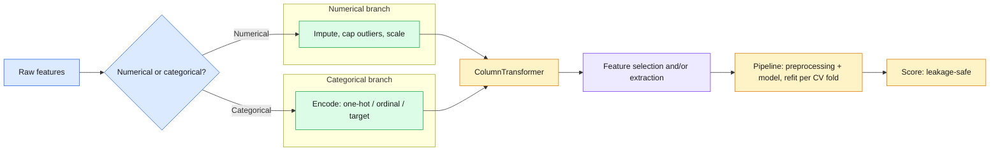
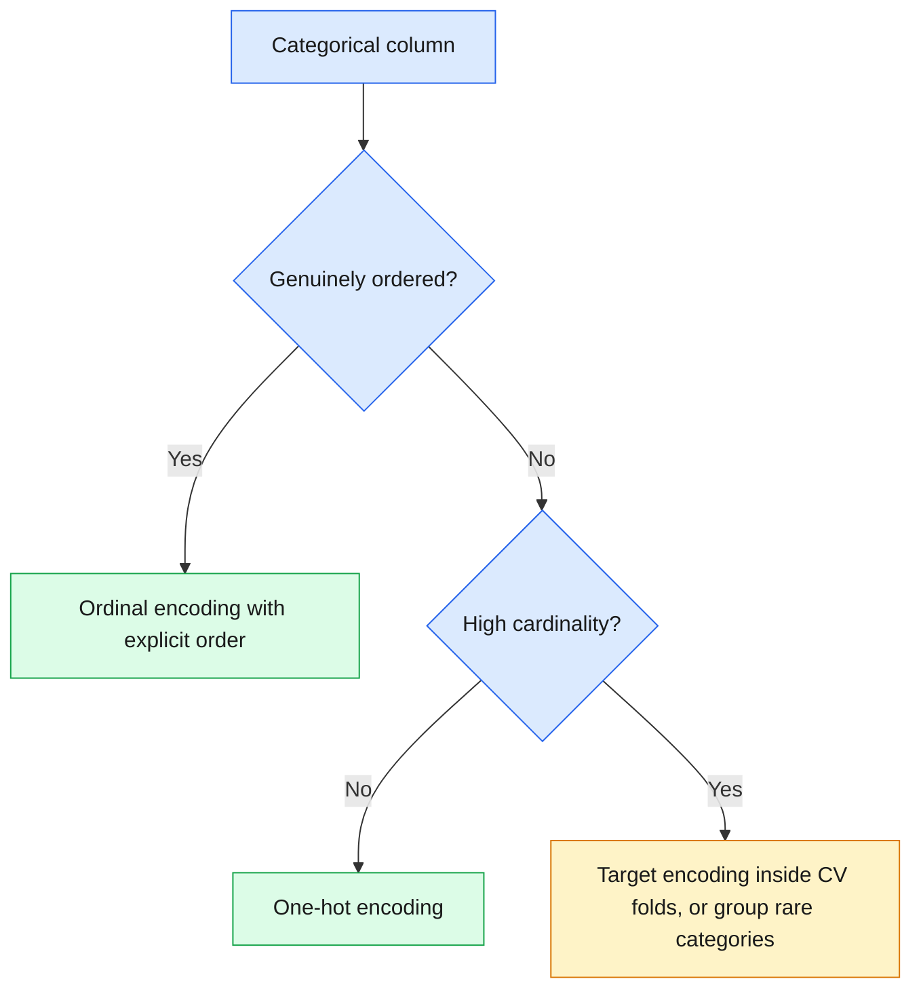

# 13 — Feature Engineering

> Turn raw, messy columns into model-ready features, and bundle every step in a `Pipeline` so nothing leaks.

**At a glance**

| | |
|---|---|
| **Day** | 2 — Machine Learning |
| **Topic** | Feature engineering: encoding, scaling, imputation, outliers, selection, extraction, pipelines |
| **Notebooks** | 1 (`01_feature_engineering_pipeline.ipynb`) |
| **Builds on** | [`12_ml_evaluation`](../12_ml_evaluation/README.md) (cross-validation, leakage) |
| **Leads to** | [`14_hyperparameter_tuning`](../14_hyperparameter_tuning/README.md) (tuning this pipeline) |

## 📖 Short forms used in this topic

| Term | Full form | What it is |
|---|---|---|
| **ML** | Machine Learning | Learning patterns from data to make predictions instead of hand-coding rules. |
| **CV** | Cross-Validation | Repeatedly splitting data into train/validation folds to estimate generalisation. |
| **PCA** | Principal Component Analysis | Linear method that extracts new uncorrelated features (components) capturing the most variance. |
| **SVM** | Support Vector Machine | Margin-based classifier/regressor; distance-sensitive, so it needs scaled features. |
| **k-NN** | k-Nearest Neighbours | Predicts from the `k` closest training points; distance-based, so it needs scaled features. |
| **L1** | L1 (Lasso) penalty | Regularization on the sum of absolute weights; drives some weights to exactly zero, so it can select features. |
| **MAR** | Missing At Random | Missingness depends on other observed values, not on the missing value itself. |
| **MNAR** | Missing Not At Random | Missingness depends on the unobserved value itself (e.g. a sensor fails at extremes). |
| **ID** | Identifier | A unique key per row/entity; as a categorical feature it has very high cardinality. |
| **f_classif** | ANOVA F-value scoring function | Scores each feature by how well its class means differ relative to within-class variance; used by `SelectKBest` in the notebook. |

## 🧠 In plain words

Feature engineering is preparing the columns a model sees: converting categories to numbers, filling gaps, taming extreme values, rescaling, keeping useful columns and building new ones. Better inputs often help more than a fancier algorithm. Doing every step inside a `Pipeline` guarantees the same recipe is learned only from training data in each fold.

## 🎒 Analogy to remember

Cooking prep (mise en place): wash, peel, chop and measure ingredients before they reach the pan (the model). Each ingredient (column type) needs different prep, and the recipe card (`Pipeline`) writes the prep steps down so you repeat them identically for every dish. The analogy breaks down at tasting: a chef can sample the final dish freely, but you must not "taste" the test set while deciding the prep.


## Learning objectives

By the end of this topic you can:
- Distinguish numerical and categorical features and apply the right encoding/scaling for each.
- Handle missing values and outliers deliberately, not by default.
- Perform feature selection and feature extraction, and explain the difference.
- Build a leakage-safe `Pipeline`/`ColumnTransformer` that applies different preprocessing to different column types.

## Why it matters

Feature engineering is where most of the practical performance gain in tabular ML comes from —
more than algorithm choice, in many real projects. It's also where leakage (from
`04_datasets`/`12_ml_evaluation`) most often sneaks in, so this topic closes the loop by
building everything inside a `Pipeline`.

## Prerequisites

[`12_ml_evaluation`](../12_ml_evaluation/README.md) (cross-validation, leakage,
`Pipeline`-based correctness).

## Core concepts

- **Numerical vs categorical features**: continuous/ordered values vs discrete, unordered (or ordinal) categories — each needs different treatment.
- **Encoding**: one-hot encoding (a column per category, for unordered/nominal categories) vs ordinal encoding (a single integer column, for genuinely ordered categories) vs target/mean encoding (encode a category by a statistic of the target — powerful but leakage-prone if not done inside cross-validation folds).
- **Scaling/normalization**: `StandardScaler` (zero mean, unit variance) vs `MinMaxScaler` (bounded `[0,1]`) — matters for distance-based models (k-NN, SVM) and gradient-based optimization, not for tree-based models.
- **Missing values**: `SimpleImputer` (mean/median/most-frequent) vs more sophisticated model-based imputation — the right choice depends on *why* data is missing (missing-at-random vs missing-not-at-random).
- **Outliers**: cap (winsorize), remove, or transform (log) — the right choice depends on whether the outlier is a data error or a genuine extreme value.
- **Feature selection**: choosing a subset of existing features (e.g. `SelectKBest`, L1-based selection from `11_generalization`) — doesn't create new features, just prunes.
- **Feature extraction**: deriving new features from existing ones (e.g. PCA components from `09_unsupervised_learning`, polynomial features, domain-specific ratios/aggregates).
- **Pipelines**: chaining preprocessing + model into one object so `fit`/`predict`/cross-validation apply every step consistently and leakage-safely (`ColumnTransformer` applies different preprocessing per column type within the same pipeline).



Concept map of the encoding decision:



## 🔍 Concepts explained

**Category chips:** 🟦 Column types and encoding · 🟩 Cleaning (missing, outliers, scaling) · 🟪 Selection vs extraction · 🟧 Pipelines and leakage safety

### 🟦 Encoding categorical features

**Definition:** models need numbers, so a category is turned into one or more numeric columns.
**Analogy:** one-hot is a set of light switches (exactly one on); ordinal is a ruler (position matters).
**Code idea:** `OneHotEncoder(handle_unknown="ignore")`, `OrdinalEncoder(categories=[[...ordered...]])`.
**Use when / watch out:** see the table below.

| Encoding | Output | Use for | Pitfall |
|---|---|---|---|
| 🟦 One-hot | One 0/1 column per category | Nominal (unordered), low cardinality (notebook: `city`) | Explodes with high cardinality (e.g. 10,000 IDs) |
| 🟦 Ordinal | One integer column | Genuinely ordered categories (notebook: `education`, with an explicit order list) | Invents a false order on nominal data |
| 🟦 Target / mean | One column: category -> statistic of target | High-cardinality categories | Leaks the label unless fit inside each CV fold |

> [!WARNING]
> Target encoding is a data-dependent transform. Fit on the full dataset, it leaks the target into the features; fit it per CV fold (inside the `Pipeline`).

### 🟩 Scaling

**Definition:** put numeric features on comparable ranges.
**Analogy:** converting all prices to one currency before comparing.
**Formula:** `StandardScaler`: `z = (x - mean) / std`. `MinMaxScaler`: `x' = (x - min) / (max - min)`, giving `[0, 1]` on the training data.
**Use when / watch out:** needed for distance-based (k-NN, SVM) and gradient-based/linear models; not needed for trees. `MinMaxScaler` is very sensitive to outliers (they stretch the range); the scaler's statistics must come from training folds only.

### 🟩 Missing values

**Definition:** gaps in a column; the fix depends on why data is missing (MAR vs MNAR).
**Analogy:** a blank answer on a survey: skipped at random, or skipped because the answer is embarrassing?
**Code idea:** `SimpleImputer(strategy="median")` (notebook choice for numeric columns).
**Use when / watch out:** median is robust to outliers; mean is not. If missingness itself carries signal, add a binary "was missing" indicator column.

### 🟩 Outliers

**Definition:** values far from the bulk of the data: either data errors or genuine extremes.
**Analogy:** a typo of 250 on an age form versus a genuinely very high earner.
**Code idea:** notebook caps (winsorizes) with `df["age"].clip(lower=0, upper=100)`; log-transform helps skewed values like income.
**Use when / watch out:** cap/remove data errors; keep genuine extremes (maybe transform). An unhandled outlier distorts a scaler's mean/std for every other value.

### 🟪 Feature selection vs feature extraction

| | 🟪 Selection | 🟪 Extraction |
|---|---|---|
| **Does** | Keeps a subset of existing columns | Creates new columns from existing ones |
| **Examples** | `SelectKBest(f_classif, k=5)`, L1-based selection | PCA components, polynomial features, ratios/aggregates |
| **Keeps interpretability?** | Yes (original names survive) | Often no (components are mixtures) |
| **Watch out** | Scores must be computed inside CV folds, else selection leaks | Fit (e.g. PCA) on training folds only |

**Analogy:** selection is picking the best players from a roster; extraction is blending players' skills into new composite roles.

### 🟧 Pipeline and ColumnTransformer

**Definition:** `Pipeline` chains preprocessing and model into one estimator; `ColumnTransformer` routes different column groups through different preprocessing and concatenates the results.
**Analogy:** an assembly line with a separate lane per part type, merging before the final station.
**Code idea (as in the notebook):**
```python
preprocessor = ColumnTransformer([
    ("numerical", numerical_pipeline, ["age", "income"]),
    ("ordinal",   ordinal_pipeline,   ["education"]),
    ("nominal",   nominal_pipeline,   ["city"]),
])
full = Pipeline([("preprocess", preprocessor),
                 ("select", SelectKBest(f_classif, k=5)),
                 ("model", LogisticRegression(max_iter=1000))])
cross_val_score(full, X, y, cv=cv)   # every step refit per fold
```
**Use when / watch out:** always, whenever any step learns from data. Manual preprocessing before `cross_val_score` leaks.

> [!IMPORTANT]
> The `Pipeline` is the mechanism that makes "refit preprocessing per fold" automatic. It is a correctness tool, not just convenience.

> [!TIP]
> Trees do not need scaling; k-NN, SVM and linear models do. Pick preprocessing by feature type **and** downstream model.

### Differences at a glance

| Group | Options | Choose by | Biggest pitfall |
|---|---|---|---|
| 🟦 Encoding | one-hot / ordinal / target | Order? Cardinality? | False order; column explosion; leakage |
| 🟩 Scaling | Standard / MinMax | Outliers? Bounded range needed? | Fitting scaler on all data |
| 🟩 Imputation | mean / median / most-frequent / model-based | Skew, why missing | Ignoring informative missingness |
| 🟪 Reduction | selection / extraction | Need original names? | Doing it outside the CV loop |


## Important APIs / functions

`sklearn.preprocessing.StandardScaler/MinMaxScaler/OneHotEncoder/OrdinalEncoder`,
`sklearn.impute.SimpleImputer`, `sklearn.feature_selection.SelectKBest`,
`sklearn.compose.ColumnTransformer`, `sklearn.pipeline.Pipeline`.

## Notebooks

| Notebook | Purpose | Expected output |
|---|---|---|
| `01_feature_engineering_pipeline.ipynb` | A mixed numerical+categorical synthetic dataset with missing values and an outlier, fully preprocessed via `ColumnTransformer` + `Pipeline`, including feature selection, then cross-validated leakage-safely | A working `Pipeline` whose cross-validated score matches a manually-per-fold-preprocessed version exactly, demonstrating the `Pipeline` does the right thing automatically |

## Key takeaways

- The right encoding/scaling choice depends on both the feature type and the downstream model (trees don't need scaling; k-NN/SVM/linear models do).
- Target encoding is powerful but is exactly the kind of data-dependent transform that leaks if not fit per cross-validation fold.
- `ColumnTransformer` + `Pipeline` isn't just convenience — it's the mechanism that makes "refit preprocessing per fold" automatic and hard to get wrong.

## Common mistakes

- One-hot encoding a high-cardinality categorical column (e.g. 10,000 unique IDs), exploding dimensionality.
- Ordinal-encoding a genuinely unordered category (implying a false order the model will try to exploit).
- Imputing missing values with the mean without checking whether "missing" itself is informative (sometimes missingness should be its own binary feature).
- Scaling before splitting into train/test (leakage, covered in `04_datasets` and `12_ml_evaluation`, reinforced here).

## Interview questions

**Conceptual**
1. Why shouldn't you ordinal-encode a genuinely unordered categorical feature?
2. When would target encoding leak information, and how does cross-validation fold boundaries fix it?
3. Why don't tree-based models need feature scaling while k-NN and SVM do?
4. What's the practical difference between feature selection and feature extraction?
5. Why does `ColumnTransformer` exist instead of just manually preprocessing each column type separately?

**Coding**
1. Build a `ColumnTransformer` that one-hot encodes categorical columns and standard-scales numerical columns in one `Pipeline`.
2. Implement target encoding manually and demonstrate the leakage that occurs if it's fit on the full dataset vs correctly within cross-validation folds.
3. Use `SelectKBest` to reduce a feature set and compare cross-validated performance with and without selection.

**Debugging**
1. Your one-hot-encoded dataset suddenly has 50,000 columns — what feature likely caused this, and what's the fix?
2. A `Pipeline`'s cross-validated score is suspiciously lower than a manually-preprocessed-on-full-data version — which one do you trust, and why?

**Real-world engineering**
1. You have a categorical feature with 500 rare categories, most appearing only a handful of times — what encoding strategy would you consider?
2. Your dataset has a numerical column where 30% of values are missing, and you suspect missingness itself is informative (e.g. a sensor failing under extreme conditions) — how would you encode that?

## Exercises

1. Build a `ColumnTransformer` + `Pipeline` for a dataset with 3 numerical and 2 categorical columns, including missing-value imputation for both types.
2. Compare one-hot vs target encoding for a categorical feature with 20 categories, cross-validated correctly for both.
3. Add `SelectKBest(k=5)` to your pipeline and report which features were kept.

## References

- [scikit-learn — Preprocessing data](https://scikit-learn.org/stable/modules/preprocessing.html)
- [scikit-learn — `ColumnTransformer`](https://scikit-learn.org/stable/modules/compose.html#columntransformer-for-heterogeneous-data)
- [scikit-learn — Feature selection](https://scikit-learn.org/stable/modules/feature_selection.html)
- [scikit-learn — Imputation of missing values](https://scikit-learn.org/stable/modules/impute.html)
