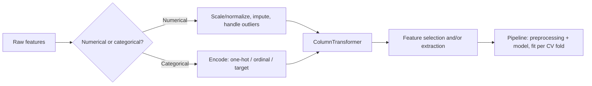

# 13 — Feature Engineering

## Learning objectives

By the end of this topic you can:
- Distinguish numerical and categorical features and apply the right encoding/scaling for each.
- Handle missing values and outliers deliberately, not by default.
- Perform feature selection and feature extraction, and explain the difference.
- Build a leakage-safe `Pipeline`/`ColumnTransformer` that applies different preprocessing to different column types.

## Why it matters

Feature engineering is where most of the practical performance gain in tabular ML comes from —
more than algorithm choice, in many real projects. It's also where leakage (from
`04_datasets`/`12_ml_evaluation`) most often sneaks in, so this topic closes the loop by
building everything inside a `Pipeline`.

## Prerequisites

[`12_ml_evaluation`](../12_ml_evaluation/README.md) (cross-validation, leakage,
`Pipeline`-based correctness).

## Core concepts

- **Numerical vs categorical features**: continuous/ordered values vs discrete, unordered (or ordinal) categories — each needs different treatment.
- **Encoding**: one-hot encoding (a column per category, for unordered/nominal categories) vs ordinal encoding (a single integer column, for genuinely ordered categories) vs target/mean encoding (encode a category by a statistic of the target — powerful but leakage-prone if not done inside cross-validation folds).
- **Scaling/normalization**: `StandardScaler` (zero mean, unit variance) vs `MinMaxScaler` (bounded `[0,1]`) — matters for distance-based models (k-NN, SVM) and gradient-based optimization, not for tree-based models.
- **Missing values**: `SimpleImputer` (mean/median/most-frequent) vs more sophisticated model-based imputation — the right choice depends on *why* data is missing (missing-at-random vs missing-not-at-random).
- **Outliers**: cap (winsorize), remove, or transform (log) — the right choice depends on whether the outlier is a data error or a genuine extreme value.
- **Feature selection**: choosing a subset of existing features (e.g. `SelectKBest`, L1-based selection from `11_generalization`) — doesn't create new features, just prunes.
- **Feature extraction**: deriving new features from existing ones (e.g. PCA components from `09_unsupervised_learning`, polynomial features, domain-specific ratios/aggregates).
- **Pipelines**: chaining preprocessing + model into one object so `fit`/`predict`/cross-validation apply every step consistently and leakage-safely (`ColumnTransformer` applies different preprocessing per column type within the same pipeline).

## Important APIs / functions

`sklearn.preprocessing.StandardScaler/MinMaxScaler/OneHotEncoder/OrdinalEncoder`,
`sklearn.impute.SimpleImputer`, `sklearn.feature_selection.SelectKBest`,
`sklearn.compose.ColumnTransformer`, `sklearn.pipeline.Pipeline`.

## Notebooks

| Notebook | Purpose | Expected output |
|---|---|---|
| `01_feature_engineering_pipeline.ipynb` | A mixed numerical+categorical synthetic dataset with missing values and an outlier, fully preprocessed via `ColumnTransformer` + `Pipeline`, including feature selection, then cross-validated leakage-safely | A working `Pipeline` whose cross-validated score matches a manually-per-fold-preprocessed version exactly, demonstrating the `Pipeline` does the right thing automatically |

## Key takeaways

- The right encoding/scaling choice depends on both the feature type and the downstream model (trees don't need scaling; k-NN/SVM/linear models do).
- Target encoding is powerful but is exactly the kind of data-dependent transform that leaks if not fit per cross-validation fold.
- `ColumnTransformer` + `Pipeline` isn't just convenience — it's the mechanism that makes "refit preprocessing per fold" automatic and hard to get wrong.

## Common mistakes

- One-hot encoding a high-cardinality categorical column (e.g. 10,000 unique IDs), exploding dimensionality.
- Ordinal-encoding a genuinely unordered category (implying a false order the model will try to exploit).
- Imputing missing values with the mean without checking whether "missing" itself is informative (sometimes missingness should be its own binary feature).
- Scaling before splitting into train/test (leakage, covered in `04_datasets` and `12_ml_evaluation`, reinforced here).

## Interview questions

**Conceptual**
1. Why shouldn't you ordinal-encode a genuinely unordered categorical feature?
2. When would target encoding leak information, and how does cross-validation fold boundaries fix it?
3. Why don't tree-based models need feature scaling while k-NN and SVM do?
4. What's the practical difference between feature selection and feature extraction?
5. Why does `ColumnTransformer` exist instead of just manually preprocessing each column type separately?

**Coding**
1. Build a `ColumnTransformer` that one-hot encodes categorical columns and standard-scales numerical columns in one `Pipeline`.
2. Implement target encoding manually and demonstrate the leakage that occurs if it's fit on the full dataset vs correctly within cross-validation folds.
3. Use `SelectKBest` to reduce a feature set and compare cross-validated performance with and without selection.

**Debugging**
1. Your one-hot-encoded dataset suddenly has 50,000 columns — what feature likely caused this, and what's the fix?
2. A `Pipeline`'s cross-validated score is suspiciously lower than a manually-preprocessed-on-full-data version — which one do you trust, and why?

**Real-world engineering**
1. You have a categorical feature with 500 rare categories, most appearing only a handful of times — what encoding strategy would you consider?
2. Your dataset has a numerical column where 30% of values are missing, and you suspect missingness itself is informative (e.g. a sensor failing under extreme conditions) — how would you encode that?

## Exercises

1. Build a `ColumnTransformer` + `Pipeline` for a dataset with 3 numerical and 2 categorical columns, including missing-value imputation for both types.
2. Compare one-hot vs target encoding for a categorical feature with 20 categories, cross-validated correctly for both.
3. Add `SelectKBest(k=5)` to your pipeline and report which features were kept.

## References

- [scikit-learn — Preprocessing data](https://scikit-learn.org/stable/modules/preprocessing.html)
- [scikit-learn — `ColumnTransformer`](https://scikit-learn.org/stable/modules/compose.html#columntransformer-for-heterogeneous-data)
- [scikit-learn — Feature selection](https://scikit-learn.org/stable/modules/feature_selection.html)
- [scikit-learn — Imputation of missing values](https://scikit-learn.org/stable/modules/impute.html)
