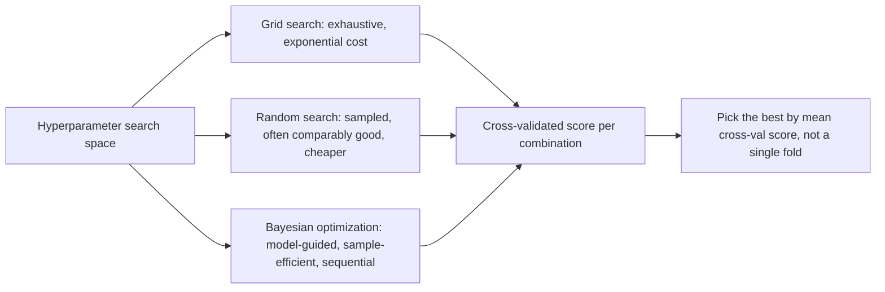

# 14 — Hyperparameter Tuning

## Learning objectives

By the end of this topic you can:
- Clearly separate parameters from hyperparameters (recap from `06_ml_fundamentals`, now applied).
- Use grid search and random search correctly, leakage-safely, with cross-validation.
- Explain the intuition behind Bayesian optimization and why it can beat random search with fewer trials.
- Combine early stopping with hyperparameter search, and compare experiments rigorously.

## Why it matters

This topic is where everything from Day 2 comes together: regularization strength (`11`),
feature-selection `k` (`13`), optimizer learning rate (`10`), and model-specific knobs (`08`)
are all hyperparameters that need systematic tuning — not guesswork — using the leakage-safe
`Pipeline` + cross-validation machinery from `12_ml_evaluation`.

## Prerequisites

[`13_feature_engineering`](../13_feature_engineering/README.md) (the `Pipeline` to tune) and
[`12_ml_evaluation`](../12_ml_evaluation/README.md) (cross-validation).

## Core concepts

- **Parameters vs hyperparameters (recap)**: parameters are learned by the optimizer during `.fit()`; hyperparameters are set *before* fitting and control how fitting happens.
- **Grid search**: exhaustively try every combination of a specified hyperparameter grid — guaranteed to find the best combination *within the grid*, but scales exponentially with the number of hyperparameters.
- **Random search**: sample random combinations from specified distributions — often finds a comparably good combination with far fewer trials than grid search, especially when only a few hyperparameters actually matter.
- **Bayesian optimization (concept)**: builds a probabilistic model of "hyperparameters → score" and uses it to choose the next most-promising point to try, rather than sampling blindly — more sample-efficient than random search, at the cost of being sequential (harder to parallelize).
- **Early stopping as part of tuning**: combine a validation-based stopping rule (`11_generalization`) with a hyperparameter search so each trial doesn't need to run to a fixed, possibly wasteful budget.
- **Experiment comparison**: comparing different hyperparameter configurations rigorously means comparing cross-validated score *distributions* (mean ± std across folds), not single numbers.

## Important APIs / functions

`sklearn.model_selection.GridSearchCV`, `RandomizedSearchCV`, `scipy.stats` distributions (for
random search sampling ranges), a from-scratch toy Bayesian-optimization loop (Gaussian-process
intuition, simplified) for the concept demo.

## Notebooks

| Notebook | Purpose | Expected output |
|---|---|---|
| `01_hyperparameter_search.ipynb` | `GridSearchCV` vs `RandomizedSearchCV` on the `13_feature_engineering` pipeline's hyperparameters (regularization strength, `SelectKBest`'s `k`); a simplified from-scratch Bayesian-optimization demo compared to random search on the same budget; rigorous comparison of the winning configurations' cross-validated score distributions | A table of grid search's exhaustive results vs random search's sampled subset reaching a comparable best score in far fewer trials; a plot showing the simplified Bayesian optimizer converging faster than random search within the same trial budget |

## Key takeaways

- Random search is usually "good enough" and dramatically cheaper than grid search once there are more than 2-3 hyperparameters to tune.
- Bayesian optimization's advantage is sample efficiency, not necessarily final quality — with enough trials, random search often catches up.
- Always compare hyperparameter configurations using cross-validated score distributions, not a single train/test split (connects directly back to `12_ml_evaluation`).
- Tuning hyperparameters on the test set (even implicitly, by repeatedly checking test performance) is itself a form of leakage — tune on validation/cross-validation, report final numbers on a held-out test set exactly once.

## Common mistakes

- Using grid search with a large hyperparameter grid, not realizing the combinatorial explosion (e.g. 5 hyperparameters × 5 values each = 3,125 combinations × CV folds).
- Tuning hyperparameters by repeatedly checking test-set performance, which leaks test information into the final model choice.
- Not using the same cross-validation splits across different search strategies, making "fair" comparisons invalid.
- Forgetting that random search's budget (number of trials) is itself a parameter of the comparison — more trials generally means a better best-found score, independent of the search strategy's intrinsic quality.

## Interview questions

**Conceptual**
1. Why does random search often outperform grid search per unit of compute, especially with many hyperparameters?
2. What does Bayesian optimization do differently from random search, conceptually?
3. Why is "tuning on the test set" a form of leakage, even if you never explicitly refit on test data?
4. When would grid search still be the right choice despite its cost?
5. Why should a final reported performance number come from a test set that was touched exactly once?

**Coding**
1. Run `GridSearchCV` and `RandomizedSearchCV` with the same total compute budget (combinations × folds) on the same pipeline and compare best scores found.
2. Implement a simplified Bayesian optimization loop (even a crude surrogate like a Gaussian process from `sklearn.gaussian_process`) and compare its convergence to random search on a toy 1D function.
3. Build a nested cross-validation setup: an outer loop for unbiased performance estimation, an inner loop for hyperparameter search.

**Debugging**
1. Your `GridSearchCV` takes far longer than expected — what's the most likely cause, and how would you estimate the total number of fits beforehand?
2. Two different hyperparameter search runs on the same data and grid give different "best" hyperparameters — what's the most likely explanation if cross-validation folds weren't fixed with a shared `random_state`?

**Real-world engineering**
1. You have a training budget of only 20 trials for a model with 6 hyperparameters — would you reach for grid search, random search, or Bayesian optimization, and why?
2. Your team keeps "tuning" by checking the test set repeatedly across many experiments — what's wrong with this practice, and what would you change?

## Exercises

1. Define a hyperparameter grid for the `13_feature_engineering` pipeline (regularization strength, `SelectKBest`'s `k`) and run `GridSearchCV`, reporting the best combination and its cross-validated score.
2. Run `RandomizedSearchCV` with the same total number of fits as the grid search above and compare the best score found.
3. Plot best-score-found-so-far vs number of trials for random search, to visualize diminishing returns.

## References

- [scikit-learn — Tuning the hyperparameters of an estimator](https://scikit-learn.org/stable/modules/grid_search.html)
- [Bergstra & Bengio (2012) — Random Search for Hyper-Parameter Optimization](https://www.jmlr.org/papers/v13/bergstra12a.html)
- [scikit-learn — Gaussian Processes](https://scikit-learn.org/stable/modules/gaussian_process.html)
