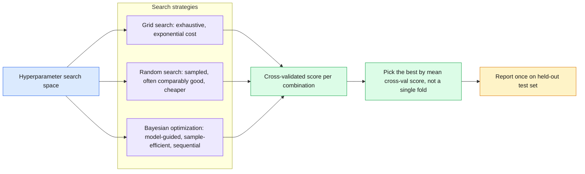
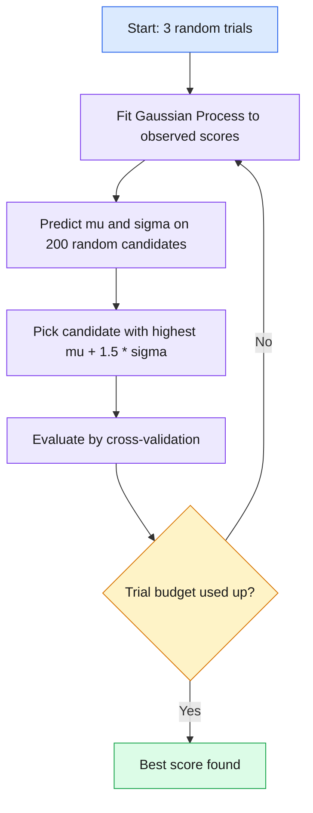

# 14 — Hyperparameter Tuning

> Choose the knobs you set before training by systematic, cross-validated search, not guesswork.

**At a glance**

| | |
|---|---|
| **Day** | 2 — Machine Learning (closing topic) |
| **Topic** | Hyperparameter tuning: grid, random, Bayesian optimization, early stopping, rigorous comparison |
| **Notebooks** | 1 (`01_hyperparameter_search.ipynb`) |
| **Builds on** | [`13_feature_engineering`](../13_feature_engineering/README.md) (the `Pipeline` to tune), [`12_ml_evaluation`](../12_ml_evaluation/README.md) (CV) |
| **Leads to** | Day 3: Deep Learning + PyTorch (learning rate, batch size, architecture tuning) |

## 📖 Short forms used in this topic

| Term | Full form | What it is |
|---|---|---|
| **ML** | Machine Learning | Learning patterns from data to make predictions instead of hand-coding rules. |
| **CV** | Cross-Validation | Repeatedly splitting data into train/validation folds to estimate generalisation. |
| **GP** | Gaussian Process | Probabilistic model giving a prediction and an uncertainty at each point; the surrogate in the Bayesian demo. |
| **UCB** | Upper Confidence Bound | Acquisition rule `mu + 1.5 * sigma` (predicted mean plus scaled uncertainty) used to pick the next trial; balances exploring and exploiting. |
| **Matern** | Matern kernel | A GP kernel controlling how smooth the surrogate function is assumed to be (notebook uses `nu=2.5`). |
| **C** | Inverse regularization strength | `LogisticRegression` hyperparameter; smaller `C` means stronger regularization. |
| **k** | Number of selected features | `SelectKBest`'s hyperparameter: how many top-scoring features to keep. |
| **f_classif** | ANOVA F-value scoring function | Scores features by class-mean separation; the scorer inside `SelectKBest` here. |
| **std** | Standard deviation | Spread of fold scores; used with the mean to compare configurations. |
| **mu / sigma** | Predicted mean / standard deviation | The GP's estimate and uncertainty at a candidate point. |
| **log10(C)** | Base-10 logarithm of `C` | Searching `C` on a log scale because useful values span orders of magnitude. |

## 🧠 In plain words

Hyperparameters are settings you choose before training, such as regularization strength or how many features to keep. Tuning means trying candidate settings, scoring each with cross-validation, and keeping the best. Grid search tries everything on a list, random search samples, and Bayesian optimization learns from past trials where to look next.

## 🎒 Analogy to remember

Finding the best oven temperature and bake time for a cake. Grid search bakes a cake at every combination on your chart; random search tries random combinations; Bayesian optimization remembers how earlier cakes turned out and picks the next promising setting. Judge each by several taste-testers (CV folds), not one. It breaks down in that the tester for the final verdict (the test set) may only taste once.

## Learning objectives

By the end of this topic you can:
- Clearly separate parameters from hyperparameters (recap from `06_ml_fundamentals`, now applied).
- Use grid search and random search correctly, leakage-safely, with cross-validation.
- Explain the intuition behind Bayesian optimization and why it can beat random search with fewer trials.
- Combine early stopping with hyperparameter search, and compare experiments rigorously.

## Why it matters

This topic is where everything from Day 2 comes together: regularization strength (`11`),
feature-selection `k` (`13`), optimizer learning rate (`10`), and model-specific knobs (`08`)
are all hyperparameters that need systematic tuning — not guesswork — using the leakage-safe
`Pipeline` + cross-validation machinery from `12_ml_evaluation`.

## Prerequisites

[`13_feature_engineering`](../13_feature_engineering/README.md) (the `Pipeline` to tune) and
[`12_ml_evaluation`](../12_ml_evaluation/README.md) (cross-validation).

## Core concepts

- **Parameters vs hyperparameters (recap)**: parameters are learned by the optimizer during `.fit()`; hyperparameters are set *before* fitting and control how fitting happens.
- **Grid search**: exhaustively try every combination of a specified hyperparameter grid — guaranteed to find the best combination *within the grid*, but scales exponentially with the number of hyperparameters.
- **Random search**: sample random combinations from specified distributions — often finds a comparably good combination with far fewer trials than grid search, especially when only a few hyperparameters actually matter.
- **Bayesian optimization (concept)**: builds a probabilistic model of "hyperparameters → score" and uses it to choose the next most-promising point to try, rather than sampling blindly — more sample-efficient than random search, at the cost of being sequential (harder to parallelize).
- **Early stopping as part of tuning**: combine a validation-based stopping rule (`11_generalization`) with a hyperparameter search so each trial doesn't need to run to a fixed, possibly wasteful budget.
- **Experiment comparison**: comparing different hyperparameter configurations rigorously means comparing cross-validated score *distributions* (mean ± std across folds), not single numbers.

Bayesian optimization loop as in the notebook:

## 🔍 Concepts explained

**Category chips:** 🟦 Search strategies · 🟩 Evaluation discipline · 🟧 Budget savers · 🟥 Leakage traps

### 🟦 Parameters vs hyperparameters (recap)

**Definition:** parameters are learned during `.fit()`; hyperparameters are set before it.
**Analogy:** hyperparameters are the recipe's oven settings; parameters are what the dough becomes.
**Examples:** parameters: weights; hyperparameters: `model__C`, `select__k`.

### 🟦 Grid search

**Definition:** try every combination in a fixed grid.
**Analogy:** a full taste-test of every menu combination.
**Code idea:** `GridSearchCV(pipeline, {"select__k": [5,10,15,20], "model__C": [0.01,0.1,1,10]}, cv=cv)`: 16 combinations x 5 folds = 80 fits.
**Use when / watch out:** few hyperparameters, cheap model, want exhaustive coverage. Cost grows multiplicatively: 5 hyperparameters x 5 values = 3,125 combinations before folds.

### 🟦 Random search

**Definition:** sample combinations from distributions for a fixed number of trials.
**Analogy:** dropping darts on the chart instead of visiting every square.
**Code idea:** `RandomizedSearchCV(pipeline, {"select__k": randint(3, 21), "model__C": loguniform(1e-3, 1e2)}, n_iter=10, cv=cv, random_state=42)`.
**Use when / watch out:** default for 3+ hyperparameters or continuous ranges. The trial budget `n_iter` is part of the comparison.

### 🟦 Bayesian optimization

**Definition:** fit a cheap surrogate (GP) to (hyperparameters -> score) seen so far, then choose the next point by an acquisition rule.
**Analogy:** a treasure hunter updating a map after each dig.
**Formula idea (notebook):** `UCB = mu + 1.5 * sigma`, pick the candidate with the highest value: high `mu` exploits, high `sigma` explores.
**Use when / watch out:** expensive trials and a small budget. It is sequential (hard to parallelize), and with an easy objective and few trials it can tie random search.

| Strategy | Trials chosen by | Cost scaling | Parallel? | Best when | Pitfall |
|---|---|---|---|---|---|
| 🟦 Grid | Fixed full list | Exponential in #hyperparameters | Yes | 1-3 hyperparameters, cheap fits | Combinatorial explosion; misses values between grid points |
| 🟦 Random | Independent samples | Linear in `n_iter` | Yes | Many hyperparameters, few matter | Budget size drives the result |
| 🟦 Bayesian | Surrogate + acquisition | Linear in trials, plus surrogate cost | Hard | Expensive evaluations, tiny budget | Sequential; simplified demos do not show production behaviour |

> [!NOTE]
> Random search wins per unit of compute when only a few hyperparameters really matter: each trial tries a new value of every hyperparameter, while a grid repeats the same few values of each.

### 🟧 Early stopping inside tuning

**Definition:** stop a trial when validation score stops improving, so weak configurations do not use the full budget.
**Analogy:** pulling a cake out of the test batch early once it is clearly burning.
**Use when / watch out:** iterative learners (boosting, neural nets). Use a validation split separate from the final test set.

### 🟩 Rigorous comparison

**Definition:** compare configurations by CV score distributions (mean and std), using the same folds.
**Analogy:** judging a runner on several races, not one.
**Code idea:** `cross_val_score(best_pipeline, X, y, cv=cv)` then report `mean ± std`.
**Use when / watch out:** if two means are within about one std, treat them as indistinguishable. Share a seeded `StratifiedKFold` across strategies.

### 🟥 Leakage traps

> [!WARNING]
> Tuning on the test set, even by repeatedly peeking, leaks test information into your choice. Tune with CV/validation data and report the test score exactly once. For an unbiased estimate of the whole tuning procedure, use nested CV (inner loop searches, outer loop evaluates).

> [!TIP]
> Estimate cost first: total fits = combinations (or `n_iter`) x `cv.n_splits`.

### Differences at a glance

| Question | Answer |
|---|---|
| 🟦 How many hyperparameters? | Few: grid. Many: random or Bayesian. |
| 🟧 Is each trial expensive? | Yes: Bayesian and/or early stopping. |
| 🟩 How to declare a winner? | Mean ± std over shared CV folds. |
| 🟥 Where to report final score? | A held-out test set, used once. |

## Important APIs / functions

`sklearn.model_selection.GridSearchCV`, `RandomizedSearchCV`, `scipy.stats` distributions (for
random search sampling ranges), a from-scratch toy Bayesian-optimization loop (Gaussian-process
intuition, simplified) for the concept demo.

## Notebooks

| Notebook | Purpose | Expected output |
|---|---|---|
| `01_hyperparameter_search.ipynb` | `GridSearchCV` vs `RandomizedSearchCV` on the `13_feature_engineering` pipeline's hyperparameters (regularization strength, `SelectKBest`'s `k`); a simplified from-scratch Bayesian-optimization demo compared to random search on the same budget; rigorous comparison of the winning configurations' cross-validated score distributions | A table of grid search's exhaustive results vs random search's sampled subset reaching a comparable best score in far fewer trials; a plot showing the simplified Bayesian optimizer converging faster than random search within the same trial budget |

## Key takeaways

- Random search is usually "good enough" and dramatically cheaper than grid search once there are more than 2-3 hyperparameters to tune.
- Bayesian optimization's advantage is sample efficiency, not necessarily final quality — with enough trials, random search often catches up.
- Always compare hyperparameter configurations using cross-validated score distributions, not a single train/test split (connects directly back to `12_ml_evaluation`).
- Tuning hyperparameters on the test set (even implicitly, by repeatedly checking test performance) is itself a form of leakage — tune on validation/cross-validation, report final numbers on a held-out test set exactly once.

## Common mistakes

- Using grid search with a large hyperparameter grid, not realizing the combinatorial explosion (e.g. 5 hyperparameters × 5 values each = 3,125 combinations × CV folds).
- Tuning hyperparameters by repeatedly checking test-set performance, which leaks test information into the final model choice.
- Not using the same cross-validation splits across different search strategies, making "fair" comparisons invalid.
- Forgetting that random search's budget (number of trials) is itself a parameter of the comparison — more trials generally means a better best-found score, independent of the search strategy's intrinsic quality.

## Interview questions

**Conceptual**
1. Why does random search often outperform grid search per unit of compute, especially with many hyperparameters?
2. What does Bayesian optimization do differently from random search, conceptually?
3. Why is "tuning on the test set" a form of leakage, even if you never explicitly refit on test data?
4. When would grid search still be the right choice despite its cost?
5. Why should a final reported performance number come from a test set that was touched exactly once?

**Coding**
1. Run `GridSearchCV` and `RandomizedSearchCV` with the same total compute budget (combinations × folds) on the same pipeline and compare best scores found.
2. Implement a simplified Bayesian optimization loop (even a crude surrogate like a Gaussian process from `sklearn.gaussian_process`) and compare its convergence to random search on a toy 1D function.
3. Build a nested cross-validation setup: an outer loop for unbiased performance estimation, an inner loop for hyperparameter search.

**Debugging**
1. Your `GridSearchCV` takes far longer than expected — what's the most likely cause, and how would you estimate the total number of fits beforehand?
2. Two different hyperparameter search runs on the same data and grid give different "best" hyperparameters — what's the most likely explanation if cross-validation folds weren't fixed with a shared `random_state`?

**Real-world engineering**
1. You have a training budget of only 20 trials for a model with 6 hyperparameters — would you reach for grid search, random search, or Bayesian optimization, and why?
2. Your team keeps "tuning" by checking the test set repeatedly across many experiments — what's wrong with this practice, and what would you change?

## Exercises

1. Define a hyperparameter grid for the `13_feature_engineering` pipeline (regularization strength, `SelectKBest`'s `k`) and run `GridSearchCV`, reporting the best combination and its cross-validated score.
2. Run `RandomizedSearchCV` with the same total number of fits as the grid search above and compare the best score found.
3. Plot best-score-found-so-far vs number of trials for random search, to visualize diminishing returns.

## References

- [scikit-learn — Tuning the hyperparameters of an estimator](https://scikit-learn.org/stable/modules/grid_search.html)
- [Bergstra & Bengio (2012) — Random Search for Hyper-Parameter Optimization](https://www.jmlr.org/papers/v13/bergstra12a.html)
- [scikit-learn — Gaussian Processes](https://scikit-learn.org/stable/modules/gaussian_process.html)
