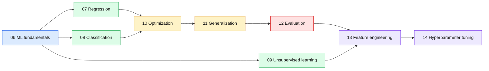

# Day 2 — Machine Learning

> The complete "classic ML" toolkit: from what learning means, to models, to measuring and tuning them.

| | |
|---|---|
| **Day** | 2 |
| **Topics** | 9 (`06` to `14`) |
| **Notebooks** | 14 across the 9 topics |
| **Builds on** | Day 1 — Python, NumPy, data and math foundations |
| **Leads to** | Day 3 — deep learning / LLM content (see repo root `ROADMAP.md`) |

Builds directly on Day 1's Python/NumPy/data/math foundations. Covers ML fundamentals,
regression, classification, unsupervised learning, optimization, generalization, evaluation,
feature engineering, and hyperparameter tuning — the complete "classic ML" toolkit, built with
the same create → execute → validate → fix method as Day 1.

## 📖 Short forms used across Day 2

| Term | Full form | What it is |
|---|---|---|
| **ML** | Machine Learning | Learning patterns from data instead of hand-coding rules. |
| **MSE** | Mean Squared Error | Average of squared errors; standard regression loss. |
| **MAE** | Mean Absolute Error | Average of absolute errors; less sensitive to outliers than MSE. |
| **RMSE** | Root Mean Squared Error | Square root of MSE, in the target's units. |
| **R2** | Coefficient of determination | Fraction of target variance explained by the model. |
| **OLS** | Ordinary Least Squares | Linear regression fit that minimizes squared error. |
| **k-NN** | k-Nearest Neighbors | Predicts from the `k` closest training points. |
| **SVM** | Support Vector Machine | Classifier that finds a maximum-margin boundary. |
| **RBF** | Radial Basis Function | A kernel that measures similarity by distance. |
| **XGBoost / LightGBM** | eXtreme Gradient Boosting / Light Gradient Boosting Machine | Fast gradient-boosted tree libraries. |
| **DBSCAN** | Density-Based Spatial Clustering of Applications with Noise | Clusters dense regions and flags outliers as noise. |
| **PCA** | Principal Component Analysis | Projects data onto directions of maximum variance. |
| **SVD** | Singular Value Decomposition | Matrix factorization underlying PCA. |
| **t-SNE** | t-distributed Stochastic Neighbor Embedding | Nonlinear embedding for visualizing neighbourhoods. |
| **UMAP** | Uniform Manifold Approximation and Projection | Nonlinear embedding that preserves more global structure than t-SNE. |
| **GD / SGD** | Gradient Descent / Stochastic Gradient Descent | Iterative loss minimization using full / mini-batch gradients. |
| **AdaGrad / RMSProp / Adam / AdamW** | Adaptive optimizers | Optimizers with per-parameter step sizes; AdamW decouples weight decay. |
| **LR** | Learning Rate | Step size of an optimizer. |
| **L1 / L2** | L1 (Lasso) / L2 (Ridge) penalty | Regularization on the sum of absolute / squared weights. |
| **TP / FP / TN / FN** | True/False Positive/Negative | Confusion-matrix counts. |
| **TPR / FPR** | True / False Positive Rate | Recall, and fraction of negatives wrongly flagged. |
| **ROC / AUC** | Receiver Operating Characteristic / Area Under the Curve | TPR vs FPR curve and its area. |
| **PR** | Precision-Recall | Curve better suited to imbalanced classes. |
| **F1** | F1 score | Harmonic mean of precision and recall. |
| **MAP / MRR / NDCG** | Mean Average Precision / Mean Reciprocal Rank / Normalized Discounted Cumulative Gain | Ranking metrics. |
| **CV** | Cross-Validation | Rotating train/validation folds to estimate generalization. |
| **LLM** | Large Language Model | Large Transformer trained to predict text. |
| **API** | Application Programming Interface | Functions a library exposes. |

## 🧠 In plain words

Day 2 teaches how a computer learns a pattern from examples and how to know whether it learned a *useful* one: pick a model, train it with an optimizer, keep it from memorizing, measure it honestly, prepare its inputs well, and tune its settings.

## 🎒 Analogy to remember

Training an athlete. Fundamentals are the rules of the sport; models are playing styles; optimizers are the coaching method; regularization stops over-specialising; evaluation is the match against unseen opponents; feature engineering is nutrition and gear; hyperparameter tuning is picking the training schedule.
*Where it breaks:* a model has no intuition, only the numbers you give it.

## 🔍 Concepts explained

| Chip | Stage | Topics | Key question |
|---|---|---|---|
| 🟦 | Foundations | [06](06_ml_fundamentals/README.md) | What is learned vs set? |
| 🟩 | Models | [07](07_regression/README.md), [08](08_classification/README.md), [09](09_unsupervised_learning/README.md) | Which model family fits the task? |
| 🟧 | Training | [10](10_ml_optimization/README.md), [11](11_generalization/README.md) | How do we fit without overfitting? |
| 🟪 | Data and tuning | [13](13_feature_engineering/README.md), [14](14_hyperparameter_tuning/README.md) | What goes in, which settings? |
| 🟥 | Measurement | [12](12_ml_evaluation/README.md) | How do we know it works? |

> [!IMPORTANT]
> Evaluation (12) is the thread through everything: tune on validation data, report once on an untouched test set.

## 🗺️ Day 2 topic flow

## Topics

1. [`06_ml_fundamentals`](06_ml_fundamentals/README.md) — learning paradigms, parameters vs hyperparameters, capacity
2. [`07_regression`](07_regression/README.md) — linear regression from scratch and with scikit-learn
3. [`08_classification`](08_classification/README.md) — logistic regression, k-NN, trees, forests, boosting, XGBoost/LightGBM, SVM, Naive Bayes
4. [`09_unsupervised_learning`](09_unsupervised_learning/README.md) — K-means, hierarchical clustering, DBSCAN, PCA/SVD, t-SNE/UMAP
5. [`10_ml_optimization`](10_ml_optimization/README.md) — SGD, momentum, AdaGrad, RMSProp, Adam, AdamW, LR schedules
6. [`11_generalization`](11_generalization/README.md) — bias-variance tradeoff, L1/L2/Elastic Net, early stopping
7. [`12_ml_evaluation`](12_ml_evaluation/README.md) — confusion-matrix metrics, ROC-AUC/PR-AUC, ranking metrics, cross-validation
8. [`13_feature_engineering`](13_feature_engineering/README.md) — encoding, scaling, imputation, selection, pipelines
9. [`14_hyperparameter_tuning`](14_hyperparameter_tuning/README.md) — grid search, random search, Bayesian optimization

See the repo root `ROADMAP.md` for how this connects to Day 1 and the upcoming Day 3.
