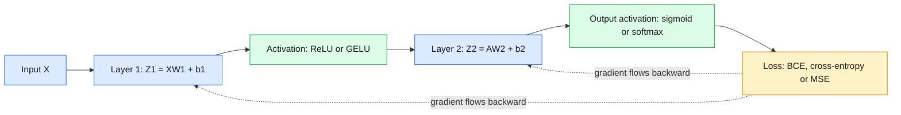
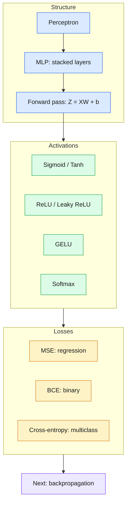

# 15 — Deep Learning Fundamentals

> A neural network is weighted sums + non-linear activations + a loss, stacked in layers — master the forward pass and the rest of deep learning is bookkeeping.

| | |
|---|---|
| **Day** | 3 — Deep Learning + PyTorch |
| **Topic** | Perceptron, MLP forward pass, activations, losses |
| **Notebooks** | 1 (`01_perceptron_and_mlp_forward_pass.ipynb`) |
| **Builds on** | Day 2 `10_ml_optimization`, Day 1 `05_ml_mathematics` |
| **Leads to** | [`16_backpropagation`](../16_backpropagation/README.md) |

## 📖 Short forms used in this topic

| Term | Full form | What it is |
|---|---|---|
| MLP | Multi-Layer Perceptron | A network of fully-connected layers with non-linear activations between them |
| ReLU | Rectified Linear Unit | Activation `max(0, x)` |
| GELU | Gaussian Error Linear Unit | Smooth ReLU-like activation `x * Φ(x)`, where Φ is the Gaussian CDF |
| CDF | Cumulative Distribution Function | `P(X ≤ x)`; GELU uses the standard normal's CDF |
| MSE | Mean Squared Error | Average of squared differences between prediction and target |
| BCE | Binary Cross-Entropy | Log-loss for two-class problems |
| CE | Cross-Entropy | Multiclass log-loss: `-log(p of the true class)`, averaged |
| NumPy | Numerical Python | Array library used for the from-scratch implementations |
| `X`, `W`, `b`, `Z`, `A` | Input, weights, bias, pre-activation, activation | `Z = XW + b`, then `A = activation(Z)` |

## 🧠 In plain words

A neural network is a chain of simple steps: multiply the inputs by learned weights, add a bias, then bend the result with an activation function. Repeat for each layer, and finish by scoring the answer with a loss function. The activation "bends" are what let the network learn curved, complex patterns instead of only straight lines.

## 🎒 Analogy to remember

A neural network is a **panel of judges scoring a contestant**: each judge (neuron) weighs different criteria (weights), adds a personal leaning (bias), and only "speaks up" if the score clears their threshold (activation). The next panel judges the first panel's verdicts. The loss is the final scoreboard saying how far the panel was from the truth. *Where it breaks down:* real neurons are numbers, not people, and the weights are learned automatically rather than chosen.

## Learning objectives

By the end of this topic you can:
- Explain the perceptron and how stacking them into layers gives an MLP.
- Implement a forward pass (weights, biases, activations) by hand with NumPy.
- Explain and implement sigmoid, tanh, ReLU, Leaky ReLU, GELU, and softmax, and state why each exists.
- Explain MSE, binary cross-entropy (BCE), and (categorical) cross-entropy as loss functions, and when to use each.

## Why it matters

Every neural network — from a 2-layer MLP to a Transformer — is the same four ingredients
repeated: weighted sums, activation functions, a loss function, and gradients. If the forward
pass here is solid, Day 3's `16_backpropagation` (the backward pass) and `18-22` (the same
thing in PyTorch) will feel like syntax, not new concepts.

## Prerequisites

Day 2's [`10_ml_optimization`](../../day02_machine_learning/10_ml_optimization/README.md)
(gradient descent) and Day 1's
[`05_ml_mathematics`](../../day01_python_data_math/05_ml_mathematics/README.md) (matrix
multiplication, the chain rule).

## Core concepts

- **Perceptron**: the simplest unit — a weighted sum of inputs plus a bias, passed through a step function. The historical ancestor of a neural network neuron.
- **Neural network / MLP (Multi-Layer Perceptron)**: perceptrons stacked in layers, with a non-linear activation between layers — without the non-linearity, stacking linear layers would collapse into a single linear layer.
- **Weights and biases**: each layer is `Y = XW + b`, exactly the `07_regression` linear-layer shape reasoning from Day 1/2, repeated per layer.
- **Forward pass**: feeding an input through every layer in sequence to produce a prediction.
- **Loss**: a single number measuring how wrong the prediction was — what the network is trained to minimize.
- **Backward pass (preview)**: computing how much each weight contributed to the loss — the subject of `16_backpropagation`.
- **Activation functions**:
  - **Sigmoid**: squashes to `(0,1)` — useful for binary probabilities, but saturates (near-zero gradient) for large `|x|`.
  - **Tanh**: squashes to `(-1,1)`, zero-centered (often better-behaved than sigmoid), still saturates.
  - **ReLU**: `max(0,x)` — the modern default; cheap, doesn't saturate for positive inputs, but can "die" (always output 0) for inputs that are always negative.
  - **Leaky ReLU**: `max(αx, x)` for small `α` — fixes ReLU's dying-neuron problem by allowing a small negative slope.
  - **GELU**: a smooth approximation to ReLU using the Gaussian CDF — common in Transformers (e.g. GPT, BERT).
  - **Softmax**: converts a vector of raw scores ("logits") into a probability distribution that sums to 1 — used for multiclass output layers.
- **Loss functions**:
  - **MSE**: for regression — squared difference between prediction and target.
  - **BCE (Binary Cross-Entropy)**: for binary classification — penalizes confident wrong predictions heavily.
  - **Cross-entropy**: the multiclass generalization of BCE, paired with softmax output.

## 🔍 Concepts explained

> [!NOTE]
> Category chips used below: 🟦 structure (perceptron, MLP, layers) · 🟩 activations · 🟧 losses · 🟥 numerical pitfalls.

### 🟦 Perceptron and MLP
- **Definition**: a perceptron is `step(w·x + b)`; an MLP stacks layers of such units with non-linear activations in between.
- **Analogy**: one judge vs. a whole panel of judges.
- **Code idea**: `Z1 = X @ W1 + b1; A1 = relu(Z1); Z2 = A1 @ W2 + b2`.
- **Use when / watch out**: tabular or small-scale problems; without non-linearity, stacked layers collapse into one linear layer.

### 🟦 Forward pass
- **Definition**: pushing an input through every layer in order to get a prediction.
- **Analogy**: an assembly line where each station transforms the part.
- **Code idea**: track shapes: `(batch, in) @ (in, hidden) -> (batch, hidden)`.
- **Use when / watch out**: assert shapes at each step; a wrong shape is the most common early bug.

### 🟩 Activation functions

| | Activation | Formula | Range | Use when | Pitfall |
|---|---|---|---|---|---|
| 🟩 | Sigmoid | `1/(1+e^-x)` | (0, 1) | Binary output probability | Saturates, vanishing gradients |
| 🟩 | Tanh | `(e^x - e^-x)/(e^x + e^-x)` | (-1, 1) | Zero-centred hidden units (older nets, RNNs) | Still saturates |
| 🟩 | ReLU | `max(0, x)` | [0, ∞) | Default for hidden layers | Dying ReLU (always 0) |
| 🟩 | Leaky ReLU | `max(αx, x)` | (-∞, ∞) | When dead neurons appear | Extra hyperparameter α |
| 🟩 | GELU | `x * Φ(x)` | about [-0.17, ∞) | Transformers (GPT, BERT) | Costlier than ReLU |
| 🟩 | Softmax | `e^zi / Σ e^zj` | (0, 1), sums to 1 | Multiclass output layer | Overflow if not max-subtracted |

> [!TIP]
> Hidden layers: start with ReLU (or GELU in Transformers). Output layer: sigmoid for binary, softmax for multiclass, none (identity) for regression.

### 🟧 Loss functions

| | Loss | Task | Formula idea | Pitfall |
|---|---|---|---|---|
| 🟧 | MSE | Regression | `mean((ŷ - y)^2)` | Poor gradients for classification |
| 🟧 | BCE | Binary classification | `-[y log p + (1-y) log(1-p)]` | `log(0)`; clip or use logits |
| 🟧 | Cross-entropy | Multiclass | `-log(p_true_class)` | Pair with a stable softmax |

- **Analogy**: a loss is a strictness-graded exam. Cross-entropy is the harsh grader who punishes confident wrong answers far more than hesitant ones.

> [!WARNING]
> Softmax then `log` by hand can overflow or give `log(0)`. Use the stable form: subtract `max(z)` before exponentiating (log-sum-exp).

> [!IMPORTANT]
> Softmax sums to 1 across **classes for one sample**, not across the batch.

### 🗺️ Concept map

## Important APIs / functions

Pure NumPy for this topic (no PyTorch yet — that starts at `18_pytorch_basics`): manual
matrix multiplication, manual activation function implementations, manual loss functions.

## Notebooks

| Notebook | Purpose | Expected output |
|---|---|---|
| `01_perceptron_and_mlp_forward_pass.ipynb` | Perceptron from scratch; a 2-layer MLP forward pass from scratch with explicit shapes at every step; every activation function implemented and plotted; MSE/BCE/cross-entropy implemented and sanity-checked | Plots of all 6 activation functions on the same axes; a full forward pass through a 2-layer MLP with asserted output shapes; loss values that behave correctly on known easy cases (e.g. BCE near 0 for a confident correct prediction) |

## Key takeaways

- Non-linear activations are what make a multi-layer network strictly more expressive than a single linear layer — without them, stacking layers is mathematically equivalent to one layer.
- ReLU's simplicity (and cheap gradient) is exactly why it became the default, despite sigmoid/tanh being the historical starting point.
- Cross-entropy specifically punishes confident *wrong* predictions far more than uncertain wrong ones — this shapes training dynamics strongly.

## Common mistakes

- Using sigmoid/tanh in deep networks and being surprised by vanishing gradients (addressed more in `16_backpropagation`).
- Applying softmax, then cross-entropy, by hand with an unstable (non-log-sum-exp) implementation, causing numerical overflow.
- Forgetting that softmax's outputs are a *distribution over classes for one sample* — summing to 1 across classes, not across the batch.
- Using MSE for a classification problem (slower convergence, worse gradient behavior than cross-entropy).

## Interview questions

**Conceptual**
1. Why does stacking linear layers without a non-linear activation between them not increase model capacity?
2. Why did ReLU largely replace sigmoid/tanh as the default activation in deep networks?
3. What's the "dying ReLU" problem, and how does Leaky ReLU address it?
4. Why is cross-entropy generally preferred over MSE for classification?
5. What does softmax guarantee about its output vector?

**Coding**
1. Implement a 2-layer MLP forward pass from scratch (NumPy), given input, weights, biases, and an activation function.
2. Implement a numerically stable softmax (subtracting the max before exponentiating) and show it matches a naive implementation on well-scaled inputs but doesn't overflow on large ones.
3. Implement binary cross-entropy from scratch and verify it approaches 0 for confident correct predictions and grows large for confident wrong ones.

**Debugging**
1. Your naive softmax implementation returns `nan` for large input values — why, and how does the stable version fix it?
2. A network using sigmoid activations in every layer trains extremely slowly — what's the likely cause?

**Real-world engineering**
1. You're designing the output layer for a model that must output a probability for each of 1,000 mutually exclusive classes — which activation do you use, and why?
2. You're designing a model with many layers and want to avoid dying neurons — which activation would you choose over plain ReLU, and why?

## Exercises

1. Plot sigmoid, tanh, ReLU, Leaky ReLU, and GELU on the same axes over `x ∈ [-5, 5]`.
2. Implement a 3-layer MLP forward pass and verify the output shape matches `(batch_size, n_output_classes)`.
3. Compute cross-entropy loss for a batch of predictions and verify it matches `-log(predicted probability of the true class)`, averaged over the batch.

## References

- [Stanford CS231n — Neural Networks notes](https://cs231n.github.io/neural-networks-1/)
- [Deep Learning Book (Goodfellow et al.) — Chapter 6](https://www.deeplearningbook.org/contents/mlp.html)
- [Hendrycks & Gimpel (2016) — GELU paper](https://arxiv.org/abs/1606.08415)
