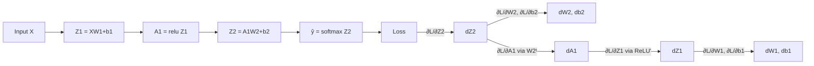

# 16 — Backpropagation

## Learning objectives

By the end of this topic you can:
- Trace the full training step: forward pass → prediction → loss → gradients → backward pass → optimizer → updated weights.
- Compute every gradient for a tiny 2-layer network by hand, matching a numerical gradient check.
- Explain why backpropagation is "just" the chain rule applied layer by layer, cached efficiently.

## Why it matters

This is the single most important mechanism in all of deep learning, and the part most
engineers treat as a black box. Doing it by hand once, on a tiny example, removes the mystery
before PyTorch's `autograd` (`19_pytorch_autograd`) does it automatically — you'll be verifying
autograd's output against your own hand-derived gradients, not trusting it blindly.

## Prerequisites

[`15_deep_learning`](../15_deep_learning/README.md) (the forward pass, losses) and Day 1's
[`05_ml_mathematics`](../../day01_python_data_math/05_ml_mathematics/README.md) (the chain rule).

## Core concepts

```text
forward pass
→ prediction
→ loss
→ gradients (backward pass)
→ optimizer
→ updated weights
```

- **Forward pass**: compute every layer's output, *keeping* the intermediate values (`Z1`, `A1`, `Z2`, ...) — they're needed again during the backward pass.
- **Loss**: a single scalar, as in `15_deep_learning`.
- **Backward pass**: starting from the loss, apply the chain rule layer by layer, *backward* through the network, computing `∂Loss/∂W` for every weight matrix and `∂Loss/∂b` for every bias.
- **The key reuse**: each layer's backward computation reuses the gradient computed one layer downstream (`∂Loss/∂A_next`) — this reuse, not any new math, is why backprop is efficient compared to recomputing each weight's gradient independently from scratch.
- **Optimizer step**: once every gradient is known, any optimizer from Day 2's `10_ml_optimization` (SGD, Adam, ...) can use them to update weights — backprop only computes the gradients, the optimizer decides how to use them.



## Important APIs / functions

Pure NumPy manual backward-pass implementation; `numpy`-based numerical gradient checking
(finite differences, reused from Day 1's `05_ml_mathematics`) to verify every analytic gradient.

## Notebooks

| Notebook | Purpose | Expected output |
|---|---|---|
| `01_backprop_by_hand.ipynb` | A tiny manual numerical example first (2-3 scalar values, full chain-rule derivation by hand), then backpropagation implemented from scratch for the 2-layer MLP from `15_deep_learning`, with every analytic gradient checked against a numerical (finite-difference) gradient | Every analytic gradient (`dW1`, `db1`, `dW2`, `db2`) matching its numerical counterpart within tolerance; one full training step shown to reduce the loss |

## Key takeaways

- Backpropagation is the chain rule, applied once per layer, with intermediate results cached and reused — it is not a separate algorithm from calculus, it's calculus organized efficiently.
- Every gradient computed by hand here is exactly what PyTorch's `autograd` computes automatically in `19_pytorch_autograd` — the same math, just tracked by a computational graph instead of hand-derived.
- Numerical gradient checking (finite differences) is the standard way to verify a hand-written or newly-implemented backward pass is correct.

## Common mistakes

- Forgetting to cache forward-pass intermediate values, forcing a wasteful full forward recomputation during the backward pass.
- Getting a transpose wrong in a backward-pass matrix multiplication (a very common bug — shapes will often still "work" by accident in one direction but be mathematically wrong).
- Not checking gradients numerically after implementing a backward pass by hand, shipping a silently-wrong gradient.

## Interview questions

**Conceptual**
1. Why is backpropagation described as "the chain rule, applied efficiently" rather than a separate algorithm?
2. What intermediate values from the forward pass does the backward pass need, and why?
3. Why does a numerical gradient check matter even when you're confident in your analytic derivation?
4. What's the relationship between backpropagation and the optimizer (e.g. SGD, Adam) — which one computes what?
5. Why would a transposed-matrix bug in a backward pass often not raise a shape error, yet still produce wrong results?

**Coding**
1. Implement the backward pass for a single linear layer (`Z = XW + b`) and verify `dW`, `db`, and `dX` against numerical gradients.
2. Implement ReLU's backward pass (`dZ = dA * (Z > 0)`) and verify it against a numerical gradient.
3. Chain the full 2-layer MLP's forward and backward pass together and run 50 steps of gradient descent, verifying the loss decreases.

**Debugging**
1. Your backward pass's `dW1` has the wrong shape — what's the most common cause (hint: check which matrix needs transposing)?
2. Your numerical gradient check consistently disagrees with your analytic gradient by roughly a factor of 2 — what's a common cause of exactly this kind of discrepancy?

**Real-world engineering**
1. You're debugging a custom loss function in a framework that doesn't support autograd for your use case — how would you verify your hand-written gradient is correct before trusting it in training?
2. Training loss decreases initially then suddenly becomes `nan` — how might a backward-pass bug (vs a learning-rate issue) cause this, and how would you distinguish the two?

## Exercises

1. By hand, derive `∂Loss/∂w` for a single-weight, single-input linear regression with MSE loss, and verify it matches the formula used in Day 2's `07_regression` gradient descent.
2. Implement numerical gradient checking as a reusable function and apply it to every weight matrix in the 2-layer MLP backward pass.
3. Deliberately introduce a transpose bug in the backward pass and observe how the numerical gradient check catches it.

## References

- [Stanford CS231n — Backpropagation notes](https://cs231n.github.io/optimization-2/)
- [3Blue1Brown — Backpropagation calculus](https://www.3blue1brown.com/lessons/backpropagation-calculus)
- [Rumelhart, Hinton, Williams (1986) — Learning representations by back-propagating errors](https://www.nature.com/articles/323533a0)
