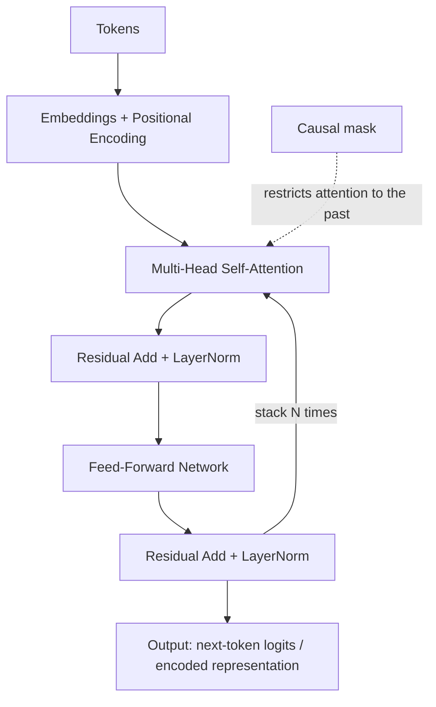

# 17 — Deep Learning Architectures: CNN, RNN/LSTM/GRU, Attention, Transformer

## Learning objectives

By the end of this topic you can:
- Explain convolution, kernels, stride, padding, and pooling, and implement a 2D convolution from scratch.
- Explain RNN/LSTM/GRU and why vanilla RNNs struggle with long sequences.
- Explain query/key/value, self-attention, cross-attention, and multi-head attention — and implement scaled dot-product attention from scratch.
- Describe the full Transformer block: embeddings, positional encoding, multi-head attention, FFN, residual connections, normalization, encoder/decoder, and causal masking.

## Why it matters

This topic is the direct on-ramp to everything in this workspace's `llm-fine-tuning/`
curriculum — every LLM is a stack of Transformer blocks. Understanding *why* attention
replaced RNNs (parallelizable, no vanishing-gradient-over-time problem) and what each piece of
a Transformer block does is the difference between using Hugging Face models as a black box and
actually understanding what you're fine-tuning.

## Prerequisites

[`16_backpropagation`](../16_backpropagation/README.md) (gradients through a network);
Day 1's [`02_numpy`](../../day01_python_data_math/02_numpy/README.md) (shape reasoning, now
applied to much higher-dimensional tensors).

## Core concepts

### CNNs
- **Convolution**: slide a small learned filter (**kernel**) across the input, computing a dot product at each position — detects local patterns (edges, textures) regardless of position.
- **Stride**: how far the kernel moves per step — larger stride = smaller output, less overlap.
- **Padding**: adding border pixels (usually zeros) so the output size can match the input size ("same" padding) instead of always shrinking ("valid" padding).
- **Pooling**: downsampling (e.g. max pooling) — reduces spatial size and adds translation invariance.

### RNNs
- **RNN**: processes a sequence step by step, carrying a hidden state forward — in principle captures arbitrary-length context, but **vanishing/exploding gradients** over many steps make long-range dependencies hard to learn.
- **LSTM / GRU**: add gating mechanisms (forget/input/output gates for LSTM; reset/update gates for GRU) specifically to control what the hidden state remembers vs forgets, mitigating vanishing gradients — GRU is a simpler, often similarly effective variant of LSTM.

### Attention and Transformers
- **Query/Key/Value**: for each position, compute a query ("what am I looking for"), compared against every position's key ("what do I offer") to get attention weights, which weight every position's value ("what information do I carry").
- **Self-attention**: queries, keys, and values all come from the *same* sequence — every token can directly attend to every other token, in one step (unlike an RNN's step-by-step propagation).
- **Cross-attention**: queries come from one sequence, keys/values from another (e.g. decoder attending to encoder outputs in a translation model).
- **Multi-head attention**: run several attention computations ("heads") in parallel, each potentially learning a different kind of relationship, then combine the results.
- **Transformer block**: embeddings → (+ positional encoding, since attention has no inherent sense of order) → multi-head self-attention → residual connection + normalization → feed-forward network (FFN) → another residual connection + normalization.
- **Encoder/decoder**: an encoder processes the full input at once (bidirectional attention); a decoder generates output step by step and uses **causal masking** to prevent attending to future tokens it hasn't generated yet.
- **Residual connections**: `output = x + f(x)` — lets gradients flow directly through many stacked layers, critical for training very deep networks.
- **Normalization (LayerNorm)**: normalizes activations within each sample, stabilizing training in deep stacks of layers.

## Important APIs / functions

Pure NumPy for this topic (a from-scratch 2D convolution, a from-scratch RNN cell, from-scratch
scaled dot-product attention) — PyTorch's `nn.Conv2d`/`nn.RNN`/`nn.MultiheadAttention`
equivalents are introduced for real in `20_pytorch_models`.

## Notebooks

| Notebook | Purpose | Expected output |
|---|---|---|
| `01_cnn_from_scratch.ipynb` | 2D convolution, stride, padding, and max pooling implemented from scratch on a small synthetic "image" | A kernel detecting a specific pattern (e.g. a vertical edge) in a toy grid, with output shapes verified for different stride/padding combinations |
| `02_rnn_lstm_gru_concept.ipynb` | A vanilla RNN cell from scratch, a demonstration of vanishing gradients over a long sequence, and a conceptual (not fully from-scratch) walkthrough of LSTM/GRU gating | A plot showing gradient magnitude shrinking exponentially with sequence length in a vanilla RNN |
| `03_attention_and_transformer_block.ipynb` | Scaled dot-product attention from scratch (Q/K/V, multi-head, causal masking), then a full from-scratch Transformer block (embeddings + positional encoding + multi-head attention + residual + LayerNorm + FFN) | Verified attention weight matrices summing to 1 per query; a causal mask visibly zeroing out attention to future positions; a full Transformer block's output shape matching its input shape (so blocks can stack) |

## Key takeaways

- Convolution exploits spatial locality and parameter sharing (the same small kernel is reused across the whole image) — a huge parameter-efficiency win over a fully-connected layer on image data.
- RNNs process sequentially and can't parallelize across time steps during training; attention computes all pairwise relationships in a sequence in one parallelizable step, which is a large part of why Transformers scale better.
- Residual connections and normalization aren't optional extras — very deep networks (CNNs, Transformers alike) are difficult or impossible to train well without them.
- Causal masking is what makes a decoder "autoregressive" — it can only attend to positions it has already generated or been given.

## Common mistakes

- Forgetting padding changes output spatial size, leading to shape-mismatch errors deeper in a CNN.
- Assuming LSTMs fully solve vanishing gradients — they mitigate it substantially but very long sequences are still hard.
- Implementing attention without scaling by `√d_k`, causing extremely peaked (low-entropy) attention distributions and unstable gradients.
- Forgetting the causal mask in a decoder, letting it "cheat" by attending to future tokens during training.

## Interview questions

**Conceptual**
1. Why does convolution use far fewer parameters than a fully-connected layer for the same input size?
2. Why do vanilla RNNs struggle with long-range dependencies, and how do LSTM/GRU gates help?
3. What problem does self-attention solve that made it preferable to RNNs for sequence modeling?
4. Why is positional encoding necessary for a Transformer but not for an RNN?
5. What does causal masking prevent, and why is it necessary for autoregressive generation?

**Coding**
1. Implement 2D convolution from scratch (a single kernel, no padding) and verify the output shape formula `(H - K + 1, W - K + 1)`.
2. Implement scaled dot-product attention (`softmax(QKᵗ/√d_k)V`) from scratch and verify attention weights sum to 1 per query.
3. Implement a causal mask and verify it correctly zeros out (via `-inf` before softmax) attention to future positions.

**Debugging**
1. Your from-scratch convolution's output is a different shape than expected — what are the two most likely causes (stride, padding)?
2. Your attention implementation produces `nan` losses during training — what's a likely missing step (hint: scaling)?

**Real-world engineering**
1. You're choosing between a CNN and a Transformer for a long-sequence time-series task — what tradeoffs would you weigh regarding sequence length and parallelism?
2. You're implementing a decoder-only language model — which masking strategy do you need, and why?

## Exercises

1. Implement max pooling from scratch and verify it reduces a 4x4 grid to 2x2 with a 2x2 pooling window.
2. Implement multi-head attention (multiple parallel single-head attentions, concatenated) and verify the output shape matches a single-head attention's output shape.
3. Stack two from-scratch Transformer blocks and verify the output shape is preserved end to end.

## References

- [Stanford CS231n — Convolutional Neural Networks](https://cs231n.github.io/convolutional-networks/)
- [Stanford CS224n — Transformers and Self-Attention](https://web.stanford.edu/class/cs224n/)
- [Vaswani et al. (2017) — Attention Is All You Need](https://arxiv.org/abs/1706.03762)
- [The Illustrated Transformer (Jay Alammar)](https://jalammar.github.io/illustrated-transformer/)
- [The Illustrated Self-Attention (Raimi Karim)](https://towardsdatascience.com/illustrated-self-attention-2d627e33b20a)
