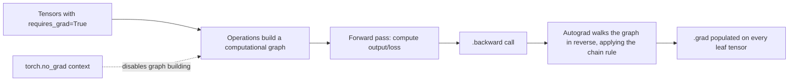

# 19 — PyTorch Autograd

## Learning objectives

By the end of this topic you can:
- Explain the computational graph PyTorch builds when `requires_grad=True`.
- Use `.backward()` and `.grad` to compute gradients automatically, and verify them against `16_backpropagation`'s hand-derived gradients.
- Explain `torch.no_grad()` and when/why to use it.

## Why it matters

This is the payoff for `16_backpropagation`. Every gradient computed by hand there is computed
automatically here — the exact same math, just tracked by a graph instead of derived on paper.
Trusting (and knowing how to debug) autograd is foundational to every PyTorch training loop
from here on.

## Prerequisites

[`18_pytorch_basics`](../18_pytorch_basics/README.md) (tensors) and
[`16_backpropagation`](../16_backpropagation/README.md) (the chain rule, done by hand — this
topic automates exactly that).

## Core concepts

- **Computational graph**: as operations are performed on tensors with `requires_grad=True`, PyTorch records them in a graph connecting inputs to outputs — this graph is what `.backward()` walks in reverse.
- **`requires_grad`**: marks a tensor as one PyTorch should track operations on, for later gradient computation. Model parameters have this set automatically; raw input data usually doesn't need it.
- **`.grad`**: after `.backward()`, each leaf tensor with `requires_grad=True` has its computed gradient accumulated here — note "accumulated," not "overwritten" (`.grad.zero_()` between steps matters, previewed here, used for real in `22_pytorch_training`).
- **`.backward()`**: triggers the automatic backward pass over the computational graph, computing `∂output/∂input` for every tracked tensor.
- **Chain rule (recap)**: autograd's internal mechanism is exactly `16_backpropagation`'s chain rule, applied automatically to an arbitrary graph of operations instead of a fixed 2-layer MLP derived by hand.
- **`torch.no_grad()`**: a context manager that disables gradient tracking — used during inference/evaluation, where gradients are never needed and tracking them wastes memory and compute.

## Important APIs / functions

`torch.tensor(..., requires_grad=True)`, `.backward()`, `.grad`, `.grad.zero_()`,
`torch.no_grad()`, `.detach()`.

## Notebooks

| Notebook | Purpose | Expected output |
|---|---|---|
| `01_autograd_basics.ipynb` | A tiny scalar example (matching `16_backpropagation`'s hand-derived `a*b+1` example) verified via autograd; the 2-layer MLP from `15_deep_learning`/`16_backpropagation` rebuilt in PyTorch, with `.backward()`'s gradients compared directly against the hand-derived NumPy gradients; a `.grad` accumulation gotcha demonstrated and fixed; `torch.no_grad()` used for inference | Autograd's gradients matching the hand-derived gradients from `16_backpropagation` to floating-point precision; a clear demonstration of `.grad` silently accumulating across calls without `zero_()`, and the fix |

## Key takeaways

- Autograd computes nothing new mathematically — it automates exactly the chain-rule bookkeeping done by hand in `16_backpropagation`.
- `.grad` accumulates by default; forgetting to zero it between training steps is one of the most common PyTorch training bugs (a silent one — training often still "sort of works" but incorrectly).
- `torch.no_grad()` isn't just a performance optimization — using it during evaluation prevents accidentally building up a graph you'll never need, and signals intent clearly.

## Common mistakes

- Forgetting `optimizer.zero_grad()` (or manually `.grad.zero_()`) between training steps, silently accumulating gradients across batches.
- Calling `.numpy()` on a tensor that still requires grad (PyTorch will raise an error — `.detach()` first).
- Doing unnecessary gradient tracking during evaluation/inference, wasting memory.
- Calling `.backward()` twice on the same graph without `retain_graph=True`, when that's not actually needed (usually a sign of a structural bug elsewhere).

## Interview questions

**Conceptual**
1. What does `requires_grad=True` actually do, mechanically?
2. Why does `.grad` accumulate instead of overwrite by default, and why does that matter?
3. What's the difference between `.detach()` and `torch.no_grad()`?
4. Why is `.backward()` able to compute gradients for an arbitrary chain of operations, not just a fixed architecture?
5. What happens if you try to call `.backward()` a second time on the same graph without `retain_graph=True`?

**Coding**
1. Build the `a*b+1` scalar example from `16_backpropagation` in PyTorch with `requires_grad=True`, call `.backward()`, and verify `.grad` matches the hand-derived gradient.
2. Rebuild the 2-layer MLP forward pass from `15_deep_learning` in PyTorch and verify `.backward()`'s gradients match `16_backpropagation`'s hand-derived NumPy gradients.
3. Demonstrate the `.grad` accumulation bug by calling `.backward()` twice without zeroing gradients, and show the fix.

**Debugging**
1. You call `.numpy()` on a tensor and get `RuntimeError: Can't call numpy() on Tensor that requires grad` — what's the fix, and why does PyTorch enforce this?
2. Your training loss looks like it's training correctly but convergence is oddly slow/unstable — you suspect a missing `zero_grad()` — how would you verify this?

**Real-world engineering**
1. You're running inference on a trained model in production — why wrap the forward pass in `torch.no_grad()`?
2. You're implementing a custom operation that autograd can't differentiate through automatically — what PyTorch mechanism would you reach for (conceptually)?

## Exercises

1. Build a small computational graph with at least 4 chained operations, and manually verify `.backward()`'s gradient against a hand-derived chain-rule calculation.
2. Reproduce the `.grad` accumulation bug intentionally, observe the incorrect (doubled) gradient, then fix it with `.grad.zero_()`.
3. Time a forward+backward pass with and without `torch.no_grad()` (forward only, since `no_grad` disables backward) and compare memory/time.

## References

- [PyTorch docs — Autograd mechanics](https://pytorch.org/docs/stable/notes/autograd.html)
- [PyTorch docs — `torch.autograd`](https://pytorch.org/docs/stable/autograd.html)
- [PyTorch tutorials — Autograd](https://pytorch.org/tutorials/beginner/basics/autogradqs_tutorial.html)
