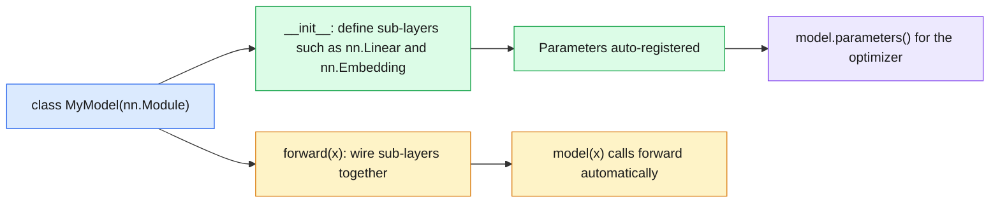
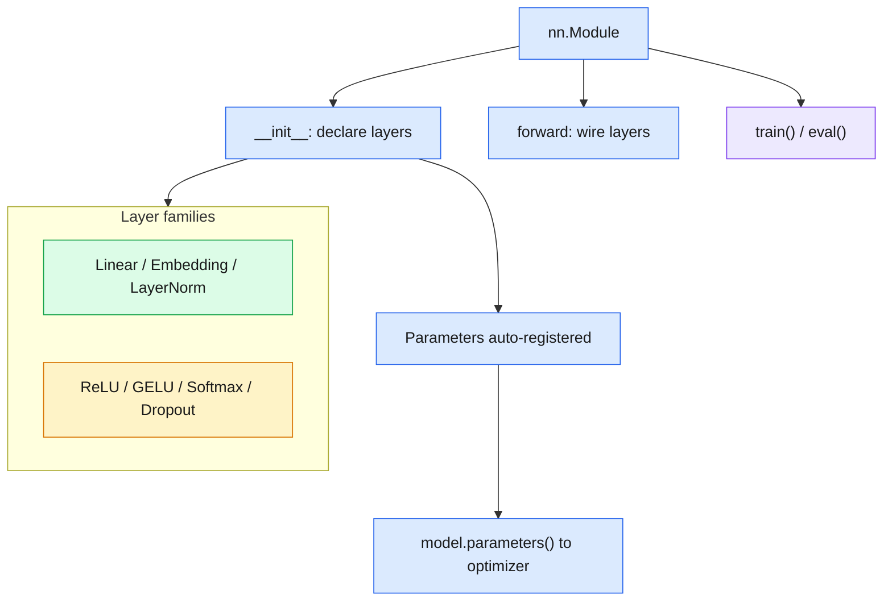

# 20 — PyTorch Models: `nn.Module`

> `nn.Module` is the container that turns layers into a model: it owns the parameters and defines `forward()`.

| | |
|---|---|
| **Day** | 3 — Deep Learning + PyTorch |
| **Topic** | `nn.Module` and the standard layers |
| **Notebooks** | 1 (`01_nn_module_basics.ipynb`) |
| **Builds on** | [`19_pytorch_autograd`](../19_pytorch_autograd/README.md), [`17_deep_learning_architectures`](../17_deep_learning_architectures/README.md) |
| **Leads to** | [`21_pytorch_data`](../21_pytorch_data/README.md), [`22_pytorch_training`](../22_pytorch_training/README.md) |

## 📖 Short forms used in this topic

| Term | Full form | What it is |
|---|---|---|
| `nn` | `torch.nn` (neural network module) | PyTorch's package of layers and containers |
| MLP | Multi-Layer Perceptron | Fully-connected network; the notebook's `TwoLayerMLP` |
| ReLU | Rectified Linear Unit | Activation `max(0, x)` |
| GELU | Gaussian Error Linear Unit | Smooth activation used in Transformers |
| FFN | Feed-Forward Network | The per-position MLP inside a Transformer block |
| LayerNorm | Layer Normalization | Normalizes each sample's features |
| ID / IDs | Identifier(s) | Integer token indices looked up by `nn.Embedding` |
| `W`, `b` | Weight matrix, bias | Learnable parameters of `nn.Linear` |
| DataLoader | (PyTorch class) | Batches data; covered in `21_pytorch_data` |

## 🧠 In plain words

An `nn.Module` is a Lego-style building block: you declare the sub-layers in `__init__` and describe how data flows through them in `forward()`. PyTorch automatically collects every learnable weight in the whole tree, so an optimizer can update them all with one call.

## 🎒 Analogy to remember

A model is a **kitchen recipe card**: `__init__` lists the ingredients and tools (layers), `forward()` lists the steps. The kitchen manager (PyTorch) keeps an inventory of everything that can be adjusted (`parameters()`), and a "tasting mode vs service mode" switch (`train()`/`eval()`) changes how some tools behave. *Where it breaks down:* a recipe is fixed, while a model's ingredient amounts (weights) are learned.

## Learning objectives

By the end of this topic you can:
- Build a model by subclassing `nn.Module`, defining layers in `__init__` and the forward pass in `forward()`.
- Use `nn.Linear`, `nn.Embedding`, `nn.ReLU`/`nn.GELU`, `nn.LayerNorm`, `nn.Dropout`, `nn.Softmax` correctly.
- Rebuild the 2-layer MLP and the Transformer block from `15-17` as proper `nn.Module`s.

## Why it matters

`nn.Module` is the organizing unit of every PyTorch model, from a 2-layer MLP to a full LLM.
It automatically registers parameters (so an optimizer can find them) and gives every model a
consistent `forward()` interface — this is the structure `22_pytorch_training`'s training loop
expects.

## Prerequisites

[`19_pytorch_autograd`](../19_pytorch_autograd/README.md) (the gradients this wraps) and
[`17_deep_learning_architectures`](../17_deep_learning_architectures/README.md) (the
architecture being rebuilt as a module).

## Core concepts

- **`nn.Module`**: the base class for all PyTorch models/layers. Subclass it, define sub-layers in `__init__`, and implement `forward()` — calling the module (`model(x)`) invokes `forward()` automatically and handles bookkeeping.
- **`nn.Linear`**: a fully-connected layer (`Y = XW^T + b`) — replaces manually tracking `W`/`b` tensors from `19_pytorch_autograd`, and registers its weights as parameters automatically.
- **`nn.Embedding`**: a lookup table mapping integer token IDs to dense vectors — the first layer of almost every NLP/LLM model.
- **`nn.ReLU` / `nn.GELU`**: activation functions as modules (vs. the functional `torch.relu` used directly in `19_pytorch_autograd`) — useful for putting activations inside `nn.Sequential`.
- **`nn.LayerNorm`**: the production version of `17_deep_learning_architectures`'s from-scratch `layer_norm` function.
- **`nn.Dropout`**: randomly zeroes elements during training (recap from Day 2's `11_generalization`) — automatically disabled during `.eval()` mode.
- **`nn.Softmax`**: softmax as a module, for use inside a `forward()` method or `nn.Sequential`.
- **Parameters**: every `nn.Linear`/`nn.Embedding`/etc. registers its weights as `nn.Parameter`s automatically — `model.parameters()` yields every learnable tensor in the whole module tree, which is exactly what an optimizer needs.



## 🔍 Concepts explained

> [!NOTE]
> Chips: 🟦 containers · 🟩 learnable layers · 🟧 activations/regularizers · 🟪 mode switches.

### 🟦 `nn.Module`
- **Definition**: base class; sub-layers set as attributes in `__init__` are registered, `forward()` defines computation.
- **Analogy**: the recipe card.
- **Code idea**:
  ```python
  class TwoLayerMLP(nn.Module):
      def __init__(self, d_in, d_h, d_out):
          super().__init__()
          self.fc1 = nn.Linear(d_in, d_h)
          self.fc2 = nn.Linear(d_h, d_out)
      def forward(self, x):
          return self.fc2(torch.relu(self.fc1(x)))
  ```
- **Use when / watch out**: call `model(x)`, not `model.forward(x)`, so hooks and bookkeeping run; call `super().__init__()` first.

### 🟩 `nn.Linear`, `nn.Embedding`, `nn.LayerNorm`
- **Definition**: `Linear` computes `Y = XWᵀ + b`; `Embedding` looks up a vector per integer ID; `LayerNorm` normalizes each sample's features.
- **Analogy**: a mixing board; a dictionary from word-ID to vector; a volume normalizer.
- **Use when / watch out**: `Embedding` takes integer (long) tensors; `Linear` stores `W` as `(out, in)`.

### 🟧 `nn.ReLU`, `nn.GELU`, `nn.Softmax`, `nn.Dropout`
- **Definition**: activation modules, and Dropout, which randomly zeroes elements in training (survivors are scaled by `1/(1-p)`).
- **Analogy**: Dropout is randomly benching players in practice so the team doesn't rely on one star.
- **Use when / watch out**: modules slot into `nn.Sequential`; with `nn.CrossEntropyLoss`, feed raw logits, not softmax output.

### 🟪 `train()` vs `eval()`
- **Definition**: mode flags that change layer behaviour (Dropout active only in train mode).
- **Analogy**: practice match vs real match.
- **Use when / watch out**: `eval()` does not disable gradients; pair it with `torch.no_grad()` for inference.

### 🟦 Parameters
- **Definition**: `nn.Parameter` tensors registered automatically; `model.parameters()` yields them all.
- **Analogy**: the inventory of adjustable knobs.
- **Use when / watch out**: plain tensors stored as attributes are not registered; wrap them in `nn.Parameter` or use `register_buffer` for non-learned state.

### Differences at a glance

| | Layer | Input to it | Learnable? | Behaviour changes in `eval()`? |
|---|---|---|---|---|
| 🟩 | `nn.Linear` | float tensor | Yes (W, b) | No |
| 🟩 | `nn.Embedding` | integer IDs | Yes (table) | No |
| 🟩 | `nn.LayerNorm` | float tensor | Yes (scale, shift) | No |
| 🟧 | `nn.ReLU` / `nn.GELU` | float tensor | No | No |
| 🟧 | `nn.Dropout` | float tensor | No | Yes (becomes identity) |
| 🟧 | `nn.Softmax` | logits | No | No |

> [!IMPORTANT]
> Forgetting `model.eval()` at inference leaves Dropout on, giving noisy, non-deterministic predictions.

> [!TIP]
> `nn.MultiheadAttention` + `nn.LayerNorm` + `nn.Linear` are the building blocks the notebook uses to rebuild the Transformer block from topic 17.

### 🗺️ Concept map



## Important APIs / functions

`nn.Module`, `nn.Linear`, `nn.Embedding`, `nn.ReLU`, `nn.GELU`, `nn.LayerNorm`, `nn.Dropout`,
`nn.Softmax`, `nn.Sequential`, `model.parameters()`, `model.train()`/`model.eval()`.

## Notebooks

| Notebook | Purpose | Expected output |
|---|---|---|
| `01_nn_module_basics.ipynb` | The 2-layer MLP from `19_pytorch_autograd` rewritten as a proper `nn.Module`; each layer type (`nn.Linear`/`nn.Embedding`/`nn.LayerNorm`/`nn.Dropout`) demonstrated individually; `model.train()` vs `model.eval()`'s effect on dropout; a from-scratch-equivalent Transformer block rebuilt using `nn.MultiheadAttention` + `nn.LayerNorm` + `nn.Linear` | The `nn.Module`-based MLP producing numerically identical output to the manual-tensor version from `19_pytorch_autograd`, given the same weights; dropout demonstrably active in `.train()` mode and inactive in `.eval()` mode |

## Key takeaways

- `nn.Module` is purely organizational — it doesn't change the underlying math, just makes parameter management and composition automatic (no more manually tracking a list of weight tensors).
- `model.parameters()` is what connects a model to an optimizer (`22_pytorch_training`) — it recursively finds every registered parameter in every sub-module.
- Dropout and some other layers behave differently in train vs eval mode — always call `.eval()` before inference and `.train()` before resuming training.

## Common mistakes

- Forgetting to call `model.eval()` before inference, leaving dropout active and getting non-deterministic predictions.
- Defining a layer in `forward()` instead of `__init__` — this creates a new, untrained layer on every call instead of reusing registered parameters.
- Not calling the parent `nn.Module.__init__()` (via `super().__init__()`) before registering sub-layers, which breaks parameter registration silently.

## Interview questions

**Conceptual**
1. What does subclassing `nn.Module` give you that manually managing tensors (as in `19_pytorch_autograd`) doesn't?
2. Why must sub-layers be defined in `__init__`, not `forward()`?
3. What's the practical difference between `model.train()` and `model.eval()`, concretely for dropout?
4. Why does `model.parameters()` need to recurse into sub-modules?
5. What does `nn.Embedding` do differently from `nn.Linear`?

**Coding**
1. Rewrite the manual-tensor 2-layer MLP from `19_pytorch_autograd` as an `nn.Module` subclass and verify identical output given the same weights.
2. Build an `nn.Sequential` stack equivalent to a hand-defined `nn.Module` with the same layers, and verify both produce the same output.
3. Demonstrate `nn.Dropout`'s different behavior in `.train()` vs `.eval()` mode on the same input.

**Debugging**
1. Your model's parameters aren't updating during training — you forgot `super().__init__()` in your `nn.Module` subclass — what symptom would you observe, and why?
2. Your model gives different outputs on identical inputs at inference time — what mode check would you add first?

**Real-world engineering**
1. You're deploying a trained model for inference-only serving — what two things should you make sure happen before serving predictions (hint: mode and gradient tracking)?
2. You're building a large model with many repeated sub-blocks — how would `nn.Module` composition help you avoid duplicating code?

## Exercises

1. Build a 3-layer MLP as an `nn.Module`, print `model.parameters()`'s shapes, and verify the total parameter count by hand.
2. Build an `nn.Embedding` layer, look up a batch of token IDs, and verify the output shape is `(batch, sequence_length, embedding_dim)`.
3. Rebuild `17_deep_learning_architectures`'s from-scratch Transformer block using `nn.MultiheadAttention`, `nn.LayerNorm`, and `nn.Linear`, and verify the output shape matches the from-scratch version.

## References

- [PyTorch docs — `nn.Module`](https://pytorch.org/docs/stable/generated/torch.nn.Module.html)
- [PyTorch tutorials — Build the Neural Network](https://pytorch.org/tutorials/beginner/basics/buildmodel_tutorial.html)
- [PyTorch docs — `nn.MultiheadAttention`](https://pytorch.org/docs/stable/generated/torch.nn.MultiheadAttention.html)
