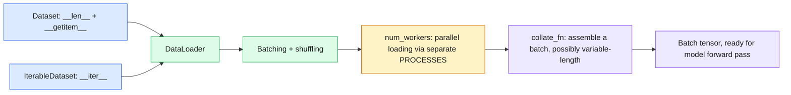
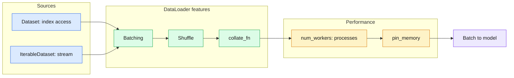

# 21 — PyTorch Data: `Dataset` and `DataLoader`

> `Dataset` says how to get one sample; `DataLoader` turns samples into shuffled, parallel-loaded batches.

| | |
|---|---|
| **Day** | 3 — Deep Learning + PyTorch |
| **Topic** | `Dataset`, `IterableDataset`, `DataLoader`, `collate_fn` |
| **Notebooks** | 1 (`01_dataset_and_dataloader.ipynb`) |
| **Builds on** | [`20_pytorch_models`](../20_pytorch_models/README.md), Day 1 `01_python`, `04_datasets` |
| **Leads to** | [`22_pytorch_training`](../22_pytorch_training/README.md) |

## 📖 Short forms used in this topic

| Term | Full form | What it is |
|---|---|---|
| GIL | Global Interpreter Lock | CPython lock letting one thread run Python bytecode at a time; why workers are processes |
| CPU | Central Processing Unit | Does data loading and preprocessing |
| GPU | Graphics Processing Unit | Trains on batches; should not wait on data |
| CPython | C implementation of Python | The standard Python interpreter that has the GIL |
| `__len__`, `__getitem__`, `__iter__` | Python magic (dunder) methods | The protocol methods a `Dataset` or `IterableDataset` implements |
| `num_workers` | Number of worker processes | `DataLoader` argument for parallel loading |
| `pin_memory` | Page-locked memory flag | Speeds CPU to GPU copies |
| `collate_fn` | Collate function | Function that merges a list of samples into one batch |
| SGD | Stochastic Gradient Descent | Optimizer that benefits from shuffled batches |

## 🧠 In plain words

Training consumes data in small batches. A `Dataset` knows how to hand you sample number `i`; a `DataLoader` repeatedly picks samples, stacks them into a batch tensor, shuffles every epoch, and can do the loading in background processes so the GPU never waits.

## 🎒 Analogy to remember

A **restaurant kitchen**: the `Dataset` is the pantry with labelled shelves (get item `i`), the `DataLoader` is the prep team that grabs ingredients, bundles them into trays (batches), and mixes the order each night (shuffle). `num_workers` are extra prep cooks working in parallel so the chef (GPU) never waits; `collate_fn` is how trays of oddly sized items get packed. *Where it breaks down:* prep cooks are separate processes with their own memory, not shared hands.

## Learning objectives

By the end of this topic you can:
- Implement a custom `Dataset` (`__len__` + `__getitem__`) and an `IterableDataset` for streaming data.
- Use `DataLoader` correctly: batching, shuffling, `num_workers`, `pin_memory`, and a custom `collate_fn`.
- Explain why `num_workers` uses separate processes, connecting back to Day 1's GIL discussion.

## Why it matters

Every PyTorch training loop pulls batches from a `DataLoader`. Getting this right (correct
batching, efficient parallel loading, proper shuffling) is often the difference between a GPU
sitting idle waiting for data and one running at full utilization.

## Prerequisites

[`20_pytorch_models`](../20_pytorch_models/README.md); Day 1's
[`01_python`](../../day01_python_data_math/01_python/README.md) (the `ToyDataset` class with
`__len__`/`__getitem__` was *literally* a `Dataset` preview) and
[`04_datasets`](../../day01_python_data_math/04_datasets/README.md) (Hugging Face `datasets`,
a different but related abstraction).

## Core concepts

- **`Dataset`**: an object implementing `__len__` and `__getitem__` — exactly the magic-method contract previewed with `ToyDataset` in Day 1's `01_python`. Represents the *whole* dataset, accessible by index.
- **`IterableDataset`**: implements `__iter__` instead — for data that's naturally streamed (too large to index randomly, or generated on the fly) rather than indexed, mirroring Day 1's `04_datasets` streaming `IterableDataset` from Hugging Face.
- **`DataLoader`**: wraps a `Dataset`, handling batching, shuffling, and parallel loading — this is what a training loop actually iterates over.
- **Batching**: grouping multiple samples into one tensor per step — `DataLoader`'s default `collate_fn` stacks same-shaped samples automatically.
- **Shuffle**: randomizing sample order each epoch — essential for SGD-based training (connects to Day 2's `10_ml_optimization`) to avoid learning spurious patterns from data order.
- **`num_workers`**: spawns separate **processes** (not threads) to load/preprocess data in parallel while the GPU/CPU trains on the previous batch — separate processes specifically because of the GIL (Day 1's `01_python`), the same reason `multiprocessing` was needed there for CPU-bound work.
- **`pin_memory`**: allocates batches in page-locked memory, speeding up the CPU→GPU transfer (relevant when training on CUDA).
- **`collate_fn`**: a custom function controlling how a list of samples becomes a batch — needed when samples have variable-length data (e.g. different-length token sequences) that can't be stacked by default.

## 🔍 Concepts explained

> [!NOTE]
> Chips: 🟦 data sources · 🟩 loader features · 🟧 performance knobs · 🟥 pitfalls.

### 🟦 `Dataset` (map-style)
- **Definition**: implements `__len__` and `__getitem__(i)`; random access by index.
- **Analogy**: a pantry with numbered shelves.
- **Code idea**: `def __getitem__(self, i): return self.x[i], self.y[i]`.
- **Use when / watch out**: data fits an index (arrays, files list); keep `__getitem__` cheap or push heavy work into workers.

### 🟦 `IterableDataset`
- **Definition**: implements `__iter__`; data is streamed, with no random access or `len`.
- **Analogy**: a conveyor belt versus a shelf.
- **Use when / watch out**: huge or generated data; `shuffle=True` is not supported with it, and with multiple workers each worker must handle its own shard or you get duplicates.

### 🟩 `DataLoader`, batching, shuffle
- **Definition**: wraps a dataset to yield batches; `shuffle=True` reorders each epoch.
- **Analogy**: the prep team making trays.
- **Code idea**: `DataLoader(ds, batch_size=32, shuffle=True)`.
- **Use when / watch out**: shuffle training data, not validation data.

### 🟩 `collate_fn`
- **Definition**: turns a list of samples into a batch; the default stacks equal-shaped tensors.
- **Analogy**: a packer who pads short boxes to fit the tray.
- **Use when / watch out**: variable-length sequences need a custom `collate_fn` (pad to the longest, return lengths or a mask).

### 🟧 `num_workers` and `pin_memory`
- **Definition**: `num_workers=N` loads in N background processes; `pin_memory=True` uses page-locked memory for faster host-to-GPU copies.
- **Analogy**: extra prep cooks; a loading dock right next to the chef.
- **Use when / watch out**: processes (not threads) because of the GIL; more workers cost RAM and startup time, and gains vanish if loading is already trivial.

### Differences at a glance

| | Aspect | `Dataset` (map-style) | `IterableDataset` |
|---|---|---|---|
| 🟦 | Methods | `__len__`, `__getitem__` | `__iter__` |
| 🟦 | Random access / `len` | Yes | No |
| 🟩 | `shuffle=True` | Supported | Not supported; shuffle in the stream |
| 🟧 | Multi-worker | Indices split automatically | You must shard yourself |
| 🟦 | Typical use | Arrays, image folders | Streams, huge or generated data |

> [!WARNING]
> If the model sees `RuntimeError: stack expects each tensor to be equal size`, your samples differ in length. Write a `collate_fn` that pads.

> [!TIP]
> GPU utilization low? Try raising `num_workers` and setting `pin_memory=True` on CUDA before touching the model (see `23_pytorch_performance`).

### 🗺️ Concept map

## Important APIs / functions

`torch.utils.data.Dataset`, `IterableDataset`, `DataLoader`, `collate_fn`, `num_workers`,
`pin_memory`, `shuffle`.

## Notebooks

| Notebook | Purpose | Expected output |
|---|---|---|
| `01_dataset_and_dataloader.ipynb` | A custom `Dataset` wrapping synthetic data; a `DataLoader` with batching/shuffling; a custom `collate_fn` for variable-length sequences; an `IterableDataset` for streaming; a brief `num_workers` timing comparison | Batches with correct, consistent shapes from the custom `Dataset`; a variable-length batch correctly padded via `collate_fn`; verified shuffling changes sample order between epochs |

## Key takeaways

- `Dataset` + `DataLoader` is the same `__len__`/`__getitem__` contract previewed all the way back in Day 1's `01_python` — this curriculum has been building toward this exact abstraction since the first topic.
- `num_workers > 0` uses separate processes specifically because the GIL would prevent threads from parallelizing CPU-bound preprocessing — the same lesson from Day 1's concurrency notebook, now applied for real.
- A custom `collate_fn` is necessary whenever samples aren't uniformly shaped (e.g. variable-length text) — the default collate function assumes they are.

## Common mistakes

- Forgetting `shuffle=True` for training data (test/validation data usually shouldn't be shuffled).
- Using a large `num_workers` on a machine with few CPU cores, causing more overhead than benefit.
- Not writing a custom `collate_fn` for variable-length data, causing a cryptic stacking error.
- Doing expensive preprocessing inside `__getitem__` that could be done once upfront instead, slowing down every epoch.

## Interview questions

**Conceptual**
1. Why does a custom `Dataset` only need `__len__` and `__getitem__`, and where has this exact contract appeared earlier in this curriculum?
2. Why does `DataLoader` use separate processes (`num_workers`) rather than threads for parallel data loading?
3. When would you need a custom `collate_fn`?
4. What's the difference between `Dataset` and `IterableDataset`, and when would you use each?
5. Why does `pin_memory` matter specifically for GPU training, not CPU training?

**Coding**
1. Implement a custom `Dataset` wrapping a list of (text, label) pairs and verify `len(dataset)` and `dataset[i]` work correctly.
2. Write a custom `collate_fn` that pads variable-length integer sequences to the same length within each batch.
3. Build an `IterableDataset` that generates synthetic samples on the fly and verify a `DataLoader` can iterate over it.

**Debugging**
1. Your `DataLoader` raises a stacking error about mismatched tensor sizes — what's the most likely cause, and what's the fix?
2. Increasing `num_workers` from 0 to 8 makes training SLOWER, not faster — what might explain this?

**Real-world engineering**
1. You're training on text data with highly variable sequence lengths — how would you structure your `Dataset` and `collate_fn` to handle this efficiently?
2. Your GPU utilization is low and you suspect the data pipeline is the bottleneck — what `DataLoader` settings would you investigate first?

## Exercises

1. Build a `Dataset` from a synthetic classification dataset (features + labels) and feed it through a `DataLoader` with `batch_size=32`, verifying every batch's shape.
2. Write a `collate_fn` for a dataset of variable-length lists of integers, padding with 0 to the longest sequence in each batch.
3. Compare `DataLoader` iteration speed with `num_workers=0` vs `num_workers=2` on a `Dataset` with an artificially slow `__getitem__` (e.g. a small `time.sleep`).

## References

- [PyTorch docs — `Dataset` and `DataLoader`](https://pytorch.org/tutorials/beginner/basics/data_tutorial.html)
- [PyTorch docs — `torch.utils.data`](https://pytorch.org/docs/stable/data.html)
- [PyTorch docs — `IterableDataset`](https://pytorch.org/docs/stable/data.html#torch.utils.data.IterableDataset)
