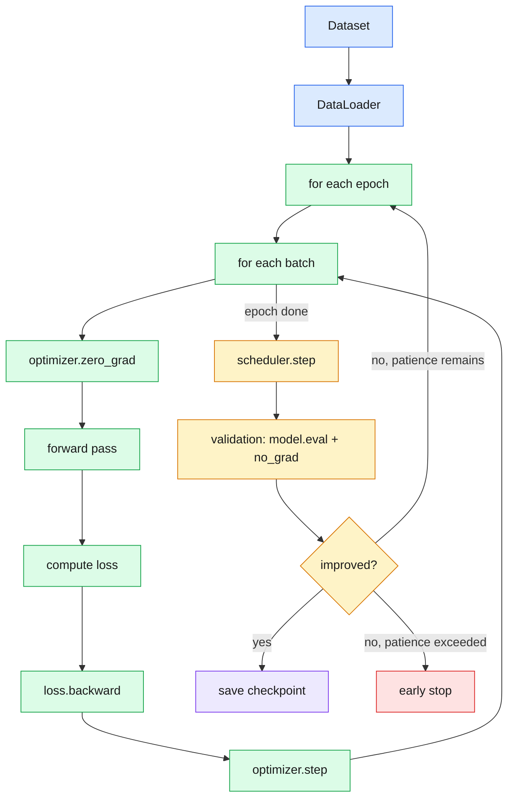
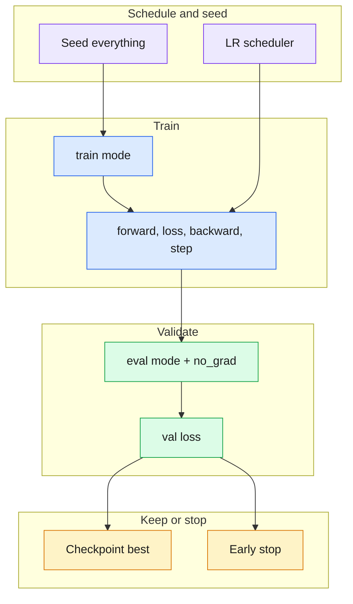

# 22 — PyTorch Training: The Complete Pipeline

> A training pipeline is the same loop every time: batch, forward, loss, backward, step, then validate and checkpoint.

| | |
|---|---|
| **Day** | 3 — Deep Learning + PyTorch |
| **Topic** | Training loop, validation, scheduler, checkpointing, early stopping, reproducibility |
| **Notebooks** | 1 (`01_full_training_pipeline.ipynb`) |
| **Builds on** | [`19_pytorch_autograd`](../19_pytorch_autograd/README.md), [`20_pytorch_models`](../20_pytorch_models/README.md), [`21_pytorch_data`](../21_pytorch_data/README.md), Day 2 `10_ml_optimization`, `11_generalization` |
| **Leads to** | [`23_pytorch_performance`](../23_pytorch_performance/README.md) |

## 📖 Short forms used in this topic

| Term | Full form | What it is |
|---|---|---|
| LR | Learning Rate | Step size multiplier for weight updates |
| `StepLR` | Step Learning-Rate scheduler | Multiplies LR by `gamma` every `step_size` epochs |
| `CosineAnnealingLR` | Cosine-annealing LR scheduler | Decays LR along a cosine curve over `T_max` epochs |
| `CrossEntropyLoss` | Cross-entropy loss module | Multiclass loss that takes raw logits and class indices |
| MLP | Multi-Layer Perceptron | The `TwoLayerMLP` model being trained |
| ReLU | Rectified Linear Unit | Activation `max(0, x)` |
| GPU | Graphics Processing Unit | Where training usually runs |
| `state_dict` | State dictionary | Mapping of parameter names to tensors, used to save and load weights |
| DataLoader | (PyTorch class) | Supplies batches to the loop |
| SGD / Adam | Stochastic Gradient Descent / Adaptive Moment Estimation | Common optimizers that apply the gradients |

## 🧠 In plain words

Training means repeating: grab a batch, predict, measure the error, compute gradients, and nudge the weights. After each pass over the data you check performance on held-out data, save the best weights, and stop if it has stopped improving. Fixing random seeds lets you repeat the run exactly.

## 🎒 Analogy to remember

Studying for an exam: **practice problems** are the training loop, a **mock exam** you never studied from is validation, a **bookmark on your best mock score** is the checkpoint, **quitting when mock scores stop improving** is early stopping, and a **study-pace plan** that slows down as you refine is the LR schedule. *Where it breaks down:* if you tune decisions on the mock exam too long, it stops being unseen; keep a separate test set.

## Learning objectives

By the end of this topic you can:
- Build the complete pipeline: `Dataset` → `DataLoader` → model → forward → loss → backward → optimizer → scheduler → validation → checkpoint.
- Implement a training loop and a validation loop correctly (including `model.train()`/`model.eval()` and `torch.no_grad()`).
- Save and load checkpoints, implement early stopping, and set seeds for reproducibility.

## Why it matters

This topic assembles every piece from `15` through `21` into the thing you'll actually run:
a real training loop. From here, training any model in this workspace's `llm-fine-tuning/`
curriculum is the same pipeline at a larger scale, not a new concept.

## Prerequisites

Every prior Day 3 topic — this is the integration point for
[`19_pytorch_autograd`](../19_pytorch_autograd/README.md),
[`20_pytorch_models`](../20_pytorch_models/README.md), and
[`21_pytorch_data`](../21_pytorch_data/README.md), plus Day 2's
[`10_ml_optimization`](../../day02_machine_learning/10_ml_optimization/README.md) (optimizers)
and [`11_generalization`](../../day02_machine_learning/11_generalization/README.md) (early
stopping).

## Core concepts

```text
Dataset
→ DataLoader
→ Model
→ Forward
→ Loss
→ Backward
→ Optimizer
→ Scheduler
→ Validation
→ Checkpoint
```

- **Training loop**: for each epoch, for each batch from the `DataLoader`: zero gradients, forward pass, compute loss, `.backward()`, optimizer step.
- **Validation loop**: after each epoch (or periodically), evaluate on held-out data with `model.eval()` and `torch.no_grad()` — no gradient tracking, no dropout.
- **Checkpointing**: saving `model.state_dict()` (and optimizer state, epoch number) periodically or whenever validation improves, so training can resume or the best model can be reloaded.
- **Early stopping**: recap from Day 2's `11_generalization`, now applied with real PyTorch validation loss tracking.
- **Reproducibility**: setting `torch.manual_seed()` (and Python's/NumPy's seeds) makes runs comparable — critical for debugging and for fair comparisons between hyperparameter settings (Day 2's `14_hyperparameter_tuning`).
- **Scheduler**: a learning-rate schedule (recap from Day 2's `10_ml_optimization`) applied via `torch.optim.lr_scheduler`, stepped once per epoch or per batch depending on the schedule.



## 🔍 Concepts explained

> [!NOTE]
> Chips: 🟦 training step · 🟩 validation · 🟧 saving and stopping · 🟪 schedule and reproducibility.

### 🟦 Training loop
- **Definition**: per batch: zero grads, forward, loss, `.backward()`, `optimizer.step()`.
- **Analogy**: one practice problem.
- **Code idea**:
  ```python
  model.train()
  for xb, yb in train_loader:
      optimizer.zero_grad()
      loss = criterion(model(xb), yb)
      loss.backward()
      optimizer.step()
  ```
- **Use when / watch out**: forgetting `zero_grad()` accumulates gradients (topic 19).

### 🟩 Validation loop
- **Definition**: evaluate on held-out data with `model.eval()` and `torch.no_grad()`.
- **Analogy**: the mock exam.
- **Use when / watch out**: forgetting `eval()` leaves Dropout on; forgetting `no_grad()` wastes memory.

### 🟧 Checkpointing
- **Definition**: save `model.state_dict()` (plus optimizer state and epoch to resume) when validation improves.
- **Analogy**: a save point in a game.
- **Code idea**: `torch.save(model.state_dict(), path)`; `model.load_state_dict(torch.load(path))`.
- **Use when / watch out**: to resume training, also save optimizer and scheduler state.

### 🟧 Early stopping
- **Definition**: stop when validation loss has not improved for `patience` epochs.
- **Analogy**: stop studying when mock scores plateau.
- **Use when / watch out**: reload the best checkpoint afterwards, not the last weights.

### 🟪 LR scheduler
- **Definition**: changes the learning rate over time via `torch.optim.lr_scheduler`.
- **Analogy**: big strides at first, small careful steps near the goal.
- **Use when / watch out**: call `scheduler.step()` after `optimizer.step()`, at the cadence the schedule expects (per epoch or per batch).

### 🟪 Reproducibility
- **Definition**: seed Python, NumPy and PyTorch so repeated runs match.
- **Code idea**: `torch.manual_seed(42)` (and `random.seed`, `np.random.seed`).
- **Use when / watch out**: GPU kernels may add non-determinism; same seed on CPU gives identical results as the notebook verifies.

### Differences at a glance

| | Mode | `model.train()` / `eval()` | Gradients? | Updates weights? |
|---|---|---|---|---|
| 🟦 | Training loop | `train()` | Yes | Yes |
| 🟩 | Validation loop | `eval()` | No (`no_grad`) | No |

| | LR schedule | Behaviour | Good for |
|---|---|---|---|
| 🟪 | `StepLR` | Drop LR by a factor every N epochs | Simple, predictable decay |
| 🟪 | `CosineAnnealingLR` | Smooth cosine decay | Smooth finish, common in modern recipes |

> [!WARNING]
> Never validate with the training-mode model on the training set and call it generalization. Always evaluate on held-out data in `eval()` mode.

> [!IMPORTANT]
> Order matters: `optimizer.zero_grad()`, forward, `loss.backward()`, `optimizer.step()`. Reordering silently corrupts training.

### 🗺️ Concept map



## Important APIs / functions

`optimizer.zero_grad()`, `loss.backward()`, `optimizer.step()`,
`torch.optim.lr_scheduler.*`, `model.train()`/`model.eval()`, `torch.save`/`torch.load`,
`model.state_dict()`/`load_state_dict()`, `torch.manual_seed`.

## Notebooks

| Notebook | Purpose | Expected output |
|---|---|---|
| `01_full_training_pipeline.ipynb` | The complete pipeline on the `SyntheticClassificationDataset` from `21_pytorch_data` and the `TwoLayerMLP` from `20_pytorch_models`: training loop, validation loop, an LR scheduler, checkpointing (save best model), early stopping, and a reproducibility check (same seed → same results) | A training/validation loss curve showing convergence; the correct checkpoint reloaded and verified to reproduce the best validation score; two runs with the same seed producing identical results |

## Key takeaways

- Every piece in this pipeline was already built in isolation across `15`-`21` — this topic is integration, not new math.
- `model.eval()` + `torch.no_grad()` together are what make validation correct and efficient — forgetting either is a common bug (dropout active during validation, or wasted memory tracking unneeded gradients).
- Checkpointing on best validation score (not best training score, and not just the last epoch) is what lets you recover the actual best model after training completes or overfits.

## Common mistakes

- Forgetting `optimizer.zero_grad()` at the start of each batch, silently accumulating gradients (the exact bug from `19_pytorch_autograd`, now in a full loop).
- Computing validation loss without `model.eval()`, leaving dropout active and producing noisy, misleading validation numbers.
- Saving only the final model instead of checkpointing on best validation performance, missing the best point before overfitting set in.
- Not setting seeds, making two "identical" runs produce different results and debugging much harder.

## Interview questions

**Conceptual**
1. Walk through the complete training step, from `optimizer.zero_grad()` to `optimizer.step()`.
2. Why must `model.eval()` and `torch.no_grad()` both be used for validation, and what does each one specifically prevent?
3. Why checkpoint on best validation score rather than just saving the final epoch's model?
4. What's the difference between stepping a scheduler once per epoch vs once per batch, and why does it matter which you choose?
5. Why does setting a random seed matter for comparing two training runs?

**Coding**
1. Implement a full training loop (train + validate per epoch) for the `TwoLayerMLP` on `SyntheticClassificationDataset`.
2. Add checkpointing that saves the model only when validation loss improves, and reload the best checkpoint at the end.
3. Implement early stopping (recap from Day 2's `11_generalization`) integrated into this training loop, using validation loss as the signal.

**Debugging**
1. Your training loss decreases smoothly but validation loss is identical to training loss every epoch — what mode-related bug would you check first?
2. Two runs with the same seed produce different results — what's commonly still a source of non-determinism even with seeds set (hint: data loading order, certain GPU operations)?

**Real-world engineering**
1. You're training a model that takes 10 hours — what checkpointing strategy would let you resume training after a crash without losing progress?
2. Your validation loss has been flat for 10 epochs while training loss keeps dropping — what would you do, concretely, using tools from this topic?

## Exercises

1. Build the full pipeline end to end and train for enough epochs to see validation loss plateau, with early stopping triggering correctly.
2. Add a learning-rate scheduler (e.g. `torch.optim.lr_scheduler.StepLR`) and plot the learning rate alongside the loss curve.
3. Save a checkpoint, intentionally modify the model's weights, reload the checkpoint, and verify the original weights are restored exactly.

## References

- [PyTorch tutorials — Optimization loop](https://pytorch.org/tutorials/beginner/basics/optimization_tutorial.html)
- [PyTorch docs — Saving and loading models](https://pytorch.org/tutorials/beginner/saving_loading_models.html)
- [PyTorch docs — `torch.optim.lr_scheduler`](https://pytorch.org/docs/stable/optim.html#how-to-adjust-learning-rate)
