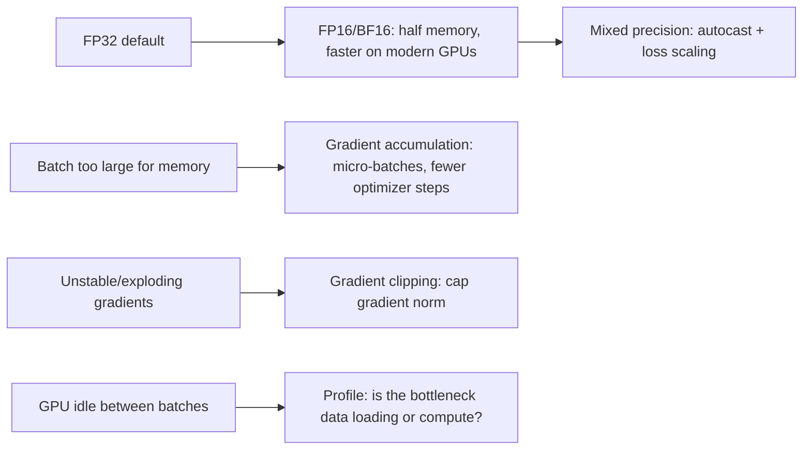

# 23 — PyTorch Performance

## Learning objectives

By the end of this topic you can:
- Explain FP32 vs FP16 vs BF16 and what mixed precision training trades off.
- Implement gradient accumulation (simulating a larger batch size than fits in memory) and gradient clipping (preventing exploding gradients).
- Identify data-loading bottlenecks and use basic profiling to find them.
- Explain GPU memory considerations at a level sufficient to reason about batch size and model size tradeoffs.

## Why it matters

This is where "my model trains correctly" becomes "my model trains fast enough, and fits in
memory, on the hardware I actually have." Every one of these techniques (mixed precision,
gradient accumulation, clipping) is standard practice in this workspace's `llm-fine-tuning/`
curriculum, where models are large enough that naive full-precision, full-batch training
simply doesn't fit.

## Prerequisites

[`22_pytorch_training`](../22_pytorch_training/README.md) (the pipeline being optimized).

## Core concepts

- **CPU vs GPU**: GPUs offer massive parallelism for matrix multiplication (the core cost of deep learning) but have their own (usually smaller) memory, and data must be explicitly moved there (`18_pytorch_basics`'s `.to(device)`).
- **GPU memory**: bounded by the GPU's VRAM; must hold the model's parameters, gradients, optimizer state (e.g. Adam keeps two extra moment buffers per parameter), and activations for the current batch — this is why larger models or batch sizes can run out of memory even when compute would be fast enough.
- **FP32 / FP16 / BF16**: FP32 (32-bit float) is the default; FP16 (16-bit) and BF16 (16-bit, different exponent/mantissa split) use half the memory and are faster on modern GPUs, at the cost of reduced numeric range/precision — BF16 keeps FP32's exponent range (more stable) while sacrificing mantissa precision, making it generally preferred over FP16 for training stability.
- **Mixed precision**: run most operations in FP16/BF16 for speed/memory, but keep certain numerically sensitive operations (e.g. loss scaling, some reductions) in FP32 — PyTorch's `torch.autocast` + `GradScaler` (for FP16) automate this.
- **Gradient accumulation**: simulate a larger effective batch size than fits in memory by accumulating gradients over several smaller "micro-batches" before calling `optimizer.step()`.
- **Gradient clipping**: cap the gradient's norm before the optimizer step, preventing a single bad batch from causing an exploding-gradient update (connects to `17_deep_learning_architectures`'s RNN vanishing/exploding gradient discussion).
- **Data-loading bottlenecks**: if the GPU finishes a batch faster than the `DataLoader` (recap from `21_pytorch_data`) can produce the next one, the GPU sits idle — profiling reveals this.
- **Profiling**: measuring where time is actually spent (data loading vs forward vs backward vs optimizer step) before trying to optimize blindly.

## Important APIs / functions

`torch.autocast`, `torch.cuda.amp.GradScaler` (CUDA-specific mixed precision), gradient
accumulation (manual loop pattern — no single API call), `torch.nn.utils.clip_grad_norm_`,
basic timing-based profiling (`torch.profiler` conceptually, timing-based measurement here for
portability across CPU/MPS/CUDA).

## Notebooks

| Notebook | Purpose | Expected output |
|---|---|---|
| `01_performance_techniques.ipynb` | FP32 vs FP16/BF16 memory and numeric-range comparison; gradient accumulation implemented and verified equivalent to a larger real batch; gradient clipping demonstrated preventing an exploding update; a simple data-loading-bottleneck profiling exercise | Verified that N accumulated micro-batches of size B produce (approximately) the same gradient as one batch of size N*B; a deliberately exploding gradient tamed by clipping; a profiling table showing time spent in data loading vs forward/backward per batch |

## Key takeaways

- BF16 is generally preferred over FP16 for training stability (same exponent range as FP32), while FP16 can need loss scaling to avoid underflow.
- Gradient accumulation and a larger real batch size are mathematically similar but not identical (batch norm statistics, if used, would differ) — still, for most purposes it's a practical way to simulate a larger batch under memory constraints.
- Gradient clipping is cheap insurance against occasional bad batches causing destabilizing updates, especially early in training or with RNNs/Transformers trained from scratch.
- Profiling before optimizing avoids wasted effort — a data-loading bottleneck can't be fixed by a faster GPU.

## Common mistakes

- Using FP16 without loss scaling and silently losing small gradient values to underflow.
- Assuming gradient accumulation and a literally larger batch size always produce identical results in the presence of batch-dependent layers (e.g. BatchNorm).
- Clipping gradients so aggressively that training barely progresses — gradient clipping is a safety net, not a substitute for a reasonable learning rate.
- Optimizing model compute when the actual bottleneck is data loading (or vice versa) without profiling first.

## Interview questions

**Conceptual**
1. Why does BF16 tend to be more numerically stable for training than FP16, despite both using 16 bits?
2. What does mixed precision training actually mix — which operations stay in FP32, and why?
3. What's the practical difference between gradient accumulation and literally increasing the batch size?
4. Why does gradient clipping target the gradient's NORM rather than clipping each element independently in most implementations?
5. Why might increasing `DataLoader` `num_workers` have zero effect on training speed in some cases?

**Coding**
1. Implement gradient accumulation over 4 micro-batches and verify the resulting gradient closely matches one full-size batch's gradient.
2. Implement gradient clipping and demonstrate it preventing a large update after an artificially huge loss on one batch.
3. Write a simple profiling wrapper that times data loading vs forward/backward separately per batch, averaged over an epoch.

**Debugging**
1. Switching to FP16 training causes your loss to become `nan` after a few steps — what's a likely fix?
2. Your training throughput doesn't improve after upgrading to a faster GPU — what would you check first?

**Real-world engineering**
1. You want to train with an effective batch size of 256 but your GPU only fits 32 samples at once — how do you achieve this, and what do you need to change in the training loop?
2. You're seeing occasional huge loss spikes early in training that destabilize the model — what's one cheap technique from this topic to try first?

## Exercises

1. Compare the memory footprint (in theory, by counting bytes) of storing the same tensor in FP32 vs FP16 vs BF16.
2. Implement gradient accumulation for `22_pytorch_training`'s pipeline with an effective batch size 4x the per-step batch size, and verify training still converges.
3. Add gradient clipping to the same pipeline and plot gradient norms before and after clipping over several batches.

## References

- [PyTorch docs — Automatic Mixed Precision](https://pytorch.org/docs/stable/amp.html)
- [PyTorch docs — `torch.cuda.amp`](https://pytorch.org/docs/stable/notes/amp_examples.html)
- [PyTorch docs — `clip_grad_norm_`](https://pytorch.org/docs/stable/generated/torch.nn.utils.clip_grad_norm_.html)
- [PyTorch docs — Profiler](https://pytorch.org/tutorials/recipes/recipes/profiler_recipe.html)
