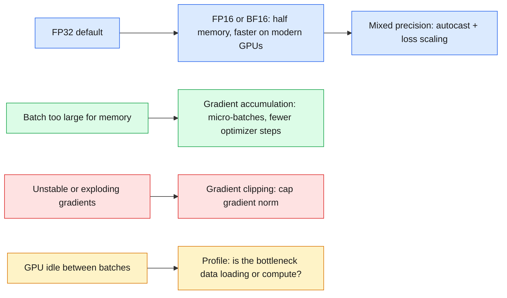
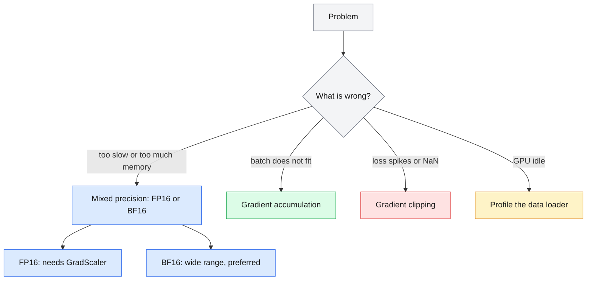

# 23 — PyTorch Performance

> Make training fit and go fast: lower precision for speed and memory, accumulation for big batches, clipping for stability, profiling to find the real bottleneck.

| | |
|---|---|
| **Day** | 3 — Deep Learning + PyTorch |
| **Topic** | Mixed precision, gradient accumulation and clipping, GPU memory, profiling |
| **Notebooks** | 1 (`01_performance_techniques.ipynb`) |
| **Builds on** | [`22_pytorch_training`](../22_pytorch_training/README.md) |
| **Leads to** | [`24_huggingface_foundations`](../24_huggingface_foundations/README.md), `llm-fine-tuning/` |

## 📖 Short forms used in this topic

| Term | Full form | What it is |
|---|---|---|
| FP32 | 32-bit floating point (single precision) | PyTorch default: 1 sign, 8 exponent, 23 mantissa bits |
| FP16 | 16-bit floating point (half precision) | 1 sign, 5 exponent, 10 mantissa bits; small range, can overflow or underflow |
| BF16 | Brain Floating Point 16 | 16 bits with FP32's 8 exponent bits but only 7 mantissa bits; wide range, lower precision |
| AMP | Automatic Mixed Precision | PyTorch's mixed-precision machinery (`torch.autocast`, `GradScaler`) |
| `GradScaler` | Gradient scaler | Scales loss up to avoid FP16 gradient underflow, then unscales |
| VRAM | Video RAM | Memory on the GPU |
| GPU | Graphics Processing Unit | Parallel processor for matrix math |
| CPU | Central Processing Unit | General-purpose processor |
| CUDA | Compute Unified Device Architecture | NVIDIA GPU platform |
| MPS | Metal Performance Shaders | Apple Silicon GPU backend |
| NVIDIA | (company name) | GPU maker behind CUDA |
| API | Application Programming Interface | The callable surface of a library |
| MSE / `MSELoss` | Mean Squared Error | Regression loss used in the notebook's demos |
| ReLU | Rectified Linear Unit | Activation `max(0, x)` |
| KB | Kilobyte | Unit used when comparing tensor memory |
| DataLoader | (PyTorch class) | Source of batches; can bottleneck the GPU |

## 🧠 In plain words

Once a model trains correctly, the next problems are "it doesn't fit in memory" and "it's too slow". Using 16-bit numbers halves memory and speeds up math; accumulating gradients over small batches imitates a big batch; clipping stops one bad batch from wrecking the weights; profiling tells you whether the GPU or the data loader is the slow part.

## 🎒 Analogy to remember

Moving house with a **small van**: shrink the boxes (mixed precision), make several trips before unpacking (gradient accumulation), put a limit on how hard any one lift can be (gradient clipping), and time each stage to find out whether loading the van or driving is the slow part (profiling). *Where it breaks down:* smaller boxes lose some detail (precision), which a house move doesn't.

## Learning objectives

By the end of this topic you can:
- Explain FP32 vs FP16 vs BF16 and what mixed precision training trades off.
- Implement gradient accumulation (simulating a larger batch size than fits in memory) and gradient clipping (preventing exploding gradients).
- Identify data-loading bottlenecks and use basic profiling to find them.
- Explain GPU memory considerations at a level sufficient to reason about batch size and model size tradeoffs.

## Why it matters

This is where "my model trains correctly" becomes "my model trains fast enough, and fits in
memory, on the hardware I actually have." Every one of these techniques (mixed precision,
gradient accumulation, clipping) is standard practice in this workspace's `llm-fine-tuning/`
curriculum, where models are large enough that naive full-precision, full-batch training
simply doesn't fit.

## Prerequisites

[`22_pytorch_training`](../22_pytorch_training/README.md) (the pipeline being optimized).

## Core concepts

- **CPU vs GPU**: GPUs offer massive parallelism for matrix multiplication (the core cost of deep learning) but have their own (usually smaller) memory, and data must be explicitly moved there (`18_pytorch_basics`'s `.to(device)`).
- **GPU memory**: bounded by the GPU's VRAM; must hold the model's parameters, gradients, optimizer state (e.g. Adam keeps two extra moment buffers per parameter), and activations for the current batch — this is why larger models or batch sizes can run out of memory even when compute would be fast enough.
- **FP32 / FP16 / BF16**: FP32 (32-bit float) is the default; FP16 (16-bit) and BF16 (16-bit, different exponent/mantissa split) use half the memory and are faster on modern GPUs, at the cost of reduced numeric range/precision — BF16 keeps FP32's exponent range (more stable) while sacrificing mantissa precision, making it generally preferred over FP16 for training stability.
- **Mixed precision**: run most operations in FP16/BF16 for speed/memory, but keep certain numerically sensitive operations (e.g. loss scaling, some reductions) in FP32 — PyTorch's `torch.autocast` + `GradScaler` (for FP16) automate this.
- **Gradient accumulation**: simulate a larger effective batch size than fits in memory by accumulating gradients over several smaller "micro-batches" before calling `optimizer.step()`.
- **Gradient clipping**: cap the gradient's norm before the optimizer step, preventing a single bad batch from causing an exploding-gradient update (connects to `17_deep_learning_architectures`'s RNN vanishing/exploding gradient discussion).
- **Data-loading bottlenecks**: if the GPU finishes a batch faster than the `DataLoader` (recap from `21_pytorch_data`) can produce the next one, the GPU sits idle — profiling reveals this.
- **Profiling**: measuring where time is actually spent (data loading vs forward vs backward vs optimizer step) before trying to optimize blindly.

## 🔍 Concepts explained

> [!NOTE]
> Chips: 🟦 number formats · 🟩 memory tricks · 🟥 stability · 🟧 measurement.

### 🟦 FP32 vs FP16 vs BF16

| | Format | Bits (sign / exp / mantissa) | Range | Precision | Needs loss scaling? |
|---|---|---|---|---|---|
| 🟦 | FP32 | 1 / 8 / 23 | Wide | High | No |
| 🟦 | FP16 | 1 / 5 / 10 | Narrow (overflow, underflow) | Medium | Yes (`GradScaler`) |
| 🟦 | BF16 | 1 / 8 / 7 | Wide (same as FP32) | Low | Usually no |

- **Analogy**: FP32 is a ruler with fine marks and long reach; FP16 has fine marks but is short; BF16 is long with coarse marks.
- **Use when / watch out**: BF16 is generally preferred for training stability where hardware supports it; FP16 needs loss scaling.

### 🟦 Mixed precision
- **Definition**: run most ops in 16-bit, keep sensitive ones in FP32 (autocast chooses per op).
- **Code idea**: `with torch.autocast(device_type="cuda", dtype=torch.bfloat16): loss = ...`
- **Use when / watch out**: for FP16 on CUDA add `GradScaler`; gains are largest on GPUs with fast 16-bit units.

### 🟩 Gradient accumulation
- **Definition**: run several micro-batches, adding their gradients, then call `optimizer.step()` once.
- **Analogy**: several trips of the small van before unpacking.
- **Code idea**: `(loss / accum_steps).backward()` each micro-batch; step and `zero_grad()` every `accum_steps`.
- **Use when / watch out**: divide the loss by `accum_steps` so the sum matches the mean over the large batch; batch-norm statistics still see only the micro-batch.

### 🟥 Gradient clipping
- **Definition**: rescale gradients so their global norm is at most a threshold.
- **Code idea**: `torch.nn.utils.clip_grad_norm_(model.parameters(), max_norm=1.0)` after `backward()` and before `step()`.
- **Analogy**: a speed limiter on the update.
- **Use when / watch out**: RNNs, Transformers, spiky losses; with `GradScaler`, call `scaler.unscale_(optimizer)` first.

### 🟩 GPU memory budget
- **Definition**: VRAM holds parameters, gradients, optimizer state, and activations.
- **Analogy**: a van's cargo space shared by boxes, packing material, and the toolbox.
- **Use when / watch out**: Adam keeps two extra buffers per parameter; activations grow with batch size and sequence length.

### 🟧 Profiling
- **Definition**: measure time in data loading, forward, backward, and optimizer step.
- **Use when / watch out**: measure before optimizing; if the loader dominates, tune `num_workers`, not the model. For GPU timing, synchronize before reading the clock.

### Differences at a glance

| | Technique | Solves | Cost / trade-off |
|---|---|---|---|
| 🟦 | Mixed precision | Slow training, high memory | Some precision loss; FP16 needs loss scaling |
| 🟩 | Gradient accumulation | Batch too big for memory | More time per optimizer step; not faster |
| 🟥 | Gradient clipping | Exploding or spiky gradients | Extra hyperparameter (max norm) |
| 🟧 | Profiling | Unknown bottleneck | Small measurement overhead |

> [!WARNING]
> FP16 without loss scaling can underflow small gradients to zero, silently stalling training.

> [!TIP]
> Out of memory? Try in order: smaller micro-batch with accumulation, mixed precision, then a smaller model or shorter sequences.

### 🗺️ Concept map

## Important APIs / functions

`torch.autocast`, `torch.cuda.amp.GradScaler` (CUDA-specific mixed precision), gradient
accumulation (manual loop pattern — no single API call), `torch.nn.utils.clip_grad_norm_`,
basic timing-based profiling (`torch.profiler` conceptually, timing-based measurement here for
portability across CPU/MPS/CUDA).

## Notebooks

| Notebook | Purpose | Expected output |
|---|---|---|
| `01_performance_techniques.ipynb` | FP32 vs FP16/BF16 memory and numeric-range comparison; gradient accumulation implemented and verified equivalent to a larger real batch; gradient clipping demonstrated preventing an exploding update; a simple data-loading-bottleneck profiling exercise | Verified that N accumulated micro-batches of size B produce (approximately) the same gradient as one batch of size N*B; a deliberately exploding gradient tamed by clipping; a profiling table showing time spent in data loading vs forward/backward per batch |

## Key takeaways

- BF16 is generally preferred over FP16 for training stability (same exponent range as FP32), while FP16 can need loss scaling to avoid underflow.
- Gradient accumulation and a larger real batch size are mathematically similar but not identical (batch norm statistics, if used, would differ) — still, for most purposes it's a practical way to simulate a larger batch under memory constraints.
- Gradient clipping is cheap insurance against occasional bad batches causing destabilizing updates, especially early in training or with RNNs/Transformers trained from scratch.
- Profiling before optimizing avoids wasted effort — a data-loading bottleneck can't be fixed by a faster GPU.

## Common mistakes

- Using FP16 without loss scaling and silently losing small gradient values to underflow.
- Assuming gradient accumulation and a literally larger batch size always produce identical results in the presence of batch-dependent layers (e.g. BatchNorm).
- Clipping gradients so aggressively that training barely progresses — gradient clipping is a safety net, not a substitute for a reasonable learning rate.
- Optimizing model compute when the actual bottleneck is data loading (or vice versa) without profiling first.

## Interview questions

**Conceptual**
1. Why does BF16 tend to be more numerically stable for training than FP16, despite both using 16 bits?
2. What does mixed precision training actually mix — which operations stay in FP32, and why?
3. What's the practical difference between gradient accumulation and literally increasing the batch size?
4. Why does gradient clipping target the gradient's NORM rather than clipping each element independently in most implementations?
5. Why might increasing `DataLoader` `num_workers` have zero effect on training speed in some cases?

**Coding**
1. Implement gradient accumulation over 4 micro-batches and verify the resulting gradient closely matches one full-size batch's gradient.
2. Implement gradient clipping and demonstrate it preventing a large update after an artificially huge loss on one batch.
3. Write a simple profiling wrapper that times data loading vs forward/backward separately per batch, averaged over an epoch.

**Debugging**
1. Switching to FP16 training causes your loss to become `nan` after a few steps — what's a likely fix?
2. Your training throughput doesn't improve after upgrading to a faster GPU — what would you check first?

**Real-world engineering**
1. You want to train with an effective batch size of 256 but your GPU only fits 32 samples at once — how do you achieve this, and what do you need to change in the training loop?
2. You're seeing occasional huge loss spikes early in training that destabilize the model — what's one cheap technique from this topic to try first?

## Exercises

1. Compare the memory footprint (in theory, by counting bytes) of storing the same tensor in FP32 vs FP16 vs BF16.
2. Implement gradient accumulation for `22_pytorch_training`'s pipeline with an effective batch size 4x the per-step batch size, and verify training still converges.
3. Add gradient clipping to the same pipeline and plot gradient norms before and after clipping over several batches.

## References

- [PyTorch docs — Automatic Mixed Precision](https://pytorch.org/docs/stable/amp.html)
- [PyTorch docs — `torch.cuda.amp`](https://pytorch.org/docs/stable/notes/amp_examples.html)
- [PyTorch docs — `clip_grad_norm_`](https://pytorch.org/docs/stable/generated/torch.nn.utils.clip_grad_norm_.html)
- [PyTorch docs — Profiler](https://pytorch.org/tutorials/recipes/recipes/profiler_recipe.html)
