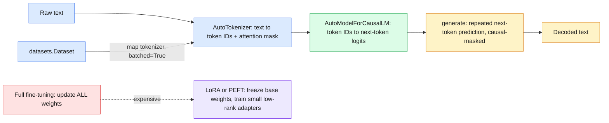
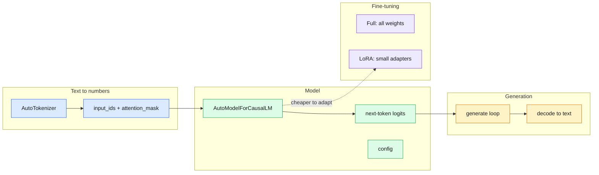

# 24 — Hugging Face Foundations

> Hugging Face turns "load a pretrained language model and use it" into three calls: tokenizer, model, `generate()`.

| | |
|---|---|
| **Day** | 3 — Deep Learning + PyTorch |
| **Topic** | Tokenizers, `AutoModel`, `generate()`, LoRA concept |
| **Notebooks** | 1 (`01_tokenizers_and_generation.ipynb`) |
| **Builds on** | [`23_pytorch_performance`](../23_pytorch_performance/README.md), Day 1 `04_datasets`, [`17_deep_learning_architectures`](../17_deep_learning_architectures/README.md) |
| **Leads to** | `llm-fine-tuning/` (LoRA, QLoRA, PEFT, inference) |

## 📖 Short forms used in this topic

| Term | Full form | What it is |
|---|---|---|
| HF | Hugging Face | Company and ecosystem behind `transformers`, `datasets`, `peft` |
| LLM | Large Language Model | Very large Transformer trained on text |
| LM | Language Model | Model that predicts the next token(s) of text |
| GPT | Generative Pre-trained Transformer | Decoder-only causal LM family; the notebook uses a small GPT-style model |
| ID / IDs | Identifier(s) | Integer indices of tokens in the vocabulary |
| PEFT | Parameter-Efficient Fine-Tuning | Family of methods that train only a small number of extra or selected parameters |
| LoRA | Low-Rank Adaptation | PEFT method: freeze base weights, learn small low-rank update matrices |
| QLoRA | Quantized LoRA | LoRA on top of a quantized (e.g. 4-bit) frozen base model |
| RAG | Retrieval-Augmented Generation | Feeding retrieved documents into a model's prompt (mentioned for context, not covered here) |
| ML | Machine Learning | Learning from data |
| AI | Artificial Intelligence | The broad field containing ML |
| `AutoTokenizer` / `AutoModel` / `AutoModelForCausalLM` | Auto classes | Load the correct tokenizer or model class from a checkpoint's config |
| `pt` | PyTorch | `return_tensors="pt"` returns PyTorch tensors |

## 🧠 In plain words

Models read numbers, not text. A tokenizer chops text into pieces and maps each to an integer ID; the model turns those IDs into predictions for the next token; `generate()` repeats that prediction in a loop to write text. Fine-tuning huge models fully is expensive, so LoRA trains only a tiny add-on instead.

## 🎒 Analogy to remember

A **translator with a phrasebook**: the tokenizer looks each piece of your sentence up in a fixed phrasebook (vocabulary) to get numbers, the model is the translator who predicts the next phrase, and `generate()` is them writing one phrase at a time, re-reading everything so far. LoRA is **adding sticky notes in the margins** of a published book rather than reprinting it. *Where it breaks down:* a phrasebook has meaning-based entries, while token pieces can be arbitrary sub-words.

## Learning objectives

By the end of this topic you can:
- Use `AutoTokenizer` to turn text into token IDs and attention masks, and explain what each represents.
- Use `AutoModel`/`AutoModelForCausalLM` to load a pretrained model and run `generate()`.
- Explain, at a conceptual level, what LoRA/PEFT does and why it matters for fine-tuning.

## Why it matters

This is intentionally the smallest topic in the curriculum — just enough to be fluent reading
and running Hugging Face code — because it's the direct handoff point to this workspace's
`llm-fine-tuning/` curriculum, which goes deep on fine-tuning, LoRA/QLoRA/PEFT, and inference
engineering. This topic should not try to teach that material; it's the on-ramp.

## Prerequisites

[`23_pytorch_performance`](../23_pytorch_performance/README.md) (this closes Day 3) and Day 1's
[`04_datasets`](../../day01_python_data_math/04_datasets/README.md) (Hugging Face `datasets`,
the sibling library to the `transformers` library used here).

## Core concepts

- **Tokenizer**: converts raw text into a sequence of integer token IDs a model can consume — using a fixed, pretrained **vocabulary** specific to that model.
- **Token IDs**: the integers a tokenizer produces; each corresponds to a row in the model's `nn.Embedding` table (`20_pytorch_models`) that turns it into a dense vector.
- **Attention mask**: a binary mask marking which tokens are real content vs padding (recap from `21_pytorch_data`'s variable-length `collate_fn`) — padded positions are masked out of attention (`17_deep_learning_architectures`) so they don't influence the output.
- **`AutoTokenizer` / `AutoModel` / `AutoModelForCausalLM`**: Hugging Face's "Auto" classes inspect a model's config and load the right tokenizer/model class automatically — you rarely need to know the exact underlying class name.
- **`generate()`**: a high-level method handling the full autoregressive generation loop (recap: causal masking from `17_deep_learning_architectures`) — repeatedly predicting the next token and feeding it back in, so you don't have to write that loop by hand.
- **Model configuration**: hyperparameters baked into a pretrained model (number of layers, hidden size, number of attention heads — all vocabulary from `17_deep_learning_architectures`) stored in a config object/file alongside the weights.
- **Dataset preprocessing (recap)**: tokenizing a Hugging Face `datasets.Dataset` (Day 1's `04_datasets`) via `.map(tokenizer_fn, batched=True)` is the standard way to prepare text data for a model.
- **PEFT / LoRA (concept only)**: fine-tuning every parameter of a large pretrained model is expensive; **PEFT** (Parameter-Efficient Fine-Tuning) methods like **LoRA** (Low-Rank Adaptation) freeze the original weights and train a small number of additional low-rank parameters instead — dramatically cheaper, while often nearly matching full fine-tuning quality. This is introduced *only* at a concept level here — full hands-on LoRA/QLoRA is this workspace's `llm-fine-tuning/02_lora_qlora_peft`.

## 🔍 Concepts explained

> [!NOTE]
> Chips: 🟦 text to numbers · 🟩 model and generation · 🟧 data prep · 🟪 efficient fine-tuning.

### 🟦 Tokenizer, token IDs, attention mask
- **Definition**: the tokenizer splits text into sub-word tokens with a fixed vocabulary and returns IDs plus an attention mask (1 = real token, 0 = padding).
- **Analogy**: the phrasebook lookup, plus a sheet marking which slots are blank.
- **Code idea**: `tok(["hi", "a longer text"], return_tensors="pt", padding=True)` returns `input_ids` and `attention_mask`.
- **Use when / watch out**: always use the tokenizer that matches the model; some tokenizers need a pad token set for batching.

### 🟩 `AutoTokenizer` / `AutoModel` / `AutoModelForCausalLM`
- **Definition**: Auto classes read the checkpoint's config and load the right classes.
- **Code idea**: `AutoModelForCausalLM.from_pretrained(name)`.
- **Use when / watch out**: `AutoModel` returns hidden states (no LM head); `AutoModelForCausalLM` adds the next-token head needed for generation.

### 🟩 `generate()`
- **Definition**: runs the autoregressive loop: predict a token, append it, repeat until a stop condition.
- **Analogy**: writing one phrase at a time while re-reading the page.
- **Code idea**: `model.generate(**inputs, max_new_tokens=20)`; then `tok.decode(...)`.
- **Use when / watch out**: output includes the prompt tokens; decoding strategy (greedy, sampling) changes the text; set `max_new_tokens` to bound length.

### 🟩 Model config
- **Definition**: hyperparameters stored beside the weights (layers, hidden size, heads, vocab size).
- **Use when / watch out**: read it via `model.config` to sanity-check size and architecture.

### 🟧 Dataset preprocessing
- **Definition**: `dataset.map(fn, batched=True)` applies the tokenizer across a Hugging Face `datasets.Dataset`.
- **Use when / watch out**: `batched=True` is much faster than per-row mapping.

### 🟪 PEFT / LoRA
- **Definition**: freeze the pretrained weights `W`; learn a low-rank update `ΔW = B·A` (rank `r` much smaller than the layer size) and train only `A` and `B`.
- **Analogy**: margin sticky notes on a printed book.
- **Formula idea**: parameters per adapted layer `r·(d_in + d_out)` versus `d_in·d_out` for full tuning.
- **Use when / watch out**: cheap fine-tuning that often nearly matches full fine-tuning; this topic is concept-only, details in `llm-fine-tuning/02_lora_qlora_peft`.

### Differences at a glance

| | Class | Output | Use for |
|---|---|---|---|
| 🟦 | `AutoTokenizer` | `input_ids`, `attention_mask` | Text to model inputs |
| 🟩 | `AutoModel` | Hidden states | Embeddings and features |
| 🟩 | `AutoModelForCausalLM` | Next-token logits, supports `generate()` | Text generation |

| | Approach | Trains | Memory and cost | Typical quality |
|---|---|---|---|---|
| 🟥 | Full fine-tuning | All weights | High | Best baseline |
| 🟪 | LoRA (PEFT) | Small adapter matrices | Low | Often close to full |
| 🟪 | QLoRA | Adapters over a quantized base | Lowest | Often close to LoRA |

> [!IMPORTANT]
> The attention mask is not optional on padded batches: without it, padding tokens influence the output.

> [!TIP]
> Start with a small, CPU-friendly checkpoint when learning; the API is identical to the large ones.

### 🗺️ Concept map

## Important APIs / functions

`transformers.AutoTokenizer.from_pretrained`, `AutoModelForCausalLM.from_pretrained`,
`.generate()`, `tokenizer(text, return_tensors="pt", padding=True)`, model `.config`.

## Notebooks

| Notebook | Purpose | Expected output |
|---|---|---|
| `01_tokenizers_and_generation.ipynb` | Load a small pretrained tokenizer and causal LM (a small, CPU-friendly model), tokenize text and inspect token IDs/attention masks, run `generate()`, inspect model configuration, and preprocess a small Hugging Face `datasets.Dataset` with the tokenizer via `.map(batched=True)`; a brief conceptual (non-hands-on) LoRA parameter-count comparison | Token IDs and attention masks printed and explained for a padded batch of 2 sentences of different lengths; `generate()` producing continuation text from a short prompt; a parameter-count comparison showing LoRA's adapter parameters are a tiny fraction of the base model's total |

## Key takeaways

- A tokenizer's vocabulary is tied to the specific pretrained model — using the wrong tokenizer for a model produces garbage, silently.
- `generate()` is doing the exact autoregressive loop (causal masking, repeated next-token prediction) covered conceptually in `17_deep_learning_architectures` — it's not new theory, just a convenient wrapper.
- LoRA's core insight — most of the *change* needed to adapt a model to a new task lives in a low-rank subspace — is why it can train a tiny fraction of the parameters and still work well; this curriculum stops at the concept, and `llm-fine-tuning/02_lora_qlora_peft` in this workspace goes hands-on.

## Common mistakes

- Mixing a tokenizer from one model with weights from a different model.
- Forgetting the attention mask when batching variable-length sequences, letting padding tokens leak into attention (connects directly to `21_pytorch_data`'s collate function and `17_deep_learning_architectures`'s masking).
- Treating `generate()`'s default settings (e.g. greedy decoding) as the only option without being aware sampling strategies exist (out of scope here — covered in `llm-fine-tuning/`).
- Downloading a large model "just to try it" instead of starting with a small CPU-friendly one for learning purposes.

## Interview questions

**Conceptual**
1. Why must a tokenizer and model always be paired correctly, and what happens if they're mismatched?
2. What does the attention mask prevent, specifically, during a forward pass on a padded batch?
3. What problem does LoRA solve compared to full fine-tuning, at a high level?
4. Why do the "Auto" classes (`AutoTokenizer`, `AutoModel`) exist instead of importing a specific model class directly?
5. What is `generate()` doing under the hood, in terms of concepts from `17_deep_learning_architectures`?

**Coding**
1. Tokenize a batch of sentences with different lengths, pad them, and print the resulting token IDs and attention mask side by side.
2. Load a small causal LM and generate a continuation from a short prompt, then decode the output back to text.
3. Use `.map(tokenizer_fn, batched=True)` to tokenize a small Hugging Face `Dataset` (recap from Day 1's `04_datasets`) and inspect the resulting columns.

**Debugging**
1. Your model's output is nonsensical even though loading succeeded without errors — what mismatch would you check first?
2. Your batched generation produces different results depending on padding side (left vs right) — why might that happen for a causal LM specifically?

**Real-world engineering**
1. You want to adapt a large pretrained model to a narrow domain but have limited GPU memory — what approach from this topic would you investigate first, and why?
2. You're deploying a tokenizer+model pair in production — what metadata (from the model's config) would you want to validate at startup?

## Exercises

1. Tokenize 3 sentences of very different lengths, batch them with padding, and verify the attention mask correctly marks padding positions.
2. Load a small causal LM, generate text from 2 different prompts, and compare the outputs.
3. Compute (conceptually, via parameter counts) what fraction of a model's total parameters a LoRA adapter with a small rank would represent, for a model of a given size and a chosen rank.

## References

- [Hugging Face — Tokenizers](https://huggingface.co/docs/transformers/main_classes/tokenizer)
- [Hugging Face — `AutoClass`](https://huggingface.co/docs/transformers/model_doc/auto)
- [Hugging Face — Text generation](https://huggingface.co/docs/transformers/generation_strategies)
- [Hu et al. (2021) — LoRA: Low-Rank Adaptation of Large Language Models](https://arxiv.org/abs/2106.09685)
- This workspace's `llm-fine-tuning/02_lora_qlora_peft` — the hands-on continuation of the LoRA concept introduced here.
