# Capstone — End-to-End AI Foundation Project

> One real dataset, one full pipeline: everything from Days 1-3 wired together, from raw data to inference.

| | |
|---|---|
| **Day** | Capstone (after Days 1-3) |
| **Topic** | End-to-end AI foundation pipeline |
| **Notebooks** | 1 (`01_end_to_end_pipeline`) |
| **Builds on** | Day 1 (Python, NumPy, Pandas, datasets), Day 2 (evaluation, feature engineering, generalization), Day 3 (PyTorch data, models, training) |
| **Leads to** | The companion `llm-fine-tuning/` curriculum |

## 📖 Short forms used in this topic

| Term | Full form | What it is |
|---|---|---|
| **AI** | Artificial Intelligence | Systems that perform tasks needing human-like intelligence. |
| **ML** | Machine Learning | Learning patterns from data instead of hand-coding rules. |
| **MLP** | Multi-Layer Perceptron | Feed-forward neural network of stacked fully connected layers. |
| **F1** | F1 score | Harmonic mean of precision and recall. |
| **ROC** | Receiver Operating Characteristic | Curve of true-positive rate vs false-positive rate across thresholds. |
| **AUC** | Area Under the Curve | Single number summarising a curve; ROC-AUC of 0.5 is chance, 1.0 is perfect ranking. |
| **UCI** | University of California, Irvine | Host of the ML Repository where this dataset originated. |
| **CPU** | Central Processing Unit | The processor this small project runs on. |
| **L2** | L2 regularization | Penalty on squared weights; `weight_decay` in PyTorch optimizers is the related mechanism. |
| **LLM** | Large Language Model | Big neural language model; the later `llm-fine-tuning/` track. |
| **RAG** | Retrieval-Augmented Generation | LLM answers grounded in retrieved documents (later curriculum). |
| **Dataset / DataLoader** | - | PyTorch classes: one exposes samples, the other batches and shuffles them. |
| **`nn.Module`** | Neural network module | Base class for PyTorch models. |
| **`model.eval()` / `torch.no_grad()`** | Evaluation mode / no-gradient context | Switch layers like dropout to inference behaviour / stop tracking gradients. |

## 🧠 In plain words

This capstone trains a small neural network to tell malignant from benign tumours using 30 measurements per sample. Nothing new is taught; the point is to run every earlier step in order, correctly, once: clean and split data, scale without leaking, batch it, train, evaluate with the right metrics, save the best model and use it.

## 🎒 Analogy to remember

It is a **restaurant kitchen line**: prep (clean/split), seasoning that is tasted on practice dishes only (scaler fit on train), cooking (training), a taste test by someone who has never seen the recipe (test set), and finally serving (inference). A shortcut at any station spoils the dish.
*Where it breaks down:* a real kitchen cooks continuously; a model pipeline is retrained and re-evaluated as data changes.

## Objective

Run the complete pipeline this curriculum has built, topic by topic, start to finish on one
real dataset:

```text
Raw data
→ Python/Pandas/NumPy preprocessing   (Day 1: 01_python, 02_numpy, 03_data_libraries)
→ train/val/test split, leakage-safe  (Day 1: 04_datasets, Day 2: 12_ml_evaluation)
→ feature scaling (fit on train only) (Day 2: 13_feature_engineering)
→ PyTorch Dataset/DataLoader          (Day 3: 21_pytorch_data)
→ nn.Module model                     (Day 3: 20_pytorch_models)
→ training loop + checkpointing       (Day 3: 22_pytorch_training)
→ evaluation (precision/recall/F1/ROC-AUC) (Day 2: 12_ml_evaluation)
→ inference on new data               (Day 3: 19_pytorch_autograd's torch.no_grad + 20's .eval())
```

Nothing here is a new concept — every step is a direct reuse of something already built and
validated earlier in the curriculum. The point of the capstone is seeing the whole thing work
together, end to end, once.

## Dataset

[`sklearn.datasets.load_breast_cancer`](https://scikit-learn.org/stable/datasets/toy_dataset.html#breast-cancer-wisconsin-diagnostic-dataset)
— 569 samples, 30 numeric features (cell nucleus measurements from breast tissue biopsies), a
binary target (malignant/benign). Built into scikit-learn, no download, no license concerns,
small enough to run entirely on CPU in seconds.

- **Source**: UCI Machine Learning Repository, via `scikit-learn`.
- **Purpose**: binary classification — is a tumor malignant or benign, from measured features.
- **Schema**: 30 continuous numeric features (e.g. `mean radius`, `mean texture`, `worst area`); target: `0` = malignant, `1` = benign.
- **Samples**: 569 total (212 malignant, 357 benign — a mild, realistic class imbalance).
- **License**: public domain / freely redistributable via scikit-learn.

## 🔍 Concepts explained

**Category chips:** 🟦 Data (Day 1) · 🟩 Preparation (Day 2) · 🟧 Model and training (Day 3) · 🟪 Evaluation and inference

| Stage | Chip | Idea | Source topic | Watch out |
|---|---|---|---|---|
| Preprocess | 🟦 | load into NumPy/Pandas, check types | `01_python`-`03_data_libraries` | missing values, duplicates |
| Split | 🟦 | train / val / test, fixed seed | `04_datasets`, `12_ml_evaluation` | split before fitting anything; consider stratifying for the imbalance |
| Scale | 🟩 | z-score using **train** statistics | `13_feature_engineering` | leakage if fit on all data |
| Batch | 🟧 | `Dataset` + `DataLoader` | `21_pytorch_data` | shuffle train only |
| Model | 🟧 | MLP as `nn.Module` | `20_pytorch_models` | output layer and loss must match the task (binary classification here) |
| Train | 🟧 | loop, optimizer, checkpoint best val | `22_pytorch_training` | restore the **best** checkpoint, not the last |
| Evaluate | 🟪 | precision, recall, F1, ROC-AUC | `12_ml_evaluation` | accuracy alone hides imbalance (212 vs 357) |
| Infer | 🟪 | `model.eval()` + `torch.no_grad()` | `19_pytorch_autograd`, `20_pytorch_models` | forgetting `eval()` leaves dropout/batch-norm in training mode |

> [!IMPORTANT]
> In a tumour classifier the cost of errors is asymmetric: a missed malignant case (false negative) is worse than a false alarm. That is why recall and ROC-AUC are reported, not just accuracy.

> [!WARNING]
> Scaler fit on the full dataset, duplicates across splits, or choosing a checkpoint on the test set are the three leakage traps this pipeline is designed to avoid.

```mermaid
flowchart LR
  subgraph D1["Day 1: data"]
    A["Raw data: breast cancer, 569 x 30"] --> B["Clean and preprocess"]
  end
  subgraph D2["Day 2: preparation"]
    C["Split train / val / test"] --> D["Scale: fit on train only"]
  end
  subgraph D3["Day 3: model and training"]
    E["Dataset and DataLoader"] --> F["MLP nn.Module"] --> G["Training loop plus best checkpoint"]
  end
  subgraph EV["Evaluate and serve"]
    H["Precision, recall, F1, ROC-AUC"] --> I["Reload best, eval mode, no_grad inference"]
  end
  B --> C
  D --> E
  G --> H
  classDef day1 fill:#DBEAFE,stroke:#2563EB,color:#1a1a1a;
  classDef day2 fill:#DCFCE7,stroke:#16A34A,color:#1a1a1a;
  classDef day3 fill:#FEF3C7,stroke:#D97706,color:#1a1a1a;
  classDef ev fill:#EDE9FE,stroke:#7C3AED,color:#1a1a1a;
  class A,B day1;
  class C,D day2;
  class E,F,G day3;
  class H,I ev;
```



## Notebook

| Notebook | Purpose | Expected output |
|---|---|---|
| `01_end_to_end_pipeline.ipynb` | The complete pipeline above, on the breast cancer dataset | A trained PyTorch MLP achieving reasonable held-out test performance (precision/recall/F1/ROC-AUC all reported, not just accuracy); the best checkpoint reloaded and used for inference on a few held-out samples with predictions compared to ground truth |

## How to run

Same as every other notebook in this repo — open in Colab or run locally after
`pip install -r ../../requirements.txt`.

## Key takeaways

- Every stage of this pipeline was already built and unit-validated earlier in the curriculum — the capstone's job is wiring, not invention.
- Fitting the scaler on the training split only (not full data) and evaluating with precision/recall/F1/ROC-AUC (not just accuracy) are both habits from Day 2 that matter just as much with a real PyTorch model as they did with scikit-learn models.
- `model.eval()` + `torch.no_grad()` at inference time (Day 3) is the same discipline used throughout `22_pytorch_training`.

## Exercises

1. Swap the MLP for a deeper network (3+ hidden layers) and compare validation performance.
2. Add L2 weight decay (Day 2's `11_generalization`, now via PyTorch's optimizer `weight_decay` argument) and observe its effect on the train/validation loss gap.
3. Repeat the whole pipeline with `sklearn.datasets.load_wine` (a multiclass problem) and adapt the model's output layer and loss function accordingly.

## References

- [scikit-learn — Breast cancer Wisconsin dataset](https://scikit-learn.org/stable/datasets/toy_dataset.html#breast-cancer-wisconsin-diagnostic-dataset)
- Every Day 1/2/3 topic README referenced above.
